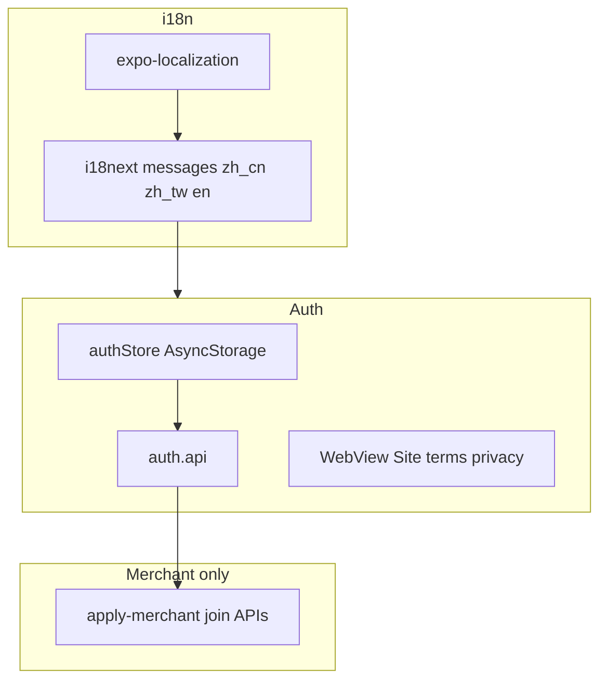

# App 登录注册 Phase 1（已确认修订）

## 已确认决策

| # | 决策 |
|---|------|
| 1 | 协议：**不复制**长文案进 App；勾选后用 **in-app WebView / Linking** 打开 Site 已有多语言页。短文案走 App i18n。 |
| 2 | **i18n 框架一期就上**：`zh_cn` / `zh_tw` / `en` 三种。 |
| 3 | 商户注册 = **平台账户**（同 CMS）；**申请商户身份**为额外步骤（对齐 CMS `apply-merchant`）。 |
| 4 | **重置密码在 App 内**完成（不仅 Web）。 |
| 5 | 顾客登录后暂落 **推送调试首页**（用户信息 + 退出 + report）。商户登录后按 CMS：无商户 → 申请页；未激活 → 状态页；否则调试首页。 |

## 范围

| 能力 | 顾客 App | 商户 App |
|------|----------|----------|
| 密码登录 | `POST /api/auth/login` | `POST /api/auth/cms/login` |
| 注册平台账户 | `POST /api/auth/register` | 同字段 → `POST /api/auth/register`（CMS 客户端语义） |
| 忘记密码 | `POST /api/auth/forgot-password`（`client: 'site'`） | `client: 'cms'` |
| 重置密码 | App 内 `ResetPasswordScreen` + `POST /api/auth/reset-password`；邮件链接优先 **Universal/App Links** 打开 App（同路径 `/…/reset-password?token=`）；无法唤起时 Web 仍可用作兜底 | 同左（CMS 域链接） |
| 申请商户 | — | 对齐 [apply-merchant.tsx](xituan_cms/src/pages/apply-merchant.tsx) + `merchant-join-applications` API |
| 微信登录 | 仅入口占位 | 仅入口占位 |
| 推送 | 登录成功后再上报；JWT 只读 auth store | 同左 |

不做：完整「我的网店」主页、OpenIM、微信支付、微信 mobile 换票 API。

## 1) 协议链接怎么做（回答确认点）

**长文（《用户服务协议》《隐私政策》）**

- **不要**拷进 RN，也 **不要**指望 codebase 里有一份可直接 import 的完整法律 JSON——Site 现体是 React 页：[TermsContent](xituan_site/src/components/legal/TermsContent.tsx) / [PrivacyContent](xituan_site/src/components/legal/PrivacyContent.tsx)，路由 `/{locale}/terms`、`/{locale}/privacy`。
- App：勾选旁可点链接 → **WebView**（或 `Linking.openURL`）打开  
  `{siteDomain[env].website}/{locale}/privacy` 与 `.../terms`  
  `locale` 用当前 App 语言（`zh_cn` | `zh_tw` | `en`），与 Site 一致。
- 真机联调可用 `EXPO_PUBLIC_API_PUBLIC_ORIGIN` 只覆盖 **API**；**官网/法律页**用 `siteDomain.website`（或可选 `EXPO_PUBLIC_WEBSITE_ORIGIN` 仅本地覆盖，生产不设）。

**短文案（按钮、错误、tab、勾选说明）**

- 放在 App `messages/{zh_cn,zh_tw,en}.json`，**键名与命名空间尽量对齐** Site/CMS 的 `messages/*.json`（尤其 `auth.*`），便于以后抽到 codebase 共享。
- 业务错误码继续用现有 `eBusinessErrorCode` + 各端 `businessError.*` 映射模式；App 同步维护同 code 的三语短句（可与 Site `businessError` 键兼容）。

## 2) RN i18n 方案（与现网兼容）

| 项 | 选择 |
|----|------|
| 库 | **`i18next` + `react-i18next` + `expo-localization`**（Expo 主流；不绑 next-intl 运行时） |
| Locale 码 | 与现网一致：`zh_cn` / `zh_tw` / `en`（不要用 `zh-CN` 除非做映射层） |
| 资源文件 | 每 App：`src/i18n/messages/zh_cn.json` 等；结构镜像 Site/CMS `messages` 的 auth/common 子集 |
| 设备语言 | 启动时 `expo-localization` → 映射到三语之一；设置页可手动切换并持久化 |
| 与 next-intl | **共享的是 JSON 键与 locale 码约定**，不是同一运行时。后续若键稳定，再把公共 JSON 挪进 `xituan_codebase` 给三端引用 |
| Accept-Language | API 请求带当前 locale（与 Site/CMS 习惯一致），便于后端/邮件文案 |

## UI 参考规则

- **Customer**：主对齐小程序 profile-stack；注册/忘记/重置对齐 Site 字段与流程。
- **Merchant**：主对齐 CMS 移动登录；申请商户对齐 CMS apply-merchant；小程序商户已有移动组件优先（**排除「我的网店」主页本身**）。

## 架构

## 实现顺序

### A) 两端 i18n 骨架

- 安装依赖；`i18n/index.ts` 初始化；三语 JSON（先填 auth/common）。
- 简单语言切换（设置或登录页角标）。

### B) Customer

- auth-store / auth.api / Login·Register·Forgot·Reset 屏；协议勾选 + WebView。
- Linking：处理 `reset-password?token=` 进 Reset 屏。
- 登录门闸 + 推送读 store；删 `EXPO_PUBLIC_AUTH_TOKEN`。

### C) Merchant

- 同上，API 走 cms login / forgot `client: cms`。
- 登录后路由：无 `merchantId` → **申请商户**；有但未 active → 状态页；否则首页。
- 申请商户：参考 CMS [apply-merchant.tsx](xituan_cms/src/pages/apply-merchant.tsx) 与 [merchant-join-application.api.ts](xituan_cms/src/lib/api/merchant-join-application.api.ts)，做移动端表单最小集（字段与 CMS 申请一致的必填项）。

### D) 微信

- 占位按钮 + i18n 提示「即将开放」。

## 验收

- 三语切换下登录/注册/忘记/重置文案正确；协议链接打开对应语言 Site 页。
- 顾客：登录 → report ok；App 内重置密码可用。
- 商户：注册平台账号 → 登录 → 进入申请商户；提交/查看状态对齐 CMS 语义。
- 无 `EXPO_PUBLIC_AUTH_TOKEN` 依赖。

## 关键参考路径

- Site 法律页：`xituan_site/src/app/[locale]/(consumer)/privacy`、`terms`
- Site/CMS messages：`messages/zh_cn.json` 等
- CMS 登录后分流：[login.tsx](xituan_cms/src/pages/login.tsx) `routeAfterAuth`
- CMS 申请商户：[apply-merchant.tsx](xituan_cms/src/pages/apply-merchant.tsx)
- App 现有：[backend-origin.util.ts](xituan_app_customer/src/utils/backend-origin.util.ts)、[device-push-report.util.ts](xituan_app_customer/src/utils/device-push-report.util.ts)
