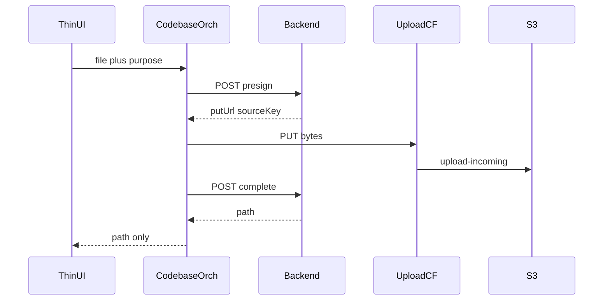

# 通用直传固定框架（1A + 2B）

## 范围

- **做**：固定 backend 签发与 complete 骨架；`xituan_codebase` 编排；Web / React Native / 微信三套 Transport；商户与顾客两套鉴权路由；`site-domain` 增加 `upload` / `wechatUpload`；IAM 可读 Secrets Manager；探测验收。
- **不做**：不迁目录图 / OpenIM / 支出 OCR / OTA；不改各业务表单；支出仍走 `amazonaws.com`。
- **权威约定**：更新 [`.cursor/skills/s3-direct-upload/reference.md`](.cursor/skills/s3-direct-upload/reference.md) 与目录图标准为「通用直传」命名；业务迁移仍指现有 planned-work entries。

## 分层（不按业务复制）

| 层 | 放哪里 | 职责 |
|----|--------|------|
| Contract | `xituan_codebase` | `purpose`、presign/complete 类型、`iDirectUploadTransport` |
| Orchestration | `xituan_codebase` | `uploadOne` / `uploadMany`：presign → PUT → complete |
| Transport | 各 app 薄适配器 | Web `fetch`；RN `File.upload` PUT；微信 `wx.request` PUT + API |
| Auth 路由 | backend | 同一 Service；商户 `/api/admin/...`；顾客现有顾客鉴权前缀下镜像路由 |
| Infra | backend | CloudFront 签名（读固定 secret 名 `xituan/cloudfront/upload-signing`）；S3 HEAD |

商户/顾客是**权限与路由**，不是两套 PUT 实现。CMS 与 Site 共用 Web Transport；商家 App 与顾客 App 共用 RN Transport；微信商家/顾客共用微信 Transport（鉴权头不同）。

## Backend

1. **常量**：secret 名写死为 `xituan/cloudfront/upload-signing`（不进 env）。`site-domain.ts` 增加各环境 `upload` / `wechatUpload`（prod 微信主机 `https://upload.lancety.com`）。
2. **Signer**（如 `cloudfront-upload-signing.util.ts`）：`GetSecretValue` → PEM + `publicKeyId` → canned policy 签 `https://{host}/upload-incoming/{key}`。按调用方选 `upload` vs `wechatUpload`。禁止改 S3 SigV4 Host。
3. **Service**（如 `DirectUploadService`）：
   - `presign({ purpose, contentType, byteSize, clientApp })` → 校验 purpose 白名单与大小/MIME → 生成 `upload-incoming/...` key → 返回 `putUrl` + `sourceKey`。
   - `complete({ sourceKey, purpose })`（框架期，已确认）：校验 key 前缀与归属 → `headObjectExists` → 返回 `path = sourceKey`。不拷贝、不跑 IMAGE_NORMALIZE；业务接入时再按 purpose 挂 hook。
4. **路由**：商户 admin 一条；顾客鉴权一组镜像。Controller 只做鉴权上下文与校验。参考 [`api-route-groups`](.cursor/skills/api-route-groups/SKILL.md)。
5. **IAM**：给本地/线上使用的 `S3_KEY` 身份加 `secretsmanager:GetSecretValue`（仅该 secret）。本步可 CLI，写入 s3/README 或直传 reference。

## 已确认决策

- **complete（框架期）**：只 HEAD；`path` = 原 `sourceKey`（仍在 `upload-incoming/`）。
- **`purpose=probe`**：生产也保留。必须商户或顾客登录；限制体积与 MIME 白名单。不按环境禁用。
- **无新 env**：secret 名写死；主机走 `site-domain`。
- **1A + 2B**：只做框架；顾客侧路由与 transport 一并落地，业务页后置。

框架期 `purpose` 至少含 `probe`（验收用）。后续目录图 / OpenIM 只加 purpose 与 complete hook，不新开签名栈。

## Codebase

命名避开仅「catalog-image」：

- `direct-upload.type.ts`：`iDirectUploadPresignRequest/Response`、`iDirectUploadCompleteRequest/Response`、`iDirectUploadTransport`
- `direct-upload.util.ts`：`uploadOne` / `uploadMany`

Transport 最小面：`presign` / `putObject` / `complete`。页面不得手写三步。

## 前端固定壳（框架期）

| 平台 | 位置（示意） | 内容 |
|------|--------------|------|
| Web React | CMS + Site 各一薄 transport；可抽共享若已有跨仓模式，否则各仓一份实现同一接口 | `fetch` PUT；无 cookie；Content-Type 与 presign 一致 |
| React Native | 商家 App + 顾客 App 各挂同一 util 模式（可先实现一份再复制/submodule） | `File.upload`：`httpMethod:'PUT'`、`BINARY_CONTENT`、`sessionType:'foreground'`；Android `content://` 先拷缓存 |
| 微信 | 商家包 + 顾客包 | API 走现有 backend.lancety；PUT 走 `upload.lancety.com` |

框架期提供**可调用的 transport + 最小探测入口**（脚本或隐藏 dev 调用），不改正式业务 UI。顾客仓一并落地 transport 文件，即使暂无页面调用。

## 验收

- 未签名 `https://upload-dev.../upload-incoming/...` → 403。
- 商户鉴权 `presign` → 返回 `upload-*.xituan.com.au`（或微信测 `upload.lancety.com`）签名 URL → PUT 2xx → `complete` 成功 → S3 上对象存在。
- 顾客鉴权同样能走通（可用同一 probe purpose）。
- 编排只在 codebase 一处；三端 transport 无第二套状态机。

## 文档

- 更新 `s3-direct-upload/reference.md`：secret 名常量、无新 env、框架模块路径、purpose 扩展方式。
- 目录图 / OpenIM planned-work 改为「依赖本框架已落地，启动业务时只加 purpose + UI」。
- Skill `s3-direct-upload-*` 链到新模块名。

## 明确后置

- 目录图 Form 去 multipart、OpenIM 附件直传、支出迁 upload、complete 内 IMAGE_NORMALIZE、孤儿 TTL 清理策略细化（可在 complete hook 设计预留）。
