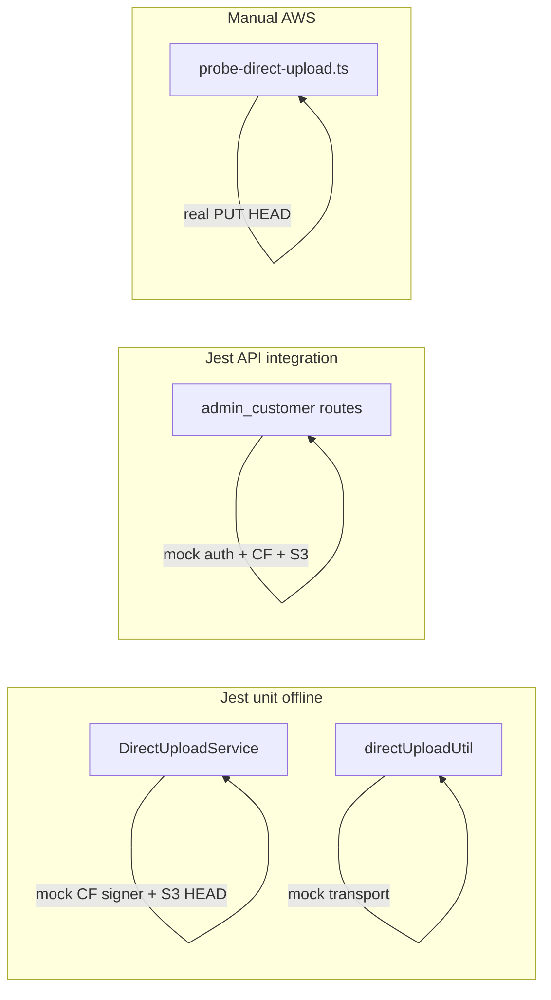

# 直传框架测试加固

## 现状

- **无** `direct-upload` 相关 Jest（unit/integration 均无）。
- 可离线加固的核心在：
  - [`DirectUploadService`](xituan_backend/src/domains/direct-upload/services/direct-upload.service.ts)（key 前缀、tenant 归属、probe 限额、wechat/web host）
  - [`directUploadUtil`](xituan_backend/submodules/xituan_codebase/utils/direct-upload.util.ts)（presign → put → complete 顺序与入参校验）
  - 路由 [`direct-upload.routes.ts`](xituan_backend/src/domains/direct-upload/routes/direct-upload.routes.ts)（admin / customer 挂载）
- 真链路由 [`scripts/probe-direct-upload.ts`](xituan_backend/scripts/probe-direct-upload.ts) 覆盖（需 Secrets Manager + S3），**不进默认 Jest**。

## 落地范围（定稿）

只加 **backend Jest**（`tests/unit` + `tests/integration`），与现有 [`order-item-return.service.unit.test.ts`](xituan_backend/tests/unit/order/order-item-return.service.unit.test.ts)、[`product-api.integration.test.ts`](xituan_backend/tests/integration/product/product-api.integration.test.ts) 同风格。

不写：Expo/微信选图 UI 测试、真 CloudFront PUT 的 CI 门禁（继续用 probe 脚本手动跑）。



## 1. Unit — DirectUploadService

新文件：[`xituan_backend/tests/unit/direct-upload/direct-upload.service.unit.test.ts`](xituan_backend/tests/unit/direct-upload/direct-upload.service.unit.test.ts)

Mock：

- `cloudfrontUploadSigningUtil.getSignedPutUrl` → 返回固定 `putUrl` / `expiresAt`
- `s3UploadManager.headObjectExists`
- `configUtil.getEnvironment` + `environmentBucketUtil.resolveSiteDomainBucket`（或只 mock signing 入参 host，断言传入的 host 字符串）

用例：

| 场景 | 断言 |
|------|------|
| merchant + purpose=probe 合法 | `sourceKey` 形如 `upload-incoming/merchant/{id}/probe/{16hex}.{ext}`；返回 `contentType` 小写 |
| clientApp=wechat vs web | signing 收到不同 upload host（`wechatUpload` vs `upload`） |
| probe 超大 / 非法 MIME | throw |
| purpose 非法 / byteSize≤0 / 空 contentType | throw |
| complete 本商户 key + HEAD true | `{ path: sourceKey }` |
| complete 跨商户 / 跨 user / 非 `upload-incoming/` | throw |
| complete HEAD false | `Uploaded object not found` |

## 2. Unit — directUploadUtil（codebase）

新文件：[`xituan_backend/tests/unit/codebase/direct-upload.util.test.ts`](xituan_backend/tests/unit/codebase/direct-upload.util.test.ts)（沿用 `tests/unit/codebase/*` 测 submodule util）

Mock `iDirectUploadTransport`（presign / putObject / complete 用 `jest.fn`）：

- `uploadOne` 调用顺序：presign → putObject(putUrl, body, contentType) → complete(sourceKey)
- 缺 contentType / 非法 byteSize 在调 transport 前失败
- `uploadMany` 按序上传多文件；任一失败则短路

## 3. Integration — API（无真 AWS）

新文件：[`xituan_backend/tests/integration/direct-upload/direct-upload-api.integration.test.ts`](xituan_backend/tests/integration/direct-upload/direct-upload-api.integration.test.ts)

模式对齐 product-api：

- Mock auth（admin 带 `x-merchant-id`；customer 带 `req.user.id`）
- 放宽 `requireMerchantAccessMiddleware`（同 product 测）
- Mock `cloudfrontUploadSigningUtil` + `s3UploadManager.headObjectExists`
- `supertest` 挂 `createAdminDirectUploadRoutes` / `createCustomerDirectUploadRoutes`

用例：

- `POST /admin/direct-upload/presign` → 200 + `data.putUrl/sourceKey`
- `POST /admin/direct-upload/complete` 本商户 key → 200；他商户 key → 400
- customer 路由同样一套（user 前缀）
- 无 merchant / 无 user → 401（与 controller `sendError` 一致）

**不连真实 DB**（service 不碰 TypeORM）；`TestHelper.initDatabase` 可省略，除非 middleware 强制依赖。

## 4. AWS 烟测（保持现状）

- 继续用 `npx ts-node --transpile-only scripts/probe-direct-upload.ts` 验真链。
- 不在 Jest 默认 `npm test` 里跑；可选在 skill/reference 加一句「本地加固：unit/integration；真链：probe」。

## 验收

```bash
cd xituan_backend
npm test -- --testPathPattern=direct-upload
```

全部绿即可；不改业务代码，除非测试暴露明显 bug（如 ownership 边界）再最小修补。
