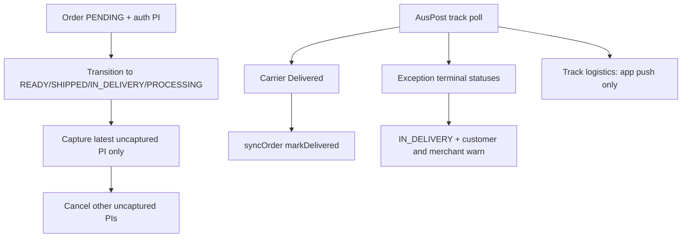

# 收紧授权作废 + 物流异常警告 + 送达回写订单

## 背景（已复现路径）

- 出单后 `PENDING → READY_FOR_DELIVERY` 走 shipment sync，**未**触发 `runDeferredCaptureBeforeProcessing`（目前只在进入 `PROCESSING` 时 capture），故订单仍 `PENDING_CAPTURE`，同时客户收到「已备好」email。
- 同一订单可留下多笔 `PENDING_CAPTURE` Stripe PI；现有 `attemptCaptures` **会对所有未扣款记录逐笔 capture**，存在重复扣款风险。
- Track poll 在 carrier `Delivered` 时只更新 `shipments.status=DELIVERED`，**未**调用 `syncOrderStatusFromShipmentsIfApplicable` / `markDelivered`。
- 物流更新已有 [`devicePushShipmentTrackNotifyUtil`](xituan_backend/src/domains/notification/utils/device-push-shipment-track-notify.util.ts)（仅 app）；订单 email 门禁在 [`orderStatusEmailNotifyUtil`](xituan_backend/submodules/xituan_codebase/utils/order-status-email-notify.util.ts)（PROCESSING / READY / SHIPPED / DELIVERED / REFUNDED，**不含** IN_DELIVERY）。保持该分工；物流异常警告为**独立**通知事件（email + app，**顾客 + 商家**）。

## 1. Deferred capture 触发面扩大

文件：[`order-status.service.ts`](xituan_backend/src/domains/order/services/order-status.service.ts)

- 在 `transitionOrderStatus` 中，凡 **from ≠ fulfillment 且 to ∈ {PROCESSING, READY_FOR_DELIVERY, SHIPPED, IN_DELIVERY, DELIVERED}** 且订单仍为 deferred-capture 适用（`PENDING_CAPTURE` + Stripe Connect），先跑 capture（复用 `OrderManualCaptureService.runDeferredCaptureBeforeProcessing`，可改名为更中性的 `runDeferredCaptureBeforeFulfillment` 或保留方法名、扩大调用条件）。
- `PENDING → READY`（出单 sync）也会先扣款再改状态，避免「已备好 email + 仍待扣款」。

## 2. 收紧作废 / 只扣一笔

文件：[`order-manual-capture.service.ts`](xituan_backend/src/domains/payment/services/order-manual-capture.service.ts)（及必要时 webhook/授权落库处）

**Capture 时（硬规则）：**

- `listUncapturedOnlinePaymentRecords` 后按 `createdAt` **只选最新一笔** Stripe Connect uncaptured PI 执行 capture。
- 该笔 **成功** 后：对其余未扣款 online PI 调已有 `cancelUncapturedOnlinePayments`（Stripe `cancelPaymentIntent` + 本地记录取消）。
- **禁止**对多笔 PENDING_CAPTURE 全部 `attemptCaptures`。
- Capture 失败：不自动作废其余 PI（保留重试/人工处理）。

**新授权落库时（收紧挂起授权）：**

- Stripe 新 PI 进入 `PENDING_CAPTURE` 且同订单已有更早的 uncaptured PI 时，**立即取消更早的**（只保留最新授权），避免再出现 3 笔挂起。改动点优先落在 [`payment.handler.service.ts`](xituan_backend/src/domains/payment/services/payment.handler.service.ts) / Stripe webhook 写 `PENDING_CAPTURE` 成功路径，复用同一 cancel helper。

## 3. Track：Delivered → 订单送达（按现有全票规则）

文件：[`auspost-track-poll-tick.service.ts`](xituan_backend/src/domains/auspost-mpb/services/auspost-track-poll-tick.service.ts)

- Carrier status 匹配 Delivered（现有 `/delivered/i`）且 `sourceType=ORDER`：
  1. 将该 **shipment** 标为 `DELIVERED`
  2. 调用 [`merchant-shipment.service.ts`](xituan_backend/src/domains/shipment/services/merchant-shipment.service.ts) 的 `syncOrderStatusFromShipmentsIfApplicable`（与 CMS/markDelivered 同一路径）
- **订单**进 `DELIVERED` 的条件沿用 [`order-shipment-status-sync.util.ts`](xituan_backend/src/domains/shipment/utils/order-shipment-status-sync.util.ts) 现有规则，**不是**「任一包裹送达就改订单」：
  - 订单行已全部装入包裹（无未打包剩余 `hasRemainingToShip=false`）
  - 且所有有效包裹均为 `DELIVERED`
- 仅部分包裹送达时：只更新该 shipment；订单仍按 util 停在 `SHIPPED` / `IN_DELIVERY` / `READY_FOR_DELIVERY`。
- 失败只打日志，不阻断 poll 游标清理。
- 订单真正进 `DELIVERED` 时仍走现有 `ORDER_STATUS_CHANGED` → email（允许集合内）+ app；**轨迹事件本身不发 email**。

## 4. Track：异常终态 → 配送中 + 顾客/商家警告（已确认）

同一 tick 服务，识别 carrier 文案（大小写不敏感），**全部算进同一套异常处理**：

- `Cannot be delivered` / `undeliverable`
- `Lost`
- `Item Damaged`
- `Return to sender`（及同类退回文案）

与现有 terminal 判定对齐；**不**把 Delivered 以外的 terminal 写成 shipment `DELIVERED`。

行为（`sourceType=ORDER`）— **方案 A 已锁定：不自动进终态**：

1. **不**把 shipment 标为 `DELIVERED`；可保留 READY/SHIPPED，snapshot 仍记 carrier 终态。
2. 订单停在 / 转到 **`IN_DELIVERY`（配送中）**，**不**自动 `CANCELLED` / `REFUNDED` / 新增失败态；完结靠商家人工（重发 / 退款 / 取消）。
   - 若当前已是 `IN_DELIVERY`：不重复改状态，仍发警告通知（带去重键，见下）。
   - 若当前为 `SHIPPED` / `READY_FOR_DELIVERY` / `PROCESSING`：经 `OrderStatusService` 合法转换到 `IN_DELIVERY`（不触发客户「普通状态」email——`IN_DELIVERY` 本就不在 `CUSTOMER_NOTIFY_STATUSES`）。
3. **警告通知（email + app，顾客 + 商家）**：新增业务事件，例如 `SHIPMENT_DELIVERY_EXCEPTION`（payload：orderId、shipmentId、trackingNumber、carrierStatus、merchantId）。
   - **顾客**：email + customer app push（文案：包裹异常/退回/损坏，请联系商家）。
   - **商家**：email + merchant staff app push（文案：某订单物流异常，需跟进）；复用现有商家受众解析（订单所属 merchant 员工 / 通知订阅路径，对齐其它 merchant 订单类通知）。
   - **幂等**：同一 `shipmentId + carrierStatus`（或 terminal snapshot）对每一受众侧只发一次（dedupe key 或 `exceptionNotifiedAt`）。
4. 物流常规更新路径继续只用 `devicePushShipmentTrackNotifyUtil`，**不**改 email handler 去订阅轨迹事件。

## 5. 通知边界确认（本次明确锁定）

- 订单状态 ∈ `CUSTOMER_NOTIFY_STATUSES`：顾客 email + app（现有 `ORDER_STATUS_CHANGED`）
- 订单 → `IN_DELIVERY`（普通）：无 status email/app
- 物流轨迹更新（非异常终态）：仅 app（现有 track util）
- 物流异常终态警告：顾客 + 商家，email + app（新事件）
- 物流 Delivered → 订单 `DELIVERED`：因订单状态变更走现有顾客通知；轨迹本身不另发 email

不改动 `CUSTOMER_NOTIFY_STATUSES` 既定集合；不为「物流信息更新」加 email。

## 6. 主要改动文件

- [`order-status.service.ts`](xituan_backend/src/domains/order/services/order-status.service.ts) — fulfillment 前 capture
- [`order-manual-capture.service.ts`](xituan_backend/src/domains/payment/services/order-manual-capture.service.ts) — 单笔 capture + 成功后作废其余
- [`payment.handler.service.ts`](xituan_backend/src/domains/payment/services/payment.handler.service.ts) 或 Stripe webhook 落库 — 新授权挤掉旧授权
- [`auspost-track-poll-tick.service.ts`](xituan_backend/src/domains/auspost-mpb/services/auspost-track-poll-tick.service.ts) — Delivered 同步订单；异常 → IN_DELIVERY + 警告
- [`merchant-shipment.service.ts`](xituan_backend/src/domains/shipment/services/merchant-shipment.service.ts) — 复用 `syncOrderStatusFromShipmentsIfApplicable`
- notification：新 `epBusinessNotificationEvent` + email/device-push handler（`CUSTOMER` + `MERCHANT` 双受众）+ i18n/模板短文案
- codebase：`order-status-email-notify.util` **保持**；可选短注释标明轨迹不走 email

## 7. 验证建议（实现后由你本地/demo）

- 多笔 PENDING_CAPTURE：出单进 READY → 只扣最新一笔，其余 Stripe+本地取消；订单 paymentStatus 变为已支付。
- Track Delivered → shipment + 订单均 DELIVERED，有一封送达状态 email，无额外「轨迹」email。
- Track Cannot be delivered / Lost / Item Damaged / Return to sender → 订单为/变为 IN_DELIVERY；顾客与商家各收到警告 email + app；无 DELIVERED。
- 普通轨迹中间态 → 仅 app。
