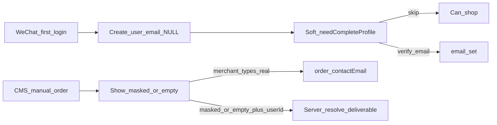

# 商户 PII 边界 + 邮箱可空（去 placeholder）

## 已确认产品口径

| 信息 | 商户侧（CMS / 微信商家面板） |
|------|------------------------------|
| 订单收货人 / 履约联系电话 / 地址 | **明文**（履约必需） |
| 账户登录手机 | **不暴露**（OpenIM / 客户资料等） |
| 账户邮箱 | **脱敏**；无真实邮箱则空，引导客户完善或商户问过后手填订单联系邮箱（不改账户邮箱） |
| Platform | 仍可看完整账号信息 |
| 补邮箱强度 | **软提示（B）**：本会话最多弹一次；可「暂不提醒」**7 天**；不挡下单 |
| placeholder | **新用户禁止写入**；存量 `@placeholder.com` **清空为 NULL** |
| 履约手机 | **本轮仍给商户看**（派送需要）；未来 AusPost 直传收件人手机、商户侧可不展示 → 另案，不进本轮 |
| 本轮范围 | 含邮箱可空/去 placeholder、软提示、ManualOrder 脱敏、OrderEdit 收件电话边界、`CLIENT_CREATE/DELETE` 清理；relay 仍后置 |

## email 可空迁移：影响面

**DB 本身**

- Schema `0406`：只去掉 `email` NOT NULL。
- Data-repair `users-clear-placeholder-email`：把 `@placeholder.com` 置 NULL（与 schema 分开跑）。
- UNIQUE 仍在；PG 下多个 NULL 不冲突。
- **已有真实邮箱行不变**。
- 无 FK 指向 email；不是破坏性 DROP。

**会坏 / 必须同发的代码（否则运行时炸）**

- `user.email.endsWith('@placeholder.com')`（微信登录 `needCompleteProfile`）—— email 为 NULL 会 TypeError；须改成 `lacksDeliverableEmail`。
- 其它假定 `email: string` 再 `.trim()` / `.toLowerCase()` 的路径（通知匹配、部分序列化）——需空安全；多数发信路径已用 `isDeliverableEmail`，相对安全。
- TypeORM entity + `iUser.email` 类型要改成可空，否则 TS/写入不一致。
- 微信建号若仍传 placeholder 或非空约束心智 → 须停写；`auth.service.register` 已支持无 email（`normalizedEmail` 可空），但 entity 未 nullable 前 INSERT 会失败。

**行为变化（产品预期，不是事故）**

| 场景 | 迁移后 |
|------|--------|
| 微信-only 用户邮箱登录 / 密码重置 | 本来 placeholder 也登不了真邮箱；清空后仍只能走微信；重置需先绑真实邮箱 |
| 邮件通知发给「客户账户邮箱」 | 无邮箱则跳过（与今日 placeholder 不可投递等价） |
| CMS 按邮箱搜手动下单用户 | 无邮箱用户搜不到；可用其它选人方式 / 客户补邮箱后可搜 |
| 邮箱+密码注册 `POST /auth/register` | **仍要求 email**（controller `EMAIL_REQUIRED`），不受影响 |
| 商户成员邀请（按 email 找人） | 只影响「没有邮箱的消费者」；员工账号通常有邮箱 |
| UNIQUE / 绑邮箱查重 | `isEmailTaken` 只查非空值；多个无邮箱用户 OK |

**不会影响**

- 订单履约字段（收货人/电话/地址 snapshot）
- 已验证真实邮箱用户的登录、CMS、订阅 Stripe customer email 等（那些走有邮箱的商户/管理员）
- OpenIM 主路径（已倾向不暴露客户 email）

**部署耦合**

- migration 与「停写 placeholder + 空安全」**必须同窗口上线**：只跑 SQL 不清代码 → 微信登录可能 500；只改代码不跑 SQL → 新用户仍可能被写成 placeholder 或 INSERT 撞 NOT NULL。

## Phase 1 — DB / 注册：email 可空，消灭 placeholder

**Migration**（`1710000000406_...sql`）：仅 `ALTER ... email DROP NOT NULL`（UNIQUE 保留，多 NULL OK）。

**Data-repair**（`jobs/users-clear-placeholder-email`）：`UPDATE ... SET email = NULL WHERE email ILIKE '%@placeholder.com'`（经 `npm run migrate:script:data-repair`，与 schema 分开批准执行）。

**Entity / types**

- [user.entity.ts](xituan_backend/src/domains/user/domain/user.entity.ts)：`email` → `nullable: true`，类型 `string | null`
- codebase `iUser` / `iRegisterData`：email 可选
- 统一用已有 [emailVerificationUtil.lacksDeliverableEmail](xituan_backend/src/domains/user/services/email-verification.service.ts) / [emailRecipientUtil.isDeliverableEmail](xituan_backend/src/shared/utils/email-recipient.util.ts)（已把空当「无邮箱」）

**停止写入 placeholder（必改点）**

- [auth.controller.ts](xituan_backend/src/domains/user/controllers/auth.controller.ts) 微信 mini/web/app 创建用户：去掉 openid@placeholder.com，不传 email 或显式 null
- [wechat-account-link.service.ts](xituan_backend/src/domains/user/services/wechat-account-link.service.ts) `registerFromLinkToken`：同上
- `needCompleteProfile`：改为「无 deliverable email」（空或旧 placeholder），不再依赖 endsWith 字符串特判为主路径
- 审计所有 `user.email.trim()` / 假定 email 必有的路径，改为空安全；通知/发信继续走 `isDeliverableEmail`

**存量逻辑**

- `absorbPlaceholderShellIfEligible`：继续用 `lacksDeliverableEmail`（NULL / 旧 placeholder）识别「无真实邮箱壳号」——行为保持

## Phase 2 — 软提示补邮箱（B）

不挡结账；登录后弹窗策略：

- **本会话最多弹一次**；用户点「暂不提醒」→ 本地存 snooze，**7 天内不再弹**
- Backend：`needCompleteProfile` / 缺邮箱标志仍下发；客户端按 session + snooze 控制展示
- WeChat / Site / Customer App：文案强调找回密码；Skip / 暂不提醒可用；验证走现有绑定流程
- UI：空 email 显示「未设置」，不再出现 `@placeholder.com`

## Phase 3 — 商户侧邮箱脱敏 + 电话边界 + 权限清理

复用 [emailMaskUtil](xituan_backend/submodules/xituan_codebase/utils/email-mask.util.ts) 与 [orderDocumentEmailRecipientUtil](xituan_backend/src/domains/order/utils/order-document-email-recipient.util.ts)。

**CMS 手动下单（邮箱）**

- `getUserHints` / `getUserContact`：email **脱敏**；无 deliverable → 空
- **手机：本轮仍可下发履约/联系用号码给商户**（派送需要）；不在本轮做「对商户隐藏手机」。未来 AusPost 直传收件人手机另案
- ManualOrderEditor：脱敏串不写入 `deliveryContactEmail`；发送靠服务端 resolve 或商户手填真实联系邮箱

**OrderEditModal 电话边界**

- 履约展示/编辑只用订单 snapshot `contactNumber`（收件电话）
- 不把 `user.phone`（账户登录手机）当作收件电话展示或回填
- admin order detail payload 若仍带 `user.phone`，商户 UI 不把它当履约电话用（Platform 除外）

**权限点清理（本轮一起做）**

- 从 [merchant-role-permissions.ts](xituan_backend/src/shared/constants/merchant-role-permissions.ts) / CMS menu 配置移除 `CLIENT_CREATE` / `CLIENT_DELETE`（路由已下线）
- 若有 DB 角色权限 JSON 存这些 key，加 migration 清洗或代码读取时忽略

**后置**

- 平台 relay 代发仍另排期
- AusPost 收件人手机直传、商户侧不展示 → 另案

## Phase 4 — 台账与文档

更新 PII ledger + registry：写入最终边界表；本轮完成后勾选对应项；relay / AusPost 手机隐藏记后置。

## 实施顺序

1. Phase 1 migration + 停写 placeholder + 空安全
2. Phase 2 软提示（session 一次 + 7 天 snooze）
3. Phase 3 脱敏 + OrderEdit 电话边界 + CLIENT_* 清理
4. Phase 4 ledger

**不做：** 硬拦下单；relay MVP；对商户隐藏履约手机；不擅自执行 migration SQL。
