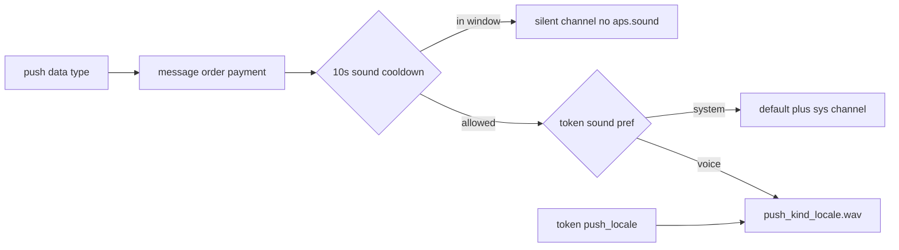

# Customer / Merchant 推送提示音

## 现状

- 推送链路：App `expo-notifications` 原生 token → backend SNS → FCM/APNs（见 [device-push-sns.util.ts](xituan_backend/src/domains/notification/utils/device-push-sns.util.ts)）。
- Android 仅渠道 `xituan_im`，声音为系统 default；APNs `aps.sound: 'default'`。
- 无用户级提示音设置；无 collapse / thread 合并配置。
- 10 个 WAV 已在 `D:/projects/learn_chinese/audio/`（`push_{kind}_{zh|en}.wav`）。

## 产品行为（已定）

| 项 | 约定 |
|----|------|
| 默认 | 各档均为**系统提示音** |
| Merchant UI | **消息 / 订单 / 收款** 三档：系统 ↔ 语音 |
| Customer UI | **仅「消息」一档**；订单更新 / 收款等提示音设置本阶段不做（后端对 customer 的 order/payment 仍走系统音默认） |
| 语音文件 | `push_${kind}_${locale}.wav`，`locale`：`en` 否则 `zh`（zh_cn/zh_tw → zh） |
| 勿扰 / 夜间 | **不做 App 内静音时段**；交给系统 Focus / DND；不额外前台 `Audio.play` 绕过系统 |
| 带声冷却 | **全局冷却（不按消息/订单/收款分类）**：同一 `userId + appKind` **10 秒内最多带声 1 次**。冷却期内**每条仍立刻推送并展示**，只是**静音**——**不是**停推、攒消息、冷却结束再打包发 |

### kind 与 data 映射（语音模式下）

| 推送 | 设置档 | kind（文件） |
|------|--------|--------------|
| `type=order` | 订单 | `order` |
| `type=payment` | 收款 | `payment` |
| `type=openim` + 顾客端收商家/客服 | 消息 | `cs` |
| `type=openim` + merchant 收客户会话 | 消息 | `customer` |
| `type=openim` + 平台会话 | 消息 | `platform` |

OpenIM 侧已有 `conversationType`（[openim-offline-push.service.ts](xituan_backend/src/domains/openim/services/openim-offline-push.service.ts)）；发布时再按 `appKind` + `conversationType` / 发送方角色解析 kind。解析失败时消息档回退：customer → `cs`，merchant → `customer`。

## 架构（已定）

远程推送的声音由 **payload（iOS）/ channel_id（Android 8+）** 决定，杀进程时 App 无法再改，因此：

1. **偏好与 locale 落在设备 token 行**（`platform.user_device_push_tokens` 增列），注册/改设置时同步。
2. Backend `publishToEndpoint` 按该行偏好拼 `sound` + `channel_id`。
3. App 启动时注册齐 Android channels；`app.json` `expo-notifications` 声明 WAV（打进 iOS bundle + `res/raw`）。

### 存储

Migration（`migrations/` 下一序号）给 `user_device_push_tokens` 增加：

- `push_locale` `varchar(8)` NOT NULL DEFAULT `'zh'`（`zh` | `en`）
- `sound_prefs` `jsonb` NOT NULL DEFAULT `{"message":"system","order":"system","payment":"system"}`

枚举进 codebase（禁止裸字符串）：如 `epDevicePushSoundMode`（`system` | `voice`）、`epDevicePushSoundCategory`（`message` | `order` | `payment`）、`epDevicePushSoundKind`（`order` | `payment` | `cs` | `customer` | `platform`）。

注册 API（现有 `POST /api/device-push-tokens`）扩展可选字段：`pushLocale`、`soundPrefs`；另加轻量 `PATCH`（或同 POST upsert）供设置页改偏好后立刻同步。

### Android channel 策略

系统档与语音档分 channel（Android 创建后改不了 sound）：

- 系统：`xituan_msg_sys` / `xituan_order_sys` / `xituan_payment_sys`（不设 custom `sound` → 系统默认）
- 语音：`xituan_{kind}_v_{locale}`，例如 `xituan_order_v_zh`，`sound: 'push_order_zh.wav'`
- 静音（冷却用）：`xituan_silent` — 无 sound、**保留震动**（`enableVibrate: true` + 与带声 channel 相同 vibrationPattern）、importance `DEFAULT`（仍可出现在通知栏）

消息语音按 kind 拆 channel（同一「消息」开关，不同会话不同 WAV）。Backend 按偏好 + 冷却选 `channel_id`；`default_sound` 仅系统档且非冷却为 true。

保留旧 `xituan_im` 注册一段时间作兼容，新推送不再使用。

### iOS

- 系统：`aps.sound = 'default'`
- 语音：`aps.sound = 'push_order_zh.wav'`（文件名，无路径）
- 冷却静音：**省略** `aps.sound`（保留 `alert` title/body，通知仍展示）
- 不标 Time Sensitive，便于 Focus/勿扰正常压制。

### 带声冷却（已定：backend 全 App 10 秒；不做纯前端）

**为什么不能只靠前端**

| 场景 | 谁播声音 | 前端 JS 能否拦截 |
|------|----------|------------------|
| App 在前台 | `setNotificationHandler` 的 `shouldPlaySound` | 能（本地计时即可） |
| App 在后台 / 被杀 | 系统按 FCM channel / APNs `aps.sound` 直接播 | **不能** — 推送到达时业务 JS 未跑或来不及改音 |

离线 IM / 锁屏连发正是「太烦」的主场景，必须在 **发 SNS 前** 决定本条是否带声（冷却内改走 `xituan_silent` / 省略 `aps.sound`）。纯前端冷却只能盖住前台，后台仍会连播。

**Cache 性能**

- 每次推送多一次内存 `get` + 偶发 `set`（TTL 10s），相对已有 SNS/FCM/DB 可忽略，不是热点路径瓶颈。
- 不新增 Redis 依赖：复用现有 `getDefaultCache()`（进程内 Map）；无网络往返。
- 不做 per-category 多 key、不做持久化表扫描。

**实现位置**（[device-push-token.service.ts](xituan_backend/src/domains/notification/services/device-push-token.service.ts) `sendToUser`，publish 前）：

1. Key：`device-push:sound-cd:{appKind}:{userId}`（常量，禁止裸串散落）。
2. `get` 有值 → `playSound=false`；无值 → `set(..., { ttlMs: 10_000 })` 且 `playSound=true`。
3. `playSound=false`：Android `channel_id=xituan_silent`；iOS 不带 `sound`；banner 文案不变。
4. `playSound=true`：按 prefs 走系统/语音 channel 与 sound。
5. 作用域：**全局**一个 10s 窗口（消息/订单/收款共用；不做按类别分别冷却）。
6. 前台不再叠一层本地冷却（backend 已静音则系统本就不播；避免双逻辑）。日后换 Redis adapter 后冷却自动跨实例。

### 资源落位

从 `D:/projects/learn_chinese/audio/`：

- Customer：仅 `push_cs_zh.wav` / `push_cs_en.wav` → [xituan_app_customer/assets/sounds/](xituan_app_customer/assets/sounds/)
- Merchant：全部 10 个 → [xituan_app_merchant/assets/sounds/](xituan_app_merchant/assets/sounds/)

各自 `app.json` 的 `expo-notifications` 插件 `sounds` 只声明本端需要的文件。改插件后需 **本地 USB 重编**（`npm run build:local:android`），Metro 热更无效。

### App UI

- Customer：[SettingsScreen.tsx](xituan_app_customer/src/screens/SettingsScreen.tsx) 仅「消息提示音」一行（系统 / 语音）；不同步/不展示订单、收款档。
- Merchant：More → 设置入口，**消息 / 订单 / 收款** 三行。
- 每档在选「语音」时提供**试听**（`expo-av` 播本地 wav；locale 跟当前 App 语言）。试听文件：Customer 消息 → `push_cs_*`；Merchant 消息 → `push_customer_*`，订单 → `push_order_*`，收款 → `push_payment_*`。试听不受 10s 推送冷却影响。
- 本地 AsyncStorage 作即时 UI；成功后再 upsert token；失败 toast 并回滚 UI。
- 改语言时同步 `pushLocale` 并重新 ensure Android channels（语音 channel 已按 locale 分 ID，无需删旧 channel）。

### Backend 发布改动

扩展 [device-push-sns.util.ts](xituan_backend/src/domains/notification/utils/device-push-sns.util.ts) `publishToEndpoint`：入参增加解析后的 `androidChannelId` + `iosSound`。

[device-push-token.service.ts](xituan_backend/src/domains/notification/services/device-push-token.service.ts) `sendToUser`：读 token 行 prefs → 按 `data.type`（+ OpenIM kind）解析 category/kind → 再 publish。

订单/收款/OpenIM 调用链无需改业务文案，只走统一解析。

### 前台

保持现有 `setNotificationHandler`；**不**在收到推送后再用 `expo-av` 播一遍（避免勿扰被绕过、双响）。

## 合并通知：哪儿设置？多久一波？

| 层级 | 现状 | 含义 |
|------|------|------|
| 本项目代码 | **未配置** `collapse_key` / Android `tag` / iOS `thread-id` | 每条 SNS 独立一条通知 |
| Android 系统托盘 | 系统按 App 自动堆叠展示 | **不是**固定「每 N 分钟合并一波」 |
| FCM `collapse_key` | 未用 | 只影响**尚未送达**的同 key 消息被替换，不是通知中心合并 |
| iOS `thread-id` | 未用 | 通知中心按线程折叠，无定时批量 |
| 服务端防抖 | 无 | 若要「N 秒内多条合成一条」需自建队列，本阶段不做 |

结论：没有「一般多久合并一波」的项目配置；用户看到的堆叠是系统 UI。本 feature **不合并通知条目**（仍可能多条横幅），但用 **10s 带声冷却** 避免连播语音。

### 连发会怎样？（已定：立刻推 + 10 秒内最多 1 次带声）

**不是**「冷却期不推、攒一起、结束再发」。

| | 行为 |
|--|------|
| 推送条数 | 业务触发几次就 SNS 几次，**立即**发，不合并、不延迟 |
| 声音 | 窗口内第一条带声；其后 10 秒内的推送仍立刻到手机，但静音 |
| 通知栏 | 仍可能出现多条（系统堆叠），与冷却无关 |

例：1 秒内 3 条 → 用户马上看到 3 条（或系统堆叠），只有第 1 条响；第 11 秒再来一条才再响。

## 勿扰说明

- 依赖系统通知权限 + Focus/DND；语音与系统音同等受系统打断规则约束。
- 新 channel importance 用 `HIGH`（不必 `MAX`），降低「勿扰仍强打断」概率。
- App 内不实现「夜间 22:00–8:00 静音」。

## 实现顺序

1. Codebase：枚举 + 文件名/channelId 拼接 util + 冷却 key/TTL 常量。
2. 拷贝 WAV + 两端 `app.json` sounds；Android 注册 sys/voice/**silent** channels。
3. Migration + entity + register/PATCH API。
4. `sendToUser` 10s 冷却 + SNS 按 prefs/冷却选音/channel；OpenIM kind 解析。
5. 两端设置 UI + 注册时带上 locale/prefs。
6. 写出 migration SQL 但不执行；不自动 USB 构建——由开发者稍后自跑 migration + 重编验证（含冷却期仍震动、设置页试听）。

## 主要改动文件

- [device-push-sns.util.ts](xituan_backend/src/domains/notification/utils/device-push-sns.util.ts)
- [device-push-token.service.ts](xituan_backend/src/domains/notification/services/device-push-token.service.ts) + entity + routes
- [openim-offline-push.service.ts](xituan_backend/src/domains/openim/services/openim-offline-push.service.ts)
- `xituan_app_customer` / `xituan_app_merchant`：`device-push-token.util.ts`、settings UI、`app.json`
- `xituan_codebase` device-push 相关 enum/util（两端 submodule 同步）
