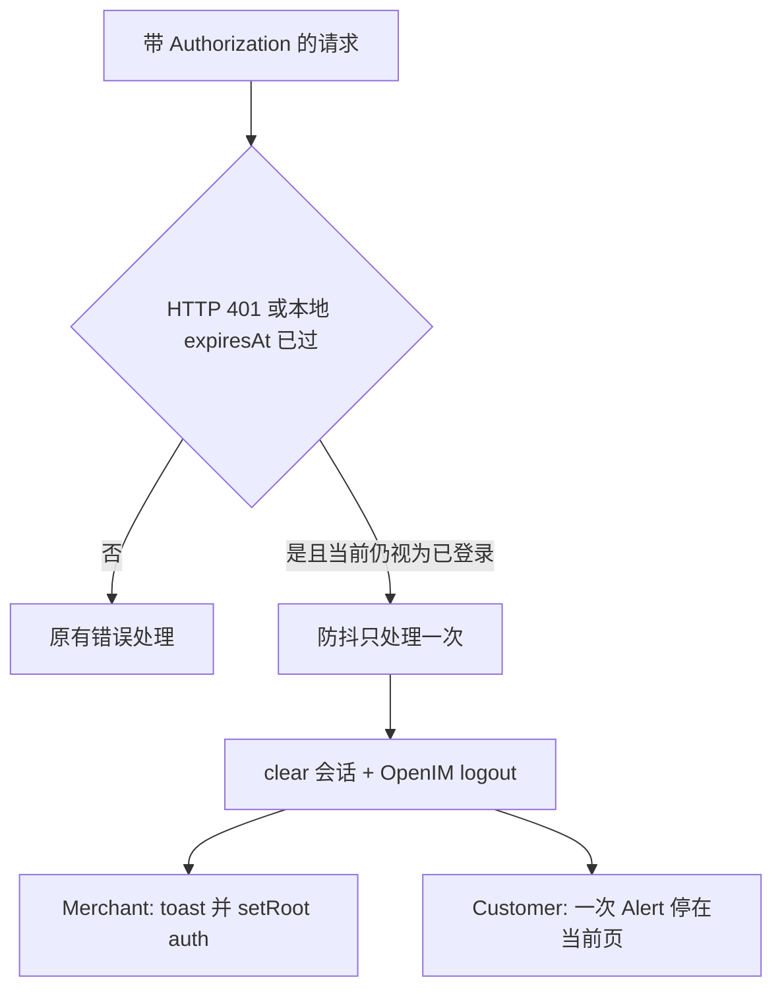

# 登录过期统一处理

本次只做「过期即退出并提示」，不做静默 refresh。后端已有 `POST /auth/refresh-token` 与 `/cms/refresh-token`，但两端都未接；续期留作后续。

## 行为

- 未登录时的 401、登录接口本身失败、网络错误（status 0）不触发。
- 防抖：短时间内多次 401 只提示、只清一次。
- 本地 `expiresAt`：App 回到前台时检查（两端都做）。没有 `expiresAt` 的旧会话不靠本地时钟踢，仍等 401。服务端提前作废仍靠 401。
- Customer 保持游客可逛。过期只清 token 并 Alert，不调用 `openProfileLogin`。已有各屏 `onRequireLogin` 在本次已被接管时直接 return（不再弹第二次，也不跳登录）。从未登录的游客走原「需要登录」流程。

## Merchant

- 新增 [`xituan_app_merchant/src/auth/auth-session-expired.util.ts`](xituan_app_merchant/src/auth/auth-session-expired.util.ts)：`notify()` 防抖、`appAuthStore.clear()`、`openimSessionUtil.logout()`、回调交给 UI。
- 在 [`merchant-api-response.util.ts`](xituan_app_merchant/src/api/merchant-api-response.util.ts) 的 `assertOk`：`httpStatus === 401` 且当前有 token 时先 `notify()` 再抛 `ApiRequestError`。
- [`auth.api.ts`](xituan_app_merchant/src/auth/auth.api.ts) 的 `getCurrentUser`（启动 `/auth/me`）同样在 401 时 `notify()`。现在 [`App.tsx`](xituan_app_merchant/App.tsx) 在 me 失败时仍 `setRoot('main')`，这是「过期还能点功能」的直接原因；`notify` 后走 auth，不要再进 main。
- [`App.tsx`](xituan_app_merchant/App.tsx) 注册回调：与现有 `handleLogout` 相同的清 IM / badge / `setRoot('auth')`，并 toast 过期文案。App 回到前台时再跑一次本地 `expiresAt` 检查。

## Customer

- 同样新增 [`xituan_app_customer/src/auth/auth-session-expired.util.ts`](xituan_app_customer/src/auth/auth-session-expired.util.ts)（两端 auth store 是复制的，不抽到 codebase）。
- 在 [`consumer-http.util.ts`](xituan_app_customer/src/api/consumer-http.util.ts) 的 `request`：仅 `options.auth === true` 且 `res.status === 401` 时 `notify()`，返回值仍是现在的 `{ httpStatus: 401 }`，各屏逻辑不用改契约。
- 在 [`App.tsx`](xituan_app_customer/App.tsx) 注册一次：只 `Alert` 过期文案。不打开登录页，用户自己去「我的」登录。回到前台时做本地 `expiresAt` 检查，过期走同一条 `notify`。
- 各屏已有 `if (httpStatus === 401) onRequireLogin()`（订单、购物车、地址、结账、商品等）：若 `notify` 已接管，直接 return。公开接口、未带 token 的 401 仍走原来的 `onRequireLogin`。

## 文案

两端 `en` / `zh_cn` / `zh_tw` 增加 `auth.sessionExpiredTitle` 与 `auth.sessionExpiredBody`（例如「登录已过期」/「请重新登录」）。不把后端 message 显示给用户。

## 不做

- 不接 refresh-token，不改 backend。
- 不改各业务列表的加载失败文案逻辑，除 401 已被过期流程接管时不再重复弹窗。
