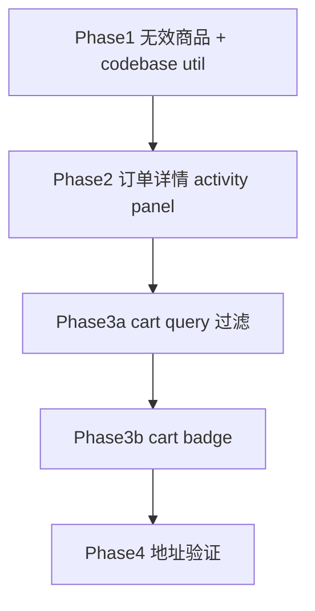
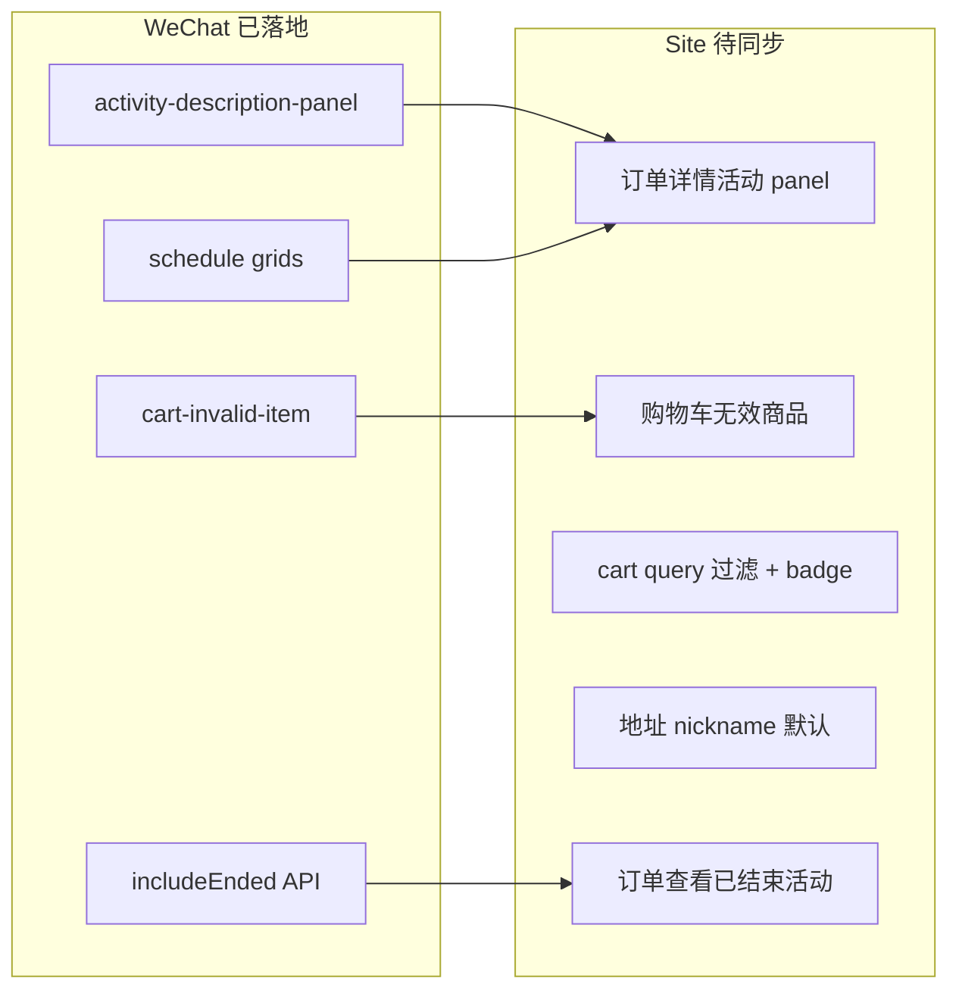

# Site 同步计划：活动 / 购物车 / 订单详情

> 上游：[WeChat 活动与购物车改动](wechat_活动与购物车改动_c2fe954c.plan.md)（小程序主体已完成）  
> 并行：[CMS 活动订单同步](cms_活动订单同步_bfddd5a2.plan.md)（管理端，**Site 完成后实施**）

## 实施优先级（已确认）

**首期先做 Site plan（Phase 1 → 2 → 3）**；CMS plan 在 Site 落地后再做。

## 响应式原则（移动 / 桌面分离）

Site 与小程序均面向手机；Site 另有 **桌面布局（≥768px）**，[`OrderDetailClient`](xituan_site/src/components/user-order-detail/OrderDetailClient.tsx) / [`ActivityDetailInfo`](xituan_site/src/components/detail/ActivityDetailInfo.tsx) 已区分 mobile tab 与 desktop 侧栏。

**同步小程序时的默认规则：**

| 类型 | 做法 |
|---|---|
| **行为 / 业务逻辑** | 三端一致（无效商品判定、结算拦截、已结束活动可查看、文案枚举等） |
| **明显移动布局**（折叠简介 100px、3×2 紧凑时间格、Tab 购物车、底部结算条、角标） | **仅 mobile 样式**（`<768px` 或现有 `ActivityDetailTabbedSection` / `CartMobileHeader` 路径） |
| **桌面布局** | 保留现有信息架构：侧栏 cart panel、展开式 Markdown、宽屏多列；**不**把小程序卡片/吸顶 Tab 套到 desktop |
| **点击类交互**（查看活动、结算、展开简介） | mobile + desktop 均需提供等效入口，但控件形态可不同（Link vs Button、折叠 vs 全文） |

**本 plan 各 Phase 落点：**

- Phase 1 无效商品：**双端相同**（逻辑 + 行内提示；`CartItemRow` 桌面 / `CartItemCard` 移动共用 context 状态）
- Phase 2 订单详情 panel：mobile 用折叠 + 紧凑 grid；**desktop 可默认展开 description**，schedule 用同组件宽屏展示（非强行 3×2 小格）
- Phase 3 cart badge：**必做** `MobileBottomNav`；`SiteTopBar` 桌面仅可选轻量数字提示，不做 TabBar 式角标
- Phase 3 cart query 过滤：**双端相同**（行为）；banner UI 跟各自 cart 页头部组件

## 推荐实施顺序

1. **Phase 1**（阻塞性最高）：无效商品 — 影响结算正确性  
2. **Phase 2**：订单详情信息密度 — 与小程序订单页对齐  
3. **Phase 3a → 3b**：购物车 UX（query 过滤优先于 badge）  
4. **Phase 4**：地址 nickname — **可能已对齐**，实施前先做验证（见下）

**建议 PR 切分**：PR-A = Phase 1 + codebase；PR-B = Phase 2；PR-C = Phase 3

## 已与小程序对齐（无需改动或仅验证）

| 能力 | Site 现状 |
|---|---|
| 活动详情 3×2 schedule grid | [`ActivityDetailInfo.tsx`](xituan_site/src/components/detail/ActivityDetailInfo.tsx) + [`site-activity-panel-schedule.util.ts`](xituan_site/src/utils/site-activity-panel-schedule.util.ts) |
| 活动详情 商品/购物车 Tab | [`ActivityDetailTabbedSection.tsx`](xituan_site/src/components/detail/ActivityDetailTabbedSection.tsx) |
| 活动域文案「已结束」 | [`messages/zh_cn.json`](xituan_site/messages/zh_cn.json) `activity.statusExpired` |
| 三模式购物车 + preferred mode | [`CartContext.tsx`](xituan_site/src/contexts/CartContext.tsx) + codebase `cartPreferredOrderModeUtil` |
| 已结束活动 API | 后端 `includeEnded: true`；[`getOfferById`](xituan_site/src/lib/api/site-api.util.ts) 可直接用 |
| 地址默认收件人 | [`auth.service.ts`](xituan_site/src/services/auth.service.ts) L602–611 已将 `nickname` 映射为 `userInfo.name`；[`UserAddressEditForm`](xituan_site/src/components/user-address/UserAddressEditForm.tsx) 用 `userInfo?.name` — **逻辑等价于小程序 nickname 优先** |

## 背景：小程序 plan 完成度 vs Site

原 plan [`wechat_活动与购物车改动_c2fe954c.plan.md`](c:\Users\lance\.cursor\plans\wechat_活动与购物车改动_c2fe954c.plan.md) 共 8 项 todo。对照当前代码：

| 小程序 todo | 小程序现状 | Site 对应模块 | Site 差距 |
|---|---|---|---|
| `activity-description-panel` | 已组件化，6 处接入 | [`ActivityDetailInfo.tsx`](xituan_site/src/components/detail/ActivityDetailInfo.tsx) | 活动详情页：全文 Markdown，**无折叠/复制**；订单详情：**仅纯文本 + 两行时间** |
| `activity-schedule-panels` | `offer/preorder-activity-schedule-grid` 已落地 | 同上 + [`site-activity-panel-schedule.util.ts`](xituan_site/src/utils/site-activity-panel-schedule.util.ts) | 活动详情页：**3×2 网格已对齐**；订单详情 offer：**缺 fulfillment/配送天数/preorder 窗口** |
| `cart-deleted-product` | [`cart-invalid-item.wechat.util.ts`](xituan_wechat_app/utils/cart-invalid-item.wechat.util.ts) + checkout 拦截 | [`CartContext.tsx`](xituan_site/src/contexts/CartContext.tsx) + [`CartItemRow.tsx`](xituan_site/src/components/cart/CartItemRow.tsx) | **无** deleted/inactive/无 product/stock=0 标记与结算拦截 |
| `api-ended-activity-view` | 后端 `includeEnded: true` 已开 | [`site-api.util.ts`](xituan_site/src/lib/api/site-api.util.ts) `getOfferById` / `getPreorderPromoteById` | API 可用；订单详情**缺「查看活动」入口**；需回归 expired 详情页 CTA 禁用 |
| `activity-status-copy` | 活动域多处「已结束」 | [`messages/zh_cn.json`](xituan_site/messages/zh_cn.json) `statusExpired: 已结束` | **已基本对齐**；[`CartMerchantGroup.tsx`](xituan_site/src/components/cart/CartMerchantGroup.tsx) 硬编码「已结束」可改 i18n |
| `address-nickname-sql` | [`address-edit.ts`](xituan_wechat_app/pages/profile/address-edit.ts) 优先 nickname | [`UserAddressEditForm.tsx`](xituan_site/src/components/user-address/UserAddressEditForm.tsx) + auth 映射 | **大概率已对齐**（`userInfo.name` ← nickname）；仅需验证旧 session / 未刷新 profile 边界；SQL 0331 为共享后端运维项 |
| `order-card-payment-seq` | 小程序「我的网店」商户端 | — | **不适用**（Site 无 mobile merchant panel） |
| `im-chat-scroll-restore` | [`chat-room-scroll-position.wechat.util.ts`](xituan_wechat_app/packageIm/utils/chat-room-scroll-position.wechat.util.ts) 已接入 room | Site 仅有 OpenIM 入口 util | **本计划不纳入**（平台差异大，另开 IM 专项） |

---

## Phase 1 — 购物车无效商品（高优先级，对齐 `cart-deleted-product`）

**目标**：与小程序 [`cart-page-config.ts`](xituan_wechat_app/lib/cart-page-config.ts) 行为一致。

### 1.1 共享 util（抽到 codebase — 三端场景完全重叠）

在 `xituan_codebase` 新增 `utils/cart-invalid-item.util.ts`（从 [`cart-invalid-item.wechat.util.ts`](xituan_wechat_app/utils/cart-invalid-item.wechat.util.ts) 迁移）：

| 导出 | 说明 |
|---|---|
| `eCartInvalidItemReason` | `'unavailable' \| 'out_of_stock'` |
| `iCartInvalidItemMeta` | `{ id, reason }` |
| `cartInvalidItemUtil.getInvalidMeta(item)` | 单条判定 |
| `cartInvalidItemUtil.collectFromItems(items)` | 批量 |

无效条件（与小程序一致）：`!product` | `epProductStatus.DELETED` | `INACTIVE` | `stock === 0`（`stock !== -1`）

**入参类型**：抽象最小接口 `iCartInvalidItemProductSlice`（`id`, `product?: { status?, stock? }`），避免 codebase 依赖 site/wechat 各自的 cart store 类型。

WeChat：保留 [`cart-invalid-item.wechat.util.ts`](xituan_wechat_app/utils/cart-invalid-item.wechat.util.ts) 为薄 wrapper（re-export + `reasonLabelZh`）。

**依赖**：按 [`xituan-codebase-change-scope`](d:\projects\xituan_module\.cursor\skills\xituan-codebase-change-scope\SKILL.md) 更新 wechat submodule；site/cms 若未消费可暂不 bump。

### 1.2 Site 接入

| 文件 | 改动 |
|---|---|
| [`CartContext.tsx`](xituan_site/src/contexts/CartContext.tsx) | `loadCart` 后计算 `invalidItemIds` + `invalidReasonById`；选中/全选/结算过滤无效项 |
| [`CartItemRow.tsx`](xituan_site/src/components/cart/CartItemRow.tsx) / [`CartItemCard.tsx`](xituan_site/src/components/cart/CartItemCard.tsx) | 红框提示（下架 vs 无库存）；禁用 checkbox + 数量控件 |
| [`CheckoutModeClient.tsx`](xituan_site/src/app/[locale]/(consumer)/checkout/[mode]/CheckoutModeClient.tsx) | 结算前二次校验，toast/alert 拦截 |
| [`messages/*.json`](xituan_site/messages/) | 新增 `cart.invalidUnavailable` / `cart.invalidOutOfStock` |

---

## Phase 2 — 订单详情活动信息区（对齐 description + schedule panels）

**目标**：Site 订单详情 offer/preorder 块与小程序 [`order-detail/offer`](xituan_wechat_app/pages/order-detail/offer/offer.wxml) / [`preorder`](xituan_wechat_app/pages/order-detail/preorder/preorder.wxml) 信息密度一致。

### 2.1 抽取可复用组件（订单详情专用，勿改活动详情页默认行为）

在 `xituan_site/src/components/detail/` 新增：

- **`ActivityDescriptionPanel.tsx`**：`SiteMarkdownBody` + 展开/收起；props：`defaultCollapsed?: boolean`
  - **mobile**（`OrderDetailClient` matchMedia `<768px`）：`defaultCollapsed=true`，max-height 100px — 对齐小程序订单详情
  - **desktop**：`defaultCollapsed=false` 或不用折叠，保持可读性 — **不强行 100px 裁切**
- **`ActivityScheduleGrid.tsx`**：从 `ActivityDetailInfo` 抽出 grid JSX；mobile 用紧凑 3×2；desktop 可用同一数据 **放宽为两行摘要或宽格**（CSS `@media (min-width: 768px)`），避免桌面出现手机窄格

**不要**改 [`ActivityDetailInfo.tsx`](xituan_site/src/components/detail/ActivityDetailInfo.tsx) 活动详情页：consumer 详情 mobile/desktop 已分叉（Tab vs 侧栏），保持现状。

Mapper：复用 `computeSiteActivityPanelSchedule` + `ActivityDetailInfo` 内 offer/preorder 分支。

### 2.2 改造 [`OrderDetailClient.tsx`](xituan_site/src/components/user-order-detail/OrderDetailClient.tsx)

当前 offer 块（约 L903–927）仅 title + 纯文本 description + start/end 两行；preorder **缺 promote 活动区**（仅有 delivery slot / note）。

改动：

1. **Offer 订单**：`offerInfo` → `ActivityDescriptionPanel`（`defaultCollapsed`）+ `ActivityScheduleGrid`（kind=offer）；状态 badge 用 `tActivity('statusExpired')` / active 文案
2. **Preorder 订单**：扩展数据加载 — 除 `preorderPromoteWindow` 外拉完整 promote（`description`, `pickupDeliveryWindowStart/End`）；新增与 offer 对称的 promote 活动 section
3. **「查看活动」**：header 行增加 Link，**无论 expired** 指向 `/${locale}/merchant/${merchantId}/offers/${offerId}` 或 `preorder-promote/${promoteId}`
4. **支付/加购 CTA**：expired 时保持禁用（对齐小程序 order-detail `活动已结束` 副文案）

数据加载注意：`OrderDetailClient` 已通过 `getOffersBatch` 拿 `offerInfo`；preorder promote 需确认是否已有 batch API 或补 `getPreorderPromoteById`。

---

## Phase 3 — 购物车体验补齐

| 项 | 小程序参考 | Site 现状 | 改动 |
|---|---|---|---|
| `?offerId=` / `?preorderPromoteId=` 过滤 | `activity-cart-browse` scope | [`ActivityDetailCartPanel`](xituan_site/src/components/detail/ActivityDetailCartPanel.tsx) 生成链接但 [`CartContext`](xituan_site/src/contexts/CartContext.tsx) **未消费 query** | `CartPageClient` 读 searchParams，过滤 `modeInstanceId`；UI 显示「当前活动」提示 + 清除 filter |
| Tab 角标 | `cart-badge.util.ts` | [`SiteTopBar`](xituan_site/src/components/layout/SiteTopBar.tsx) / [`MobileBottomNav`](xituan_site/src/components/layout/MobileBottomNav.tsx) 无数量 | `CartContext` 暴露 `totalCount`；nav 显示 badge（CSS 变量，遵循 ant-design 规则） |
| 选中缓存 | `cart-selection-cache.util.ts` 24h | 切换 mode 重置全选 | **Deferred** — 单独 backlog，本 plan 不纳入 |

### 3.1 Cart query 过滤实现要点

- [`CartPageClient.tsx`](xituan_site/src/app/[locale]/(consumer)/cart/CartPageClient.tsx)：`useSearchParams()` 读 `offerId` / `preorderPromoteId`
- [`CartContext.tsx`](xituan_site/src/contexts/CartContext.tsx)：新增 `activityScopeFilter: { kind, id } | null`；`filteredItems` 在现有 mode/search 后再按 `modeInstanceId` 过滤
- UI：filter 生效时顶部 banner「正在查看该活动购物车」+ 清除按钮（清除 = router 去掉 query）
- 与 [`ActivityDetailCartPanel`](xituan_site/src/components/detail/ActivityDetailCartPanel.tsx) L49–52 已有 href 对齐

### 3.2 Cart badge 实现要点

- 计数：全模式合计（对齐小程序 TabBar badge）
- **必做 — mobile**：[`MobileBottomNav.tsx`](xituan_site/src/components/layout/MobileBottomNav.tsx) cart Tab 角标（小程序式圆点数字）
- **可选 — desktop**：[`SiteTopBar.tsx`](xituan_site/src/components/layout/SiteTopBar.tsx) 链接旁小数字即可；**不做**底部 Tab 角标样式
- 样式：CSS 变量；mobile/desktop 可分 class，不共用小程序 rpx 尺寸

---

## Phase 4 — 地址默认收件人（验证项，非必改）

**结论**：Site [`auth.service.ts`](xituan_site/src/services/auth.service.ts) 登录时 `userInfo.name = nickname || username`，[`UserAddressEditForm`](xituan_site/src/components/user-address/UserAddressEditForm.tsx) 新建地址用 `userInfo?.name` — 与小程序 `nickname || username` **等价**。

实施时仅做手工验证：

1. 用户修改 nickname 后（account-info 页）再新建地址 → contactName 应为新 nickname  
2. 若发现 stale `userInfo.name`：在 `UserAddressEditForm` mount 时 `authStore` refresh profile（小 patch）

SQL migration 0331：共享后端运维，Site 无 UI 工作。

---

## Phase 5 — 验证清单

1. 购物车：下架/删除/无库存商品显示红框，不可选、不可改数量，结算被拦截
2. 订单详情 offer：简介可折叠 + 完整 schedule grid；expired 活动仍可点「查看活动」
3. 订单详情 preorder：promote 简介 + 预定窗口 grid（非仅 delivery slot）
4. `/cart?offerId=xxx` 只显示该活动行；清除后恢复全量
5. 导航 cart badge 与 Tab 内数量一致
6. 新建地址默认 contactName 取 nickname

**Post-deploy**：后端 `includeEnded` 已在 prod 生效时，确认 Site 详情页不因 expired 404/空数据（登记见原 wechat plan §8）。

---

## 不在本计划范围

- 小程序「我的网店」商户 panel（CMS 活动订单页为 admin 对应面，见 CMS 同步 plan）
- IM 对话滚动恢复
- 收藏 / Web Share

## 关键依赖

- codebase 变更需按 [`xituan-codebase-change-scope`](d:\projects\xituan_module\.cursor\skills\xituan-codebase-change-scope\SKILL.md) 更新 wechat submodule 指针
- UI 遵循 [`css-style-baseline`](d:\projects\xituan_module\.cursor\skills\css-style-baseline\SKILL.md) 与 [`ant-design-component-custom-css-rules`](d:\projects\xituan_module\.cursor\rules\ant-design-component-custom-css-rules.mdc)
