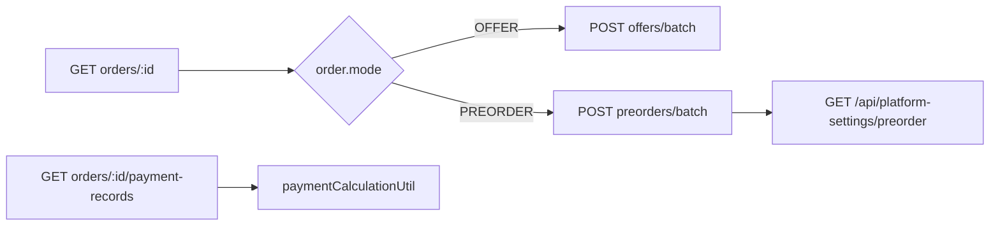

# Site 订单详情对齐 WeChat 三模式

## 产品决策摘要（已确认）

| 项          | 决策                                                                                                                                                              |
| ---------- | --------------------------------------------------------------------------------------------------------------------------------------------------------------- |
| 支付动作与落地页   | 现有逻辑将迁往新支付服务，**本轮不实现**支付跳转与支付流程页面；详情页须在合适位置 **备注/TODO**，待迁移完成后接新入口。                                                                                             |
| 支付方式       | **不受**支付服务迁移影响，仍为既有几种；详情页做方式选择 + `PATCH orders/:id/payment-method`（与 canPay 条件一致）。                                                                              |
| 申请退款       | **本轮不做**；不实现入口与流程；计划中 **【跟进】** 标注。                                                                                                                              |
| 再次购买（谁覆盖谁） | **替换策略**：对购物车中与订单行 **同键** 的条目先移除，再按订单行加购。同键定义：**同一 `productId` 且 `selectedOptions` 规范化后一致**（`note`/`noteImages` 是否纳入同键须与购物车模型一致，实现时以 CartContext 已有合并键为准并在此备注）。 |
| 客服按钮       | **一律 mock**（占位，无真实客服能力）；代码内 **英文 TODO**，便于后续研究网页客服再接。                                                                                                           |
| 响应式断点      | `**>= 768px` 为桌面模式**；`< 768px` 为移动模式（对齐小程序布局参考）。                                                                                                                |
| 多语言        | 订单详情页 **完整** `next-intl`，与列表等用户区文案同一套规范。                                                                                                                        |
| 商品行展示      | **是**，对齐小程序 `order-item-display` 粒度（选项、加价、备注与缩略图等，受接口字段约束）。                                                                                                     |

## 本轮暂不实现与后续跟进（须在代码/计划中可发现）

以下项须在实现时落在**明确位置**（组件旁 TODO、或 `order-detail` 相关文件顶部短注释、或本计划引用），便于以后跟进：

1. **支付执行**：`去支付` 的真实跳转、与新支付服务对接 — **defer**，见 todo `defer-payment-execution`。
2. **申请退款**：入口、文案、与商户/平台流程 — **defer**，见 todo `defer-refund`。
3. **客服**：当前仅为 **mock**（样式可像按钮），不接企业微信/在线客服 SDK — 见 todo `customer-service-mock`；后续方案确定后替换实现。

---

## 现状与差距

- **站点**：[xituan_site/src/app/[locale]/(user)/user/orders/[id]/page.tsx](xituan_site/src/app/[locale]/(user)/user/orders/[id]/page.tsx) 单一路径、通用卡片结构；无模式分支；地址为单行拼接；金额仅 `total/delivery/final`；支付记录为简略文本；无团购块、无预定块、无改时段。
- **小程序**：[xituan_wechat_app/pages/order-detail/regular|preorder|offer/*.wxml](xituan_wechat_app/pages/order-detail/regular/regular.wxml) 共享 [order-detail.wxss](xituan_wechat_app/pages/order-detail/order-detail.wxss)：**顶部渐变条 + 左文案/右状态** → 商品清单 → **(OFFER: 团购信息) / (PREORDER: 预定时间、备选时段、记录等)** → 地址（联系人/电话/详细/补充信息）→ 备注 → **(可支付时) 支付方式** → **金额条（含已收款/退款/余额，对齐 `cart-order-payment`）** → **支付历史** → 操作区（顺序与禁用态因模式而异）。
- **列表页已用色条区分模式**（紫/橙/青，见 [user/orders/page.tsx](xituan_site/src/app/[locale]/(user)/user/orders/page.tsx)），详情页应对齐同色主题（小程序：`regular` 紫 `#8b5cf6`、`preorder` 橙 `#f59e0b`、`offer` 青 `#06b6d4`）。

## 响应式策略（移动端 vs 桌面端）

**原则**：数据与业务规则一套；**展示两套**——手机参考小程序，**桌面不采用「拉宽单列」**，单独设计以利于扫读与扫视。

**断点**：`**max-width: 767px`** → 移动（对齐小程序参考）；`**min-width: 768px`** → 桌面专门版式。

| 维度  | 手机（mobile, <768px）                          | 桌面（desktop, ≥768px）         |
| --- | ------------------------------------------- | --------------------------- |
| 参考  | `xituan_wechat_app` 订单详情：单列、区块顺序、渐变顶栏、操作区习惯 | 站点自有：相同信息前提下优化阅读（可略增辅助信息）   |
| 结构  | 与小程序一致：自上而下同一顺序                             | 栅格/侧栏、支付历史表格式多列等            |
| 实现  | 移动优先 CSS                                    | `min-width: 768px` 下启用桌面布局类 |
| 数据  | 同一 props/hooks，禁止为桌面重复请求                    | 仅展示层分叉                      |

**阅读增强（仅桌面）**：多行备注、支付记录列对齐、团购说明不截断等——在已有数据范围内加细。

## 布局与排版

### 手机模式（对齐小程序）

1. **顶部 Header**：订单号、时间行、状态 Badge、渐变背景按 mode（CSS 变量 + 暗色主题）。
2. **区块顺序**：与 [regular.wxml](xituan_wechat_app/pages/order-detail/regular/regular.wxml) / [preorder.wxml](xituan_wechat_app/pages/order-detail/preorder/preorder.wxml) / [offer.wxml](xituan_wechat_app/pages/order-detail/offer/offer.wxml) 一致。
3. **样式**：[orders.module.css](xituan_site/src/styles/orders.module.css)；仅用 CSS 变量与 `body[data-theme]`。

### 桌面模式（专门设计，≥768px）

- 栅格/侧栏；与站点用户区最大宽、间距体系一致。

## 预订单日期/时段选择器

- **实现**：React + TypeScript + dayjs/Ant Design；规则对齐 [preorder-calendar](xituan_wechat_app/components/preorder-calendar/preorder-calendar.ts) 与 `PUT /api/preorders/:id/slots`。
- **移动**：布局贴近小程序。
- **桌面**：月历 + 列表并排等优化；可 `PreorderSlotEditorMobile` / `Desktop` 共享 `usePreorderSlotState`。

## 数据与类型

- 订单带 `merchantId`；禁止 `any`。
- **OFFER / PREORDER**：batch 接口；详情用完整类型。
- **merchantId 与请求（要带吗 / 会自动带吗）**  
  - 订单表以 **merchant_id** 为分区键，实体 [Order](xituan_backend/src/domains/order/domain/order.entity.ts) 含 `merchantId`；用户态 `GET /api/orders/:id` **应在 JSON 中返回该字段**（TypeORM 序列化），前端 batch、改时段、商户设置都依赖它。  
  - [order.service.ts](xituan_site/src/services/order.service.ts) 的 `authRequest` **不会**自动加 `X-Merchant-Id`；仅 [site-api.util.ts](xituan_site/src/lib/api/site-api.util.ts) 在传入 `options.merchantId` 时写入 header。  
  - 需要商户上下文的接口（如 `PUT /api/preorders/:id/slots`、`GET /api/merchant-settings/:category`）必须在单次请求里 **显式带 `X-Merchant-Id: order.merchantId`**（与小程序当前商户上下文等价）。
- **预定时段配置（与小程序一致）**：**必须以 merchant settings 为准**——微信小程序来自 **getMerchantSettings()**；站点详情页使用 **GET /api/merchant-settings/preorder**，且 **必须**带 **X-Merchant-Id: order.merchantId**（见 [public-merchant-setting.routes.ts](xituan_backend/src/domains/merchant/routes/public-merchant-setting.routes.ts)）；返回 `{ success, data: [{ category, settings }] }`，**settings** 为 **iPreorderSettings**（`maxTimeSlots`、`startTime`、`endTime`、`maxAdvanceDays` 等以类型为准）。404/失败则回退默认 3 槽 / 9–18 / 30 天。  
  - **范围约定**：**只有 platform 项目**（如全平台管理/平台级配置视图）才会在业务上「只要 platform settings」；**xituan_site / 消费者与商户上下文**下的预订单槽位参数 **一律走 merchant settings**（带 `X-Merchant-Id`），**不要**用纯 `platform-settings` 替代本条。

## 预订单改时段（API）

- `PUT /api/preorders/:id/slots`，`X-Merchant-Id: order.merchantId`；扩展 [order.service.ts](xituan_site/src/services/order.service.ts)。

## 支付与操作（与本轮范围）

- **支付方式**：展示并可切换既有几种，`PATCH payment-method`。
- **去支付**：**本轮不接真实支付跳转**；UI 可显示按钮为 **disabled** + i18n 说明「支付升级中」或等价，并在组件旁 **TODO(defer)** 指向 `defer-payment-execution`。**禁止**静默死链。
- **申请退款**：**不实现**（无按钮或隐藏），文件级 **TODO** 指向 `defer-refund`。
- **客服**：PREORDER pending 等处的联系按钮 → **mock**（`customer-service-mock`）。
- **再次购买**：实现 **replace_line** 策略（见上表）；依赖 `CartContext` 移除+加购能力。

## 多语言（next-intl）

- 订单详情页**全部**用户可见文案走 `next-intl`；建议 `messages` 中 `user.orders.detail.`* 或与列表共享 `user.orders.`* 并分子键。
- 日期时间展示仍遵守 workspace 日期规范。

## 商品行（对齐小程序）

- 对齐 `order-item-display`：**选项、加价、备注、note 缩略图**（接口返回则展示；无则降级隐藏）。

## 建议文件组织

- [page.tsx](xituan_site/src/app/[locale]/(user)/user/orders/[id]/page.tsx) 编排；`xituan_site/src/components/user-order-detail/` 分子组件。
- 响应式：共享数据组件 + 移动/桌面布局分叉或 CSS 媒体查询。

## 实施阶段仍须核对的技术点（产品已拍板；以下为写代码时要对齐的实现细节）

1. **再次购买「同键」**：实现时从 `CartContext` 找到与订单行一致的 **line id / 合并键**（若购物车以 `cartItem.id` 为单位而非按 product+options 自动合并，则「先删后加」要调用已有 **removeLine** + **add** API，避免手写键与购物车不一致）。
2. **团购订单是否展示「再次购买」**：小程序曾排除 OFFER；若仍排除，需在 `canReorder` 分支里对 `epOrderMode.OFFER` 保持隐藏（与现网小程序一致）。
3. **用户订单详情 API**：确认 `GET orders/:id` 响应含 **merchantId**（batch、`X-Merchant-Id`、merchant-settings）。
4. **预定设置 API**：**固定**使用 **GET /api/merchant-settings/preorder** + **X-Merchant-Id**；解析 `data[0].settings`。（平台项目才可能只关心 platform-only；站点不是。）
5. **支付方式**：展示与 `PATCH` 均使用 **epPaymentMethod**；可选集合与后端 `updateOrderPaymentMethod` 允许值一致。
6. **商品行 note 图**：`orderItem.noteImages` 与 `productImageUtil` 路径规则是否与列表/购物车一致，实现时对照现有工具函数。

---

## 风险与验收

- **时区**：遵守 workspace 日期规范。
- **枚举**：`epOrderMode`、`epPreorderStatus`、`epPaymentStatus` 等，禁止魔法字符串。
- **验收**：三模式数据与阻断逻辑正确；移动/桌面断点符合 768；i18n 覆盖；商品行与小程序一致（字段允许范围内）；预订单改时段可提交；**支付/退款/真客服** 不在本轮验收范围。

