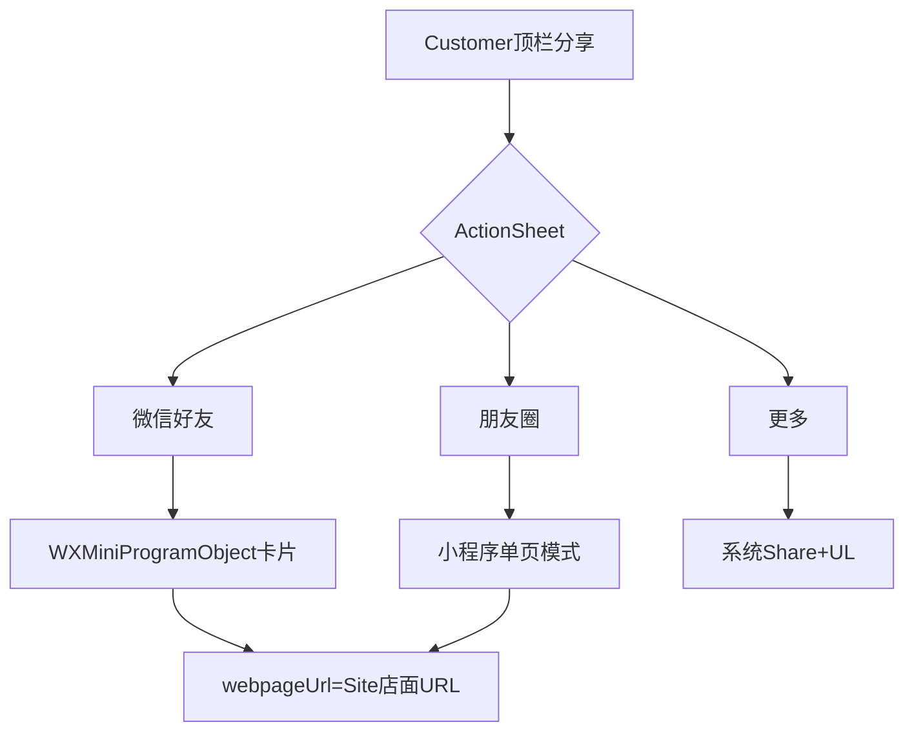

# 微信移动登录 + Customer 小程序卡片分享

## 决策变更（已确认）

- **不考虑服务号**，不做开放标签 / JS-SDK /「微信内优先 App」落地。
- App 分享到微信：走 OpenSDK **小程序对象**（同主体小程序已绑）。
- 小程序分享目标版本：**local→开发版，production 包→正式版**（见下表）。
- 验收：**Android 先**；iOS 开放平台 UL 绑完后再真机验微信回调。
- 原始 ID：backend env `WECHAT_APP_ORIGINAL_ID`（`gh_…`）；实现时写入 [`deploy.yml`](xituan_backend/.github/workflows/deploy.yml) 与 [`deploy-demo.yml`](xituan_backend/.github/workflows/deploy-demo.yml)。

### 小程序 `miniprogramType`（已确认 · 简化）

现实约束：测试包与上架包是**同一 production 二进制**（TestFlight / Play 测完直接提审），没有独立 preview App；也不能靠 OTA `preview` channel 切换（preview 包不能当 production 用）。因此 **无法**在「测试期自动体验版、上架后自动正式版」之间靠打包通道切换——`miniprogramType` 打进包后不会因商店状态变。

**本期采用：**

| 包 | 小程序 `miniprogramType` |
|----|--------------------------|
| **本地**（USB `build:local:android` / dev-client / `__DEV__`） | **开发版** |
| **production 打包**（EAS `production` / `production-apk`，含商店测试与正式上架） | **正式版** |

验收流程：先把小程序发到**正式版** → 再用 App production 包测「分享进正式版小程序」。本地联调走开发版（微信号需在开发者名单）。

不做：按 OTA channel 映射体验版；不为同一 binary 做远程改 mp 类型（若以后要「测体验 / 上架正式」且同包，需另做远程配置，本期不做）。  
可选 `EXPO_PUBLIC_WECHAT_MP_TYPE` 强制覆盖。禁止硬编码 SDK 数字。

### 原始 ID 如何到 Customer App

`WECHAT_APP_ORIGINAL_ID` 在 backend/GHA 不够单独完成分享——OpenSDK 在 **手机端** 组卡片，客户端必须能读到 `gh_…`（非 Secret，可公开）。

实现约定：

1. Backend config + deploy 写入 `WECHAT_APP_ORIGINAL_ID`（你已要求）。
2. Customer 构建同时带 `EXPO_PUBLIC_WECHAT_APP_ORIGINAL_ID`（同值），分享直读；或启动时拉公开配置接口（二选一，优先 EXPO_PUBLIC，离线也能分享）。
3. Customer 移动应用 AppId：`EXPO_PUBLIC_WECHAT_CUSTOMER_APP_ID`（对应 `WECHAT_CUSTOMER_APP_ID`）；Merchant 同理。Secret 只留后端。

## 分享能力结论

| 目标 | 能否「小程序卡片」 | 实际行为 |
|------|-------------------|----------|
| 微信好友 / 群会话 | **能** | 标准小程序卡片；点开进小程序对应 `path` |
| 朋友圈 | **不是会话那种卡片** | SDK 可发小程序类型；接收方打开为小程序 **[单页模式](https://developers.weixin.qq.com/miniprogram/dev/framework/open-ability/share-timeline.html)**（无登录态、不能跳其它页、适合内容展示） |
| 更多（系统 Share） | 否 | Site URL + Universal Link（有 App 开 App，无 App 开网页） |

官方约束摘要（[Android 分享文档](https://developers.weixin.qq.com/doc/oplatform/Mobile_App/Share_and_Favorites/android.html)）：

1. 发起分享的 App 与小程序须同一开放平台账号（你们已满足）。
2. 必须填 `webpageUrl`：低版本微信 / iPad 会降级为网页；用现有 Site storefront URL。
3. 小程序 `userName` = 原始 ID（`gh_...`，小程序后台 → 设置 → 基本设置）。
4. 未上架移动应用有每日分享次数限制（调试用）。



---

## 范围

- 登录：Customer + Merchant（Android 主验收；iOS 等开放平台 UL）
- 分享：仅 Customer；屏：商户首页、Offer/Preorder 详情、商品详情、定制、新闻（对齐小程序可分享公开页）
- Merchant 登录分流：有店进店；无店/新用户 → [`ApplyMerchantScreen`](xituan_app_merchant/src/screens/ApplyMerchantScreen.tsx)

---

## 1. Backend：移动应用登录

对齐 [`wechatWebLogin`](xituan_backend/src/domains/user/controllers/auth.controller.ts)（`sns/oauth2/access_token`）。

- config 读 `WECHAT_CUSTOMER_*` / `WECHAT_MERCHANT_*` / `WECHAT_APP_ORIGINAL_ID`
- `POST /api/auth/wechat-mobile/login`，`{ code, client }`（enum）
- migration `1710000000367_...`：`wechat_customer_open_id`、`wechat_merchant_open_id`；跨端 `wechat_union_id`
- 扩展 `wechat-user-identity.util` + codebase types
- GHA：[`deploy.yml`](xituan_backend/.github/workflows/deploy.yml)、[`deploy-demo.yml`](xituan_backend/.github/workflows/deploy-demo.yml) 增加 `WECHAT_APP_ORIGINAL_ID`（与现有 WECHAT_* 并列）

## 2. Expo OpenSDK（Customer + Merchant）

- OpenSDK + config plugin：`registerApp`、`sendAuthRequest`、分享 `WXMiniProgramObject`（local→开发版，production 包→正式版）
- Customer：`EXPO_PUBLIC_WECHAT_CUSTOMER_APP_ID` + `EXPO_PUBLIC_WECHAT_APP_ORIGINAL_ID`
- Merchant：`EXPO_PUBLIC_WECHAT_MERCHANT_APP_ID`（登录用；无分享）
- Secret 仅后端；Android 主验收；iOS 代码先接
- 替换登录占位；原生变更需重新 local/EAS build

## 3. Customer 分享：App → 小程序 path 怎么算

**不要**用 App 导航路由字符串去「翻译」成小程序 path（两边路由本就不一样）。

用 **业务分享目标（kind + ids）** 分别拼三套地址，与现有 Site 分享同一套 kind：

```text
epStorefrontShareKind + { merchantId, entityId, … }
  → buildSitePath()          // 已有：offers/{id} 等 → webpageUrl / 「更多」
  → buildMiniProgramPath()   // 新增：对齐小程序 onShareAppMessage 的真实 path
  → title / thumb            // 当前屏已有文案与图
```

实现放 **codebase 共享 util**（推荐，避免 App 手抄 path 日后漂移），或至少 Customer 内单一 `storefront-miniprogram-share-path.util.ts`，常量对齐小程序现网：

| 分享 kind（App 屏） | 小程序 path（与微信端现网一致） | Site webpageUrl（已有） |
|---------------------|--------------------------------|-------------------------|
| 商户首页 | `/pages/index/index?merchantId=&shopName=` | `{code}.m.*/{locale}` |
| 团购详情 | `/pages/offer-detail/offer-detail?offerId=&merchantId=` | `…/offers/{id}` |
| 预定详情 | `/pages/preorder-promote/preorder-promote?promoteId=&merchantId=` | `…/preorder-promote/{id}` |
| 商品详情 | `/pages/product-detail/product-detail?id=&merchantId=`（分享只带必要 query，不抄 themeColor/stock 等 UI 态） | `…/products/{id}` |
| 商品定制 | `/pages/product-custom/product-custom?productId=&merchantId=&…`（需要的 mode/preorderId 从屏 props 传入） | 仍可用 `…/products/{id}` 作降级网页 |
| 新闻 | `/packageSubPages/pages/news-detail/news-detail?id=&merchantId=` | `…/news/{id}` |

各屏调用分享时传入 **kind + ids**（与现在传 Site `path` 同级），由 util 生成小程序 path；**禁止**从 React Navigation route name 推断。

朋友圈单页模式：同一 `buildMiniProgramPath`，query 必须自包含（补齐小程序端 timeline 常缺的 `query` 问题，至少 App 发出去的要带齐 id）。

- **好友**：`WXMiniProgramObject` + 上表 path + title + 预览图 + `webpageUrl=Site`
- **朋友圈**：同对象，`scene=Timeline`（单页模式）
- **更多**：现有系统 Share（仅 Site URL）
- ActionSheet；未装微信 toast，仍可走「更多」

## 4. 刻意不做

- 服务号、开放标签、JS-SDK、微信内「优先开 App」
- Merchant 分享；订单/支付/IM/账号分享
- 新增团购/预定列表分享屏

## 5. 运维

- [x] 开放平台同主体：移动×2 + 小程序 + 网站
- [x] Android 包名/签名
- [x] `WECHAT_APP_ORIGINAL_ID` 已进 local env + GHA secrets（实现时接线 workflow）
- [ ] Customer/Merchant EAS 或本地 `EXPO_PUBLIC_*` 同步 AppId / ORIGINAL_ID
- [ ] iOS 开放平台 UL（不挡 Android 验收）
- [x] 不申请服务号
- [x] 分享小程序版本：local→开发版，production 包→正式版（不搞 preview/体验自动切换）
