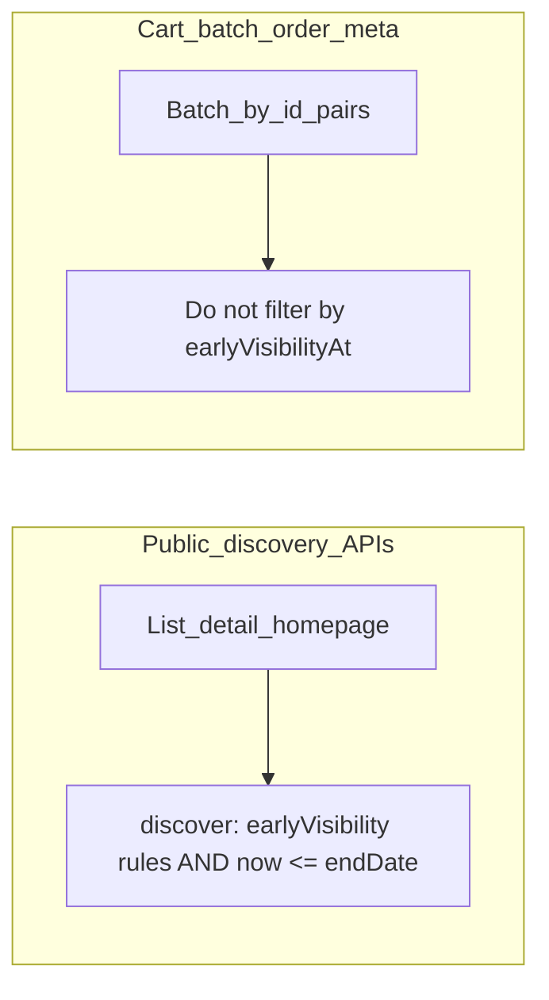

# 活动生命周期时间模型（替代 isVisibleBeforeStart bool）

## 与当前代码的差异（必须先对齐预期）

- **团购付款（目标态）**：见下节；**废除**「开团前 **`[start−N, start)`** 可付」与任何 **`presaleOpensAt` / 提前支付日期** 设计。可支付 **仅** **`[startDate, endDate]`**。**Capture**：支付通道 **支持 manual 则 manual**（商户后续 capture 再 **processing**），**不支持则 automatic capture**（已确认）。**定时 batch capture 完全下线**（改校验、移除 batch 任务、按 PSP 能力设 intent）。
- **预定推广**：仅 **`earlyVisibilityAt`** + 活动 **`startDate` / `endDate`**（及 `isReleased` 等）；**不设 `presaleOpensAt`**。可下单/可支付自 **`startDate`** 起至 **`endDate`**（与后端校验一致）。**不配履约天数字段**、不配 `fulfillmentStartAt`。

## 已确认：支付、capture 与错误码（产品，**2026-04 修订**）

1. **团购（OFFER）阶段（四段）**：**① 提前展示**（`earlyVisibilityAt`，可空）→ **② 活动期**（`startDate`–`endDate`，可下单/可支付）→ **③ 活动已结束**（`now > endDate`，不可新单）→ **④ 备货 / 送货 / 发货**（对外说明用 `fulfillmentStartAt` + `fulfillmentWindowDays`，**不**再单独叫「预售」）。
2. **不设「提前支付日期」**：**无** `presaleOpensAt` 字段（**Offer 与 Preorder 均无**）。**废除**依赖 **`offerManualCaptureMaxAdvanceHours`** 的 **「开团前 N 小时至开团前」可支付** 阶段；**N 小时**仅保留为 **授权有效 / 待支付过期等** 的**参考时长**，**不**再定义「最早何时可付款」。
3. **团购活动期内 capture（已确认）**：**若 PSP 支持 manual** → 建单 **manual**，**pending_capture** → 商户 **capture → processing**。**若不支持** → **automatic capture**。**定时 batch capture 完全下线**（同上文件）。**PSP 清单式核对**（已确认执行）：逐通道核对 intent、capture 模式与订单状态流转。
4. **预定（PREORDER）**：**接单/支付** 仅在 **`startDate`–`endDate`**；capture 规则 **同 Offer**（支持则 manual，否则 auto）；N 小时作过期参考。**配送/自提日** 须落在 **履约窗**。
5. **API / 前端**：**支付未开始** vs **活动已结束** **分码**（见前）；**Preorder 加购/支付** 看 **接单窗**；**日历选日** 看 **履约窗**。Offer 可支付判定同前条 Offer 规则，**不再**用开团前 N 小时 util 作为 Offer 加购条件。**订单详情**：**沿用现网**（通常为 **JOIN** 活动主数据）；**暂不**强制「开始后不可改日期」、**暂不**上快照。

## 实体范围（已确认）

| 实体 | 提前展示 | 可支付时间 | 活动后履约说明 | 字段 |
|------|----------|------------|----------------|------|
| `preorder_promotes` | `earlyVisibilityAt`（可空） | **接单/支付窗**（见下「双时间轴」） | **配送/自提可选日窗**（新增起止） | 无 `presaleOpensAt` |
| `offers` | `earlyVisibilityAt`（可空） | **`[startDate, endDate]`**（**无**开团前窗） | `fulfillmentStartAt` + `fulfillmentWindowDays` | 无 `presaleOpensAt` |

## 预定推广：双时间轴（接单支付 vs 备货后配送/自提）

**产品定案（与你的设想一致）**

- **现有 `start_date` / `end_date`**（API 仍可用 `startDate`/`endDate`，建议在类型与 CMS 文案中标为 **接单/支付有效期**）：仅约束 **何时可下单、可支付**（加购、创单、支付校验均以该窗为准）。
- **新增一对 `timestamp with time zone`**（与 `offers` / `preorder_promotes` 上既有活动日期列一致，已确认）：命名示例列 `pickup_delivery_window_start`、`pickup_delivery_window_end`（**均可空**）；属性如 `pickupDeliveryWindowStartAt` / `pickupDeliveryWindowEndAt`。
- **履约窗可选（已确认）**：CMS **可不填**履约窗；**整对留空**时语义 **与接单窗相同**。实现上用 **按字段分别 coalesce**：**`effectivePickupStart = coalesce(pickup_delivery_window_start, start_date)`**、**`effectivePickupEnd = coalesce(pickup_delivery_window_end, end_date)`** 参与选日边界与不等式校验（**允许只填一端**，**缺的一端与接单窗对应端对齐**，已确认）。**顾客所选配送/自提日** 须落在 **effective 履约窗** 内（可与 `maxAdvanceDays`、时段规则组合；展示层仍可按「日」裁剪）。

**业务约束（实现时校验）**

- **Preorder 推广（已确认）**：对 **effective 履约窗** 满足 **`接单 start ≤ effective 履约 start`** 且 **`接单 end ≤ effective 履约 end`**。当两列均为空时 **自动等于接单窗**，两式恒成立。若 **显式填写**履约窗，保存（CMS / admin API）**必须**满足上式；不满足则 **拒绝保存**。履约窗与接单窗在日历上仍可重叠（例如接单 3/1–3/15、履约 3/10–4/30）。  
- **CMS 更新接单日期时自动修正履约 `end`**（已确认）：仅当 **`pickup_delivery_window_end` 已非空**（显式填了履约结束）且 **`接单 end` > 该值** 时，将 **`pickup_delivery_window_end` 抬升至 `接单 end`**。若履约 `end` 列为空（effective 用接单 `end`），**无需**写库抬升。抬升后须仍满足 **effective** 不等式及 **`effective 履约 start ≤ effective 履约 end`**；若 **任一** 不满足则 **拒绝保存**（**不**自动改显式 `履约 start`，由运营手调）。**不**与「开始后锁定字段」绑定（该锁定 **暂缓**，见下节）。  
- **加购**：仅在 **`now ∈ [接单 start, 接单 end]`** 内允许；**不必**再用履约窗挡加购。  
- **选日（datetime picker / slot）**：**仅**用 **履约窗** 作日期边界；**接单窗不参与选日**（已确认）。`maxAdvanceDays`、与「今天」的裁剪等 **在履约窗内**再算。  
- **`earlyVisibilityAt` ≤ 接单窗 `start`**（沿用现规则）。  
- 下单支付：`now ∈ [接单 start, 接单 end]`；提交/保存 slot：**slot ∈ [履约窗 start, 履约窗 end]**。  
- **改 slot（已确认）**：见下节 **`preorders.delivery_datetime`** — 未设置时顾客可在履约窗内改；**已设置则仅后台人工可改**。

### 预定订单表 `preorders.delivery_datetime`（**最终 timeslot 标志，已确认**）

- **`delivery_datetime`**：**后台确认后的最终配送/自提 slot**（日期时刻）。  
- **已为非空**：视为 **timeslot 已锁定** → **顾客端**（站点 / 小程序 / 用户订单 API）**禁止**再改 slot；**仅后台 / 管理端人工**可修改（专用 admin 接口或 CMS 订单操作）。  
- **仍为空**：顾客可在 **履约窗** 内自助选、改 slot（须过 `order.service` 与 slot 校验）。  
- 与推广侧「商户确认 timeslot」业务语义一致；实现时以该列是否为 **null** 作为分支条件。

**边角举例：接单已结束，履约窗仍覆盖未来**（便于实现与客服对齐）

- 设接单窗：3/1 00:00 – 3/15 23:59；履约窗：3/10 00:00 – 4/30 23:59（均为商户业务时区落库的 instants）。  
- **3/16 起**：`now > 接单 end` → **不能再加购/支付**；**首页/列表等发现链路**不再展示该推广（见下节）。  
- **已下单客户**：仍可通过 **订单** 查看活动名、时间说明等；**改 slot** 规则见 **`delivery_datetime`** 一节。  
- **对外拉新/广告停于接单结束**，**履约与订单售后**可继续到履约窗结束。

**影响面（需跟进的系统）**

| 层级 | 说明 |
|------|------|
| **DB 迁移** | `preorder_promotes` 增两列 **可空**；**历史与默认（已确认）**：**`NULL` = 与接单窗相同**（**不**做批量复制接单日期至两列）；上线后运营可在 CMS **显式**填履约窗。 |
| **后端 — 列表/公开 API** | [`preorder-promotes.repository`](d:\projects\xituan_module\xituan_backend\src\domains\preorder-promotes\infrastructure\preorder-promotes.repository.ts) 的 `activeInWindow` / `releasedNotEnded` / 首页 cron：**「进行中」**应对齐 **接单窗**；返回体带上 **履约窗** 供前端选日。 |
| **后端 — 订单** | [`order.service`](d:\projects\xituan_module\xituan_backend\src\domains\order\services\order.service.ts)：买单 **接单窗**；创单/改 slot **slot ∈ 履约窗**；**`preorders.delivery_datetime` 已非空则拒绝顾客改 slot**，仅 **admin** 可改。**详情 API**：**沿用现网 JOIN** 活动主数据。 |
| **后端 — 购物车** | 与 promote 相关：**仅接单窗**；**不**用履约窗挡加购（已确认：接单期内无需额外履约窗条件）。 |
| **共享 util** | [`preorder-slot-bounds.util.ts`](d:\projects\xituan_module\xituan_backend\submodules\xituan_codebase\utils\preorder-slot-bounds.util.ts)：选日 min/max 使用 **effective 履约窗**（`coalesce(pickup_*, 接单 *)`）；**不接单窗**作选日上界（已确认）。 |
| **站点** | [`preorder-checkout-activity-window.util`](d:\projects\xituan_module\xituan_site\src\utils\preorder-checkout-activity-window.util.ts)、[`PreorderSlotEditor`](d:\projects\xituan_module\xituan_site\src\components\user-order-detail\PreorderSlotEditor.tsx)、[`PreorderCard`](d:\projects\xituan_module\xituan_site\src\components\cards\PreorderCard.tsx)：阶段用接单窗；选日仅履约窗；**`delivery_datetime` 已设 → 选日器隐藏/只读**；未设则履约窗内可改。 |
| **小程序** | 预定页日历与 util 同源；**`delivery_datetime` 已设**则与站点一致 **不可自助改 slot**。 |
| **CMS** | 预定推广：**接单窗必填**；**履约窗选填**；**硬校验** effective；**自动抬升**仅当已填履约 `end`；**归档**见 **「CMS 归档」**（**`archive_category` + `archived_at`** 同写同清）；**常规列表**排除已归档；活动字段编辑 **沿用现网**。 |
| **类型与 API 契约** | [`preorder-promotes.type.ts`](d:\projects\xituan_module\xituan_backend\submodules\xituan_codebase\typing_entity\preorder-promotes.type.ts) 扩展可空履约列 + 接单窗；**不**在 API 中额外返回 `effectivePickup*`（**已确认**：**前端**用与后端相同的 **coalesce 纯函数** 自算）；**标注** `startDate`/`endDate` 语义为接单/支付窗。 |

**是否有必要**：若存在「先卖一段时间、提货日整体晚于开卖」的节令/礼盒场景，**有必要**；与团购 Offer 的「接单期 vs 发货说明」分工类似，但预定用 **硬起止** 管住选日更稳。

### 已拍板（原「待确认」）

- **履约窗「只填一端」（已确认）**：**允许**；**缺的一端与接单窗对应端对齐**（见上 **per-field coalesce**）。
- **归档与关联订单（已确认）**：守卫 **仅** **`orders.status` + `orders.payment_status`**（**ONLINE** 单）；白名单 **仅 `CANCELLED`/`EXPIRED`**；**`DELETED`/`REFUNDED`/`DELIVERED` 等** 均拦；**`pending_capture`** 拦。
- **API / effective 履约窗（已确认）**：**仅**返回可空 `pickup_delivery_window_*` + 接单窗；**前端**（站点/小程序/CMS 若需展示）**import 共享 coalesce 纯函数** 自算 effective，与后端校验 **同源**。
- **历史迁移（已确认）**：`pickup_delivery_window_*` **默认 NULL**（语义=接单），**不**批量复制 `start_date`/`end_date`。

## 原 `delivery_days` 命名（仅更名，不扩设计）

- 业务上该整数表示的是**备货 + 发货安排**相关周期，而非单纯的「快递在途天数」；商户解释用于**选一个更贴切的英文名**，**不**据此扩展分批发货表、批次等新设计。
- **推荐命名**：属性 **`fulfillmentWindowDays`**，列 **`fulfillment_window_days`**（迁移：`ALTER TABLE ... RENAME COLUMN delivery_days TO fulfillment_window_days`，默认值/非空与现有一致）。
- **语义约定（文案层）**：自 `fulfillmentStartAt` 起计，商户向客户展示的**履约完成窗口（日历天数）**；可涵盖备货、分多批送达、自配等，**仍为单一整数**，不承诺系统内按批次拆单。

## 建议的数据字段（命名可再统一前缀）

均以 **`timestamp with time zone`** 存 UTC（与现有 `start_date` / `end_date` 一致）；前端按商户业务时区编辑后转 ISO 入后端。

| 字段 | 语义 | 约束与备注 |
|------|------|------------|
| `earlyVisibilityAt` | 客户可**浏览**（列表/详情/首页等公共发现链路）的最早时刻 | **可空**：空表示**不提前**，即从 `startDate` 起才进入「可发现」逻辑（在仍 `isReleased` 且未结束的前提下）。**必须 `≤ startDate`**（按同一比较基准，建议用 instant 比较）。 |
| `startDate` / `endDate` | **活动期**；顾客**可下单/可支付**仅在此区间内（配合 `isReleased` 等） | **Offer / Preorder**：PSP **支持 manual → pending_capture + 商户 capture → processing**；**不支持 → automatic capture**（按通道）。**无**开团前付款窗、**无** `presaleOpensAt`。 |
| `fulfillmentStartAt` | **配货/履约开始**的最早业务时刻（**仅 `offers`**） | 可空：**未填时按 `endDate` 在商户业务时区对应日历日的次日 `00:00:00` 落库/派生**（已确认）。手动填写须不早于该默认规则所表达的最早配货起点；`endDate` 变更时若已存值早于新规则下界则自动纠正（与既有「早于 end 则抬升」一致，具体以次日 00:00 为基准实现）。 |
| `fulfillmentWindowDays`（由 `delivery_days` **更名**） | 自 `fulfillmentStartAt` 起的**履约窗口（天）** | 整数；用于展示与客户预期，**不**表示「单次快递天数」。实现为列重命名 + 全栈属性名替换，**不改**为批次等新结构。 |

**废弃**：bool `isVisibleBeforeStart`；**不落地** `presaleOpensAt`。若曾设计迁移含 `presaleOpensAt` 列则删除该列相关脚本。

## 公共 API vs 补全/批量（保持你已确认的分界）

- **浏览类（列表 / 详情 / 首页 / 广告等「发现」）**：**时间比较（已确认）**：一律按库内 **`timestamptz` 与当前 instant** 比较（**`startDate`/`endDate`/`earlyVisibilityAt` 均为具体时间戳**），**不**再按「日历日」单独截断或换日界线重算。`now < startDate` 时，仅当 `earlyVisibilityAt` 非空且 `now ≥ earlyVisibilityAt` 才展示；`earlyVisibilityAt` 为空则要求 `now ≥ startDate`。且须 **`now ≤ endDate`** — **`now > endDate` 后**不再出现在主页或对外推广位。Offer 与 Preorder 均按各自的 **`startDate`/`endDate`**（接单窗）判断「是否仍可做广告/发现」。**已归档**活动（见 **CMS 归档**）**不得**出现在对外发现链路（与 `archive_category` 过滤一致）。
- **已购客户**：通过 **订单列表 / 订单详情** 查看活动信息 **不**套用发现过滤；详情 **沿用现网**（**JOIN** `offers` / `preorder_promotes`、`preorders`、行项等）。**暂不**要求活动开始后禁止改日期、**暂不**做快照/版本表；运营若改主数据，订单页展示可能与历史认知不一致 — **已知风险**，日后可重启「锁定」或快照方案。
- **购物车/批量/订单补全**：不按 `earlyVisibilityAt` 过滤，便于展示「未开始 / 已结束」等状态文案；与上条「发现」过滤区分。

### 活动敏感字段锁定 / 快照 / 版本表（**暂缓，2026-04**）

**结论**：认为「开始后锁定敏感字段」会 **增加复杂度与连带问题**，**本阶段不做**。**订单快照、版本表** 亦 **不做**。**活动编辑权限与订单详情组装** — **保持当前代码已实现的行为**，本计划其余条目（双时间轴、发现过滤、capture、购物车分码等）仍按文档推进。

**Backlog（供日后产品重启）**：若再要做纠纷防控，可在 **「`now ≥ startDate` 后禁止 PATCH 日期/履约窗」** 与 **「下单快照 / 版本行」** 之间重选；届时单独立项，不在本轮范围。

**订单域已有持久化**（不变）：[`order_items`](d:\projects\xituan_module\xituan_backend\src\domains\order\domain\order-item.entity.ts) 价款与 `product_name`；[`preorders`](d:\projects\xituan_module\xituan_backend\src\domains\preorder\domain\preorder.entity.ts) 的 **`delivery_datetime_slots` / `delivery_datetime`**。

## 业务逻辑：冲突、漏洞与补充建议（**已采纳为实现约束**）

1. **earlyVisibilityAt**：允许「仅提前可见、**不可付**（`now < startDate`）」。**加购/支付**仅以 **`[startDate, endDate]`** 为准；深链须服务端校验。
2. **平台 N（`offerManualCaptureMaxAdvanceHours`）**：**不**再用于「何时可发起团购支付」；仅用于 **授权/待付过期** 等与现网 cron 对齐（见 [`inventory-cron.service.ts`](d:\projects\xituan_module\xituan_backend\src\domains\inventory\services\inventory-cron.service.ts) 等）。
3. **Offer capture**：**PSP 支持则 manual**，否则 **auto**；manual 路径下商户 **capture → processing**；**批量定时 capture 已下线**；全通道 **清单核对**（见上节）。
4. **Preorder**：capture **同 Offer**；**接单/支付** 仅在 **`[startDate, endDate]`**；**选日仅履约窗**；**改 slot**：**`preorders.delivery_datetime` 为空** 时顾客可在履约窗内改；**已设则仅后台人工改**；slot util 与 [`order.service`](d:\projects\xituan_module\xituan_backend\src\domains\order\services\order.service.ts) 一致。
5. **配货开始**：`fulfillmentStartAt` 默认 **`endDate` 次日 00:00**（商户时区）。
6. **统计与 CMS**：与前台公共过滤一致。**敏感字段锁定 / 快照**：**暂缓**（见「公共 API」下专节）。
7. **错误码**（已确认）：加购/支付拒绝使用 **两个通用码**（**未开始** vs **已结束**），**不按** Offer/Preorder **拆分**。**购物车**：**单一 `assert` + `cart-add-validation.util` 必须复用同一逻辑**（已再次确认），禁止两套不等价判断。

## 实现顺序建议（降低风险）

1. **Schema + 实体 + 校验**：迁移加列、非空默认值与回填规则、`endDate`/`fulfillmentStartAt` 联动在 **admin update** 与 **repository save** 层统一封装（避免多处漏改）。
2. **浏览类过滤**：替换原 bool 方案，按 `earlyVisibilityAt` 实现公共列表/详情/[`homepage-cache-cron.service.ts`](d:\projects\xituan_module\xituan_backend\src\domains\homepage-cache\services\homepage-cache-cron.service.ts)。
3. **支付与选日**：**Offer** — 加购/支付 **`[startDate, endDate]`**；**Preorder** — 加购/支付 **接单窗**；**日历 slot** 边界 **履约窗**。**分码**「未开始 / 已结束」针对接单窗。
4. **Capture 与过期**：**Offer + Preorder** 按 PSP **manual 或 auto**；**N 小时**仅过期参考；Offer **batch capture 任务已移除**；**PSP 矩阵清单核对**。
5. **CMS**：Preorder：**`earlyVisibilityAt`** + 双窗；`接单 end ≤ 履约 end` + 自动抬升履约 `end`；**无**敏感字段只读（暂缓）。Offer：新字段与文案。
6. **测试**：**`delivery_datetime`** 空/非空 改 slot；PSP manual/auto；双窗与发现过滤回归。
7. **前端（分阶段展示）**：见下节 — **团购**与**预定推广**共用「时间边界驱动阶段」的思路，**分支实现**（见对比表）。

## 前端配套：分阶段提示（Offer 与 Preorder）

面向消费者端（**优先 [`xituan_site`](d:\projects\xituan_module\xituan_site)**；微信小程序 [`xituan_wechat_app`](d:\projects\xituan_module\xituan_wechat_app) 在能力到位后同步阶段逻辑）。

### 实现策略（避免混用）

- 使用**判别类型**（如 `activityKind: 'offer' | 'preorderPromote'`）或**两套并列 util**（如 `offer-activity-phase.util.ts` 与 `preorder-promote-phase.util.ts`），**禁止**把 Preorder 卡片强行走 Offer 的「配货/履约窗口」文案。
- **共享**：时区解析、`earlyVisibilityAt` / `startDate` / `endDate`（可对齐 [`activity-window.util`](d:\projects\xituan_module\xituan_site\src\utils\activity-window.util.ts)、[`promote-offer-date.util`](d:\projects\xituan_module\xituan_site\src\utils\promote-offer-date.util.ts)）。
- **xituan_site i18n**：Offer 与 Preorder 使用**不同 key 前缀**（例如 `offer.phase.*` vs `preorderPromote.phase.*`），同一阶段名在两边可有不同中文说明。
- **微信小程序（当前）**：**尚未完整多语言**，阶段相关文案**暂仅用中文**（常量或小程序内中文文案表即可，**不**按站点同等 i18n 工程强制；日后补齐多语言再对齐站点 key 或抽共享包）。

### Offer（团购）— 数据与阶段 UI（四段）

- **字段**：`earlyVisibilityAt`、`startDate`、`endDate`、`fulfillmentStartAt`、`fulfillmentWindowDays`（**无** `presaleOpensAt`）。
- **阶段与文案**：
  - **① 提前展示**：配置了 `earlyVisibilityAt` 且 `now < startDate` — 可浏览，**不可付/不可加购**。
  - **② 活动期**：`startDate ≤ now ≤ endDate` — 可加购、可付；**PSP 支持 manual 则 pending_capture → 商户 capture → processing**，否则 **auto capture** 按通道入账。
  - **③ 活动已结束**：`now > endDate` — 不可新单、不可加购；**首页/列表等发现位不再展示**（订单内仍可看已购活动信息）。
  - **④ 备货送货发货**：面向客户的履约说明 — **`fulfillmentStartAt` + `fulfillmentWindowDays`**（不承诺批次）；可与③并行（客户已从订单查看，主页不再打广告）。
- **触点**：列表 / 详情 / 购物车活动条 — **同源阶段函数**。

### Preorder（预定推广）— 数据与阶段 UI（**与 Offer 区别处理**）

- **字段**：**`earlyVisibilityAt`、`startDate`、`endDate`** + **`pickupDeliveryWindowStartAt` / `pickupDeliveryWindowEndAt`**（timestamptz，**无** `presaleOpensAt`、无 `fulfillmentStartAt` / `fulfillmentWindowDays`）。列表/发现阶段文案**不要**用团购式「配货窗口」话术；**日历选日** min/max 用履约窗。
- **阶段与文案方向**：
  - **仅提前可见**：`earlyVisibilityAt ≤ now < startDate` — 可浏览，**不可下单/支付**（与后端一致）。
  - **活动进行中**：`startDate ≤ now ≤ endDate` — 可下单；**capture 与 Offer 相同**（manual 或 auto 视 PSP）；文案可按「预定」与「团购」微调。
  - **已结束**：`now > endDate` — 发现位不再展示；卡片若仍出现（如购物车历史）显示「活动已结束」；**履约与选日**见订单及 **履约窗** 字段。
- **触点**：预定列表卡片（如 [`PreorderCard`](d:\projects\xituan_module\xituan_site\src\components\cards\PreorderCard.tsx)）、预定推广详情页、相关活动条 — **同源 `preorderPromote` 阶段函数**。

### Offer vs Preorder 行为差异（前端须遵守）

| 维度 | Offer（团购） | Preorder（预定推广） |
|------|----------------|----------------------|
| 提前展示 | `earlyVisibilityAt` 与列表过滤一致 | 同左，文案术语不同 |
| 可付时间窗 | **`[startDate, endDate]`**（无开团前窗） | **`[startDate, endDate]`** |
| Capture 心智 | **PSP 支持则 manual，否则 auto** | **同左** |
| 活动结束后（发现位） | **不**再上首页/列表广告；订单内仍可看活动信息 | 同左；订单/改期依赖 **履约窗** |
| 履约说明 | **`fulfillmentStartAt` + `fulfillmentWindowDays`**（仅 Offer） | **`pickupDeliveryWindow*`** 管选日边界 |
| 购物车活动条 | 若有团购条目，用 Offer 阶段 | 若有预定条目，用 Preorder 阶段 |

### 微信小程序：团购（Offer）本轮改动是什么（与预定区分）

- **不包含**：预定推广的 **履约日历双窗**（`pickupDeliveryWindow*`）— 那是预定下单页、[`preorder-slot-bounds.util`](d:\projects\xituan_module\xituan_backend\submodules\xituan_codebase\utils\preorder-slot-bounds.util.ts) 同源逻辑，**团购商品无选日双窗**。
- **包含**：与站点对齐 — **加购/库存展示**仅在 **`[startDate, endDate]`**（+ `isReleased` 等）；列表与详情 **同一套判定**，废除「开团前 N 小时可加购」类逻辑。
- **包含**：**阶段文案**（四段 + `fulfillmentStartAt` / `fulfillmentWindowDays` 说明）**暂中文**，与站点阶段函数 **规则一致**、文案可不同 key。
- **包含**：`endDate` 后 **发现列表/首页** 不再展示该团购（由后端发现 API + 小程序列表数据源保证）；**订单页** 仍展示已购团购活动信息。
- **支付侧**：与后端一致（**manual 或 auto** 由 PSP 决定）；**无** batch capture 小程序改动。

## 购物车与活动「可支付」窗一致（WeChat 问题修复 + Site 对齐）

### 现象（WeChat）

活动商品在**活动开始前**，列表/卡片侧已显示**售罄**并**隐藏加购**，但进入**商品详情**仍可加购 — 与列表行为不一致，且绕过「尚未开放支付」的预期。

### 目标行为

1. **前端（WeChat + Site）**：仅在 **`startDate ≤ now ≤ endDate`**（及 `isReleased` 等）时展示库存与加购；与 **加购 API** 同源判定。**不再**用开团前 N 小时 util 作为加购条件。
2. **共享层（已确认）**：在 [`xituan_codebase`](d:\projects\xituan_module\xituan_backend\submodules\xituan_codebase) 新增 **纯函数**（例如根据 `now`、活动 `start`/`end`、发布标志等入参返回 **`notStarted` | `ended` | `ok`**），**无** I/O；**后端** [`cart.service.ts`](d:\projects\xituan_module\xituan_backend\src\domains\order\services\cart.service.ts) `addToCart`（及数量变更路径）**只调用该纯函数**，再映射为 **两个通用** [`eBusinessErrorCode`](d:\projects\xituan_module\xituan_backend\submodules\xituan_codebase\typing_api\business-error.enum.ts)（示例：`ACTIVITY_PAYMENT_NOT_STARTED`、`ACTIVITY_PAYMENT_ENDED`）。**站点 / 小程序** 同一 util 决定加购按钮与库存展示，避免与后端各写一路。
3. **商品详情页数据**：活动商品详情请求需返回**与列表卡片一致**的字段或派生标志（例如 `canAddToCart`、`payWindowOpen`、或完整 `offer`/`preorderPromote` **时间字段**），避免详情页自行缺字段而默认展示加购。若已有 API，补全响应并在前端**与共享纯函数一致**的展示逻辑。
4. **订单详情/列表**：**沿用现网**；**发现位下架**不影响订单内查看（按现有逻辑）。

### Site 排查

- 审查 [`xituan_site`](d:\projects\xituan_module\xituan_site) 中团购/预定**列表卡片**与**商品详情**的加购、库存展示条件是否与后端一致；修复后与 WeChat **行为对齐**（同一业务规则，UI 框架可不同）。

### 实现时注意

- **纯函数 + 薄封装**：共享 util 只做 **日期/发布等入参 → 三态结果**；**抛 `BusinessError` 仅在后端**（`cart.service` 或专用薄层），便于单测与前后端共用同一分支表。
- **与 `validateOfferForPayment` 对齐**：Offer 侧支付窗规则须与下单校验 **一致**（同一套边界与 `isReleased` 语义）；Preorder 侧用 **接单窗** `[startDate, endDate]`。**勿**再绑 `isNowWithinOfferOnlinePayWindow`。
- [`cart-add-validation.util.ts`](d:\projects\xituan_module\xituan_backend\submodules\xituan_codebase\utils\cart-add-validation.util.ts)（若保留）**内部须调用同一纯函数**，**禁止**重复实现不等价判断。

### CMS 归档（替代彻底删除，已确认）

- **目标**：**不**以「物理删除」作为常规下线手段；在 **`offers`**、**`preorder_promotes`**（可扩展同类实体）上 **两列配套（已确认）**：**`archive_category`**（归档分类，可空）+ **`archived_at timestamptz`**（可空）。**未归档**：**两列均为 `NULL`**。**归档**：**同时写入** `archive_category`（非空，**`epActivityArchiveCategory`** 字符串枚举，见下）与 **`archived_at = now()`**（服务端 UTC）。**恢复**：**两列同时清空**，禁止长期出现「只有一列有值」的脏状态；列表/API 用 **`archive_category IS NULL`** 作为常规列表条件即可。
- **`archive_category` 取值（已定案，实现可微调命名以贴合仓库惯例）**：在 [`xituan_codebase`](d:\projects\xituan_module\xituan_backend\submodules\xituan_codebase) 新增 [`typing_entity/activity-archive-category.enum.ts`](d:\projects\xituan_module\xituan_backend\submodules\xituan_codebase\typing_entity\activity-archive-category.enum.ts)（与 [`order.enum.ts`](d:\projects\xituan_module\xituan_backend\submodules\xituan_codebase\typing_entity\order.enum.ts) 同层），**`epActivityArchiveCategory`**：
  - **`NATURAL_END`** — 活动已结束、常规下线  
  - **`OPERATOR`** — 运营主动归档（活动仍可售期但需下架）  
  - **`REPLACED`** — 已被新活动替代  
  - **`COMPLIANCE`** — 合规 / 风控下架  
  CMS 下拉与 i18n 与上述四值对齐；若日后需扩展，**只加枚举值 + 迁移无需**（字符串列）。
- **CMS 行为**：**归档**后 **不在常规列表**展示；提供 **已归档列表 / 筛选**（可按 `archived_at` 排序）与 **恢复**。**恢复权限（已确认）**：**全员**（具备该商户 CMS 活动管理入口的登录用户均可恢复，**不**单独限制管理员角色 — 与现有 CMS 模块权限模型一致；若现有 RBAC 已有「活动编辑」则与其同范围）。**审计（已确认）**：**每次「归档」与「恢复」均写审计日志**（实体 id、`archive_category`、操作者、时间；与现有 CMS 审计表/中间件 **同一套**）。
- **对外发现**：公开列表 / 首页 / 广告等 **须排除已归档**（与常规列表同一条件），与上节「发现」一致。
- **守卫范围 — 仅线上单（已确认）**：归档拦截 **只针对** **`epOrderSource.ONLINE`** 的关联订单。**`MANUAL`（CMS 手工单）与线上客户支付 / 活动售卖流程完全不相关**，**不参与**本套归档守卫（不计入「是否存在阻断归档的关联单」）。
- **数据源（已确认）**：本套归档守卫 **只读** 关联 **`orders`** 上的 **`status`** 与 **`payment_status`** 两列（列名以 [`order.entity`](d:\projects\xituan_module\xituan_backend\src\domains\order\domain\order.entity.ts) 为准）。**禁止**为归档判断去 JOIN **payment record**、退款申请/退款行、或其它表；**部分退款**若未反映在 **`status`** / **`payment_status`** 内，**不**作为拦截依据。
- **禁止归档**（**团购 + 预定推广**；以下关联订单均指 **`source = ONLINE`**；关联关系：`orders.mode = OFFER` + `mode_instance_id`；预定侧 `preorder_promote_id` 等）当存在 **任一** 线上关联订单满足 **下列任一**：
  1. **`payment_status`** 为 **`pending_capture`**（与 payment record **无关**，**仅**订单列）。
  2. **`status`** **不在** **`ARCHIVE_ALLOWED_ORDER_STATUSES`**（**仅 `epOrderStatus.CANCELLED` 与 `epOrderStatus.EXPIRED`** — 已确认）。**因此**：**`DELIVERED`（已履约）**、**`REFUNDED`（有退款态）**、**`DELETED`**、**`PENDING` / `PROCESSING` / `READY_FOR_DELIVERY` / `IN_DELIVERY`** 等 **凡不在上述白名单** → **一律禁止归档**（用户确认 **`DELETED` 不可视为可归档终态**）。
- **白名单实现**：[`utils/activity-archive-guard.util.ts`](d:\projects\xituan_module\xituan_backend\submodules\xituan_codebase\utils\activity-archive-guard.util.ts) 导出 **`activityArchiveGuardUtil`**（如 **`orderStatusAllowsActivityArchive(status)`**、**`orderAllowsActivityArchive({ status, paymentStatus })`**），**仅此处**维护 **`ARCHIVE_ALLOWED_ORDER_STATUSES`** 与 **`pending_capture`** 常量引用；归档 API **只**根据已加载的 **`status`/`payment_status`** 调用，**禁止**散落魔法字符串。
- **购物车不计**；返回稳定业务错误码/文案。**彻底删除**（硬删）若保留，仅 **极少数**场景（如合规）另议，**不在**本常规流程。

### 实现备忘（产品已定；落地时对照代码）

- **守卫仅 `ONLINE`**：**`MANUAL` 不参与**；查询关联订单 **`WHERE source = 'online'`**。
- **仅两列**：守卫逻辑 **只**消费每行 **`orders.status`**、**`orders.payment_status`**（已确认）。
- **回归表**：**白名单仅 `CANCELLED`/`EXPIRED`**；**`DELIVERED`/`REFUNDED`/`DELETED`/履约链/`PENDING` → 不可归档**；**`payment_status = pending_capture` → 不可归档**；**双列均「安全」才可归档**；**仅有 MANUAL 关联单 → 本守卫不拦**。
- **审计 / PSP**：同前节 — 实现按仓库惯例。

### 时间边界统一（已确认）

- **可支付窗、加购、发现下架、阶段 UI**：与 **`startDate`/`endDate`/`earlyVisibilityAt`** 的比较 **一律按 `timestamptz` 具体时间戳**（instant），**与「日历日」切割无单独规则**（除非某列类型非 timestamptz — 迁移后应对齐为 timestamptz）。

### 发布节奏（已确认）

- **站点（`xituan_site`）与小程序（`xituan_wechat_app`）同批**：购物车支付窗、活动阶段展示、详情加购与列表一致等改动 **同一发布窗口** 对齐上线，避免一端仍用旧 N 小时规则。

## 涉及的主要代码位置（后续落地时改）

- 类型与实体：[`offer.type.ts`](d:\projects\xituan_module\xituan_backend\submodules\xituan_codebase\typing_entity\offer.type.ts)、[`offer.entity.ts`](d:\projects\xituan_module\xituan_backend\src\domains\offer\domain\offer.entity.ts)；[`preorder-promotes.type.ts`](d:\projects\xituan_module\xituan_backend\submodules\xituan_codebase\typing_entity\preorder-promotes.type.ts) / entity（**`earlyVisibilityAt` + 接单窗 + 履约窗 + `archive_category` + `archived_at`**；**无** `presaleOpensAt`）。
- 公开查询：[`offer.repository.ts`](d:\projects\xituan_module\xituan_backend\src\domains\offer\infrastructure\offer.repository.ts) `findReleasedOffers` / `findReleasedOfferWithProducts`；[`preorder-promotes.repository.ts`](d:\projects\xituan_module\xituan_backend\src\domains\preorder-promotes\infrastructure\preorder-promotes.repository.ts) 公开方法。
- 支付：[`order-validation.service.ts`](d:\projects\xituan_module\xituan_backend\src\domains\order\services\order-validation.service.ts)、[`payment.handler.service.ts`](d:\projects\xituan_module\xituan_backend\src\domains\payment\services\payment.handler.service.ts) 等。
- **活动编辑 / 订单详情**：**暂缓**锁定与快照；继续用现有 offer、preorder-promote、order 组装路径。
- 购物车与活动窗：[`cart.service.ts`](d:\projects\xituan_module\xituan_backend\src\domains\order\services\cart.service.ts)、[`cart.controller.ts`](d:\projects\xituan_module\xituan_backend\src\domains\order\controllers\cart.controller.ts)、[`site-cart.routes.ts`](d:\projects\xituan_module\xituan_backend\src\domains\order\routes\site-cart.routes.ts)；可选扩展 [`cart-add-validation.util.ts`](d:\projects\xituan_module\xituan_backend\submodules\xituan_codebase\utils\cart-add-validation.util.ts) / enum。
- 迁移：仅 [`xituan_backend/migrations/`](d:\projects\xituan_module\xituan_backend\migrations) 下一序号 SQL（勿动 `migrations_stable/`）。
- 站点 UI：[`xituan_site/src`](d:\projects\xituan_module\xituan_site\src) 下 **offers** 与 **preorder-promote** 列表/详情、`PreorderCard` 等；工具函数 **`offer-activity-phase.util.ts`** 与 **`preorder-promote-phase.util.ts`**（或等价 discriminated union），**注释英文**。
- 小程序：[`xituan_wechat_app`](d:\projects\xituan_module\xituan_wechat_app) 团购/预定相关页 — 阶段逻辑可与站点对齐，**用户可见字符串暂中文硬编码或本地常量**（与站点 i18n 解耦至后续）。

## 原「isVisibleBeforeStart」计划文档

逻辑上由本方案**取代**；若仓库或 `.cursor/plans` 中仍有旧计划文件，应归档或更新标题指向本「活动生命周期时间模型」。
