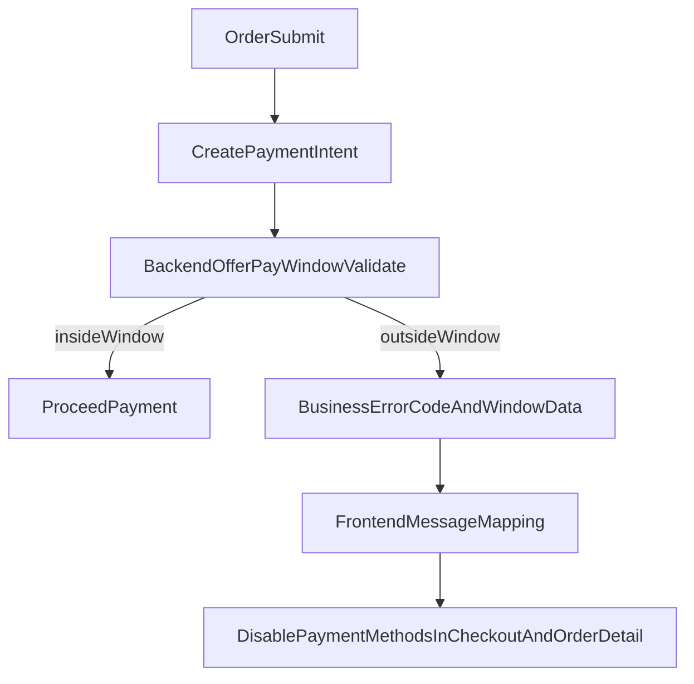

# 统一团购付款时间窗改造计划

## 目标规则（按你确认）
- 团购付款窗口统一为：`活动开始时间 <= 当前时间 < 截单时间`。
- 删除“活动开始前N小时可付款”配置与业务校验（不再用于付款环节）。
- 后端只返回稳定 business error code + 结构化信息；前端负责用户可读文案。
- 结算页与订单详情页对支付方式可用性保持一致（不可支付时禁用并提示）。
- 覆盖端：`xituan_site` 与 `xituan_wechat_app`；并检查 `xituan_cms` 是否有同源提示/配置需要同步。

## 现状与根因
- 后端支付校验仍使用 `offerManualCaptureMaxAdvanceHours`：
  - [d:\projects\xituan_module\xituan_backend\src\domains\order\services\order-validation.service.ts](d:\projects\xituan_module\xituan_backend\src\domains\order\services\order-validation.service.ts)
  - [d:\projects\xituan_module\xituan_backend\submodules\xituan_codebase\utils\offer-manual-capture-pay-window.util.ts](d:\projects\xituan_module\xituan_backend\submodules\xituan_codebase\utils\offer-manual-capture-pay-window.util.ts)
- 订单详情页展示与禁用逻辑也基于同一“提前N小时窗口”：
  - [d:\projects\xituan_module\xituan_site\src\components\user-order-detail\OrderDetailClient.tsx](d:\projects\xituan_module\xituan_site\src\components\user-order-detail\OrderDetailClient.tsx)
  - [d:\projects\xituan_module\xituan_site\messages\zh_cn.json](d:\projects\xituan_module\xituan_site\messages\zh_cn.json)
- 结算页目前未对团购付款窗做前置禁用/提示，最终在 `/api/payment_intents/create` 才失败：
  - [d:\projects\xituan_module\xituan_site\src\app\[locale]\(consumer)\checkout\[mode]\CheckoutModeClient.tsx](d:\projects\xituan_module\xituan_site\src\app\[locale]\(consumer)\checkout\[mode]\CheckoutModeClient.tsx)
- WeChat 端订单详情已存在部分禁用逻辑，但仍与新规则（开始到截单）不一致，且结算链路需同步：
  - [d:\projects\xituan_module\xituan_wechat_app\pages\order-detail\offer\offer.ts](d:\projects\xituan_module\xituan_wechat_app\pages\order-detail\offer\offer.ts)
  - [d:\projects\xituan_module\xituan_wechat_app\pages\order-detail\offer\offer.wxml](d:\projects\xituan_module\xituan_wechat_app\pages\order-detail\offer\offer.wxml)
  - [d:\projects\xituan_module\xituan_wechat_app\pages\payment\payment.ts](d:\projects\xituan_module\xituan_wechat_app\pages\payment\payment.ts)
- “付款截止时间”文案来自通用 pending 过期计算，会与团购活动付款窗冲突：
  - [d:\projects\xituan_module\xituan_site\src\utils\order-pay-expiry-display.util.ts](d:\projects\xituan_module\xituan_site\src\utils\order-pay-expiry-display.util.ts)

## 实施方案

- 后端规则统一
  - 在 `OrderValidationService.validateOfferForPayment` 中改为基于 `offer.startDate` 与 `offer.endDate`（截单）判断，不再读取 `offerManualCaptureMaxAdvanceHours`。
  - 将过期外的两种场景拆分为明确错误码（建议优先复用已有）：
    - 未到付款开始：`ACTIVITY_PAYMENT_NOT_STARTED`
    - 已超过付款结束：`ACTIVITY_PAYMENT_ENDED`
  - 错误响应保留机器可读字段（如 `startDate`, `endDate`, `now`）放在 `errorData`，避免后端硬编码面向终端用户措辞。

- 前端错误处理与文案职责
  - 在 site 支付流程中，按业务错误码映射文案（不直接透传后端 details）。
  - 在 WeChat 支付流程中，同步按业务错误码映射文案，避免仅依赖后端 `details`。
  - 团购相关提示统一引用活动开始/截单时间，不再出现“开团前N小时”字样。

- 订单详情页一致性修复
  - 去除 `offerManualCapturePayWindowUtil` 依赖，改为新时间窗判断（开始到截单）。
  - 当不在可付款窗口时，继续禁用支付方式选择；提示文案改为“活动开始后至截单前可付款（本地时区显示）”。
  - 调整“付款截止时间”展示策略：团购订单优先展示活动付款窗截止（截单），避免与通用 `pendingPayExpMinutes_offer` 产生冲突。

- 结算页一致性修复
  - 在 `CheckoutModeClient`（offer 模式）增加同款窗口判断与禁用逻辑。
  - 不在窗口时：
    - 禁用支付方式交互或提交按钮中的支付相关动作。
    - 显示与订单详情同一套提示文案。
  - 这样可在提交订单/发起支付前就给出清晰反馈，减少 400 失败。

- WeChat 端一致性修复
  - 订单详情页（offer）改为使用新付款时间窗判断，禁用支付方式与提示文案与 site 对齐。
  - 结算/支付发起链路在用户操作前给出可支付状态提示，避免在 create payment intent 后才暴露错误。
  - 统一处理 `ACTIVITY_PAYMENT_NOT_STARTED` / `ACTIVITY_PAYMENT_ENDED` 的前端提示与跳转策略。

- CMS 与后端协同检查
  - 核查 CMS 活动展示字段（开放时间/截单时间）与支付窗口规则描述是否一致，避免运营后台与消费者端认知冲突。
  - 若 CMS 有支付相关提示或审核逻辑依赖旧窗口规则，补充最小改动保持一致。

- 配置与兼容收尾
  - 清理前端/后端对 `offerManualCaptureMaxAdvanceHours` 的付款用途（保留该字段仅在其它仍需场景时使用；若无用途再评估移除）。
  - 确保 `regular/preorder` 支付流程不受影响。

## 验证清单
- 团购订单在“活动开始前”提交支付：
  - 后端返回 `ACTIVITY_PAYMENT_NOT_STARTED`。
  - 结算页与订单详情都禁用支付方式并显示一致提示。
- 团购订单在“活动开始后且截单前”支付：可正常支付。
- 团购订单在“截单后”支付：
  - 后端返回 `ACTIVITY_PAYMENT_ENDED`。
  - 前端提示一致。
- 团购订单详情中“付款截止时间”与活动时间一致，不再与“24小时/30分钟”等通用文案冲突。
- WeChat 端在相同场景下也给出一致禁用与提示，且不再出现“开始前N小时”逻辑痕迹。
- 非团购（regular/preorder）回归验证通过。