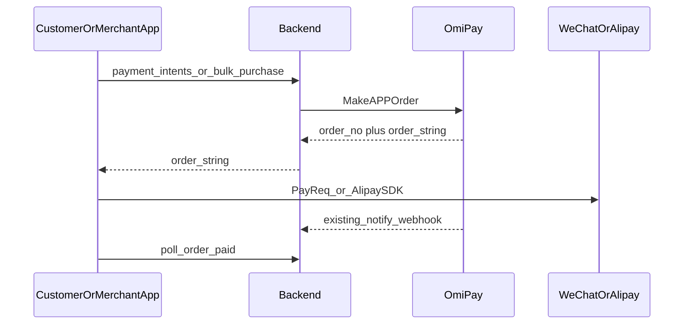

# OmiPay APP 支付集成（当前评审）

## 结论

**可以开始写支付集成代码。** 产品与接口约定已定；登录/分享已落地。剩余是支付专用后端 + 原生唤起 + 结算接线，以及开通侧（不挡编码，挡真机付通）。

## 现状对照

| 项 | 状态 |
|----|------|
| 顾客/商户 App，iOS + Android | 已就绪 |
| 包名 `au.com.xituan.customer` / `au.com.xituan.merchant` | 已锁定 |
| 微信开放平台移动应用 AppId（顾客一个、商户一个；Android/iOS 同应用） | 已申请；本地 `.env.development` 已填 |
| `WECHAT_*_APP_ID/SECRET` → deploy.yml / deploy-demo.yml | 已注入；GitHub Secrets 需与本地一致 |
| OmiPay `order_string` 格式与服务端下单 | 2026-09-30 已确认 |
| 微信登录（`sns/oauth2` + AppSecret） | 顾客/商户已用 `expo-native-wechat` + backend config |
| 分享好友 / 朋友圈 | 顾客已接（[storefront-share.util.ts](xituan_app_customer/src/utils/storefront-share.util.ts)） |
| `MakeAPPOrder` / App 支付 client | **未做** |
| 结算展示微信/支付宝 | 顾客 checkout 仍故意隐藏（`CHECKOUT_VISIBLE_METHODS`） |
| 商户 App 套餐预付款原生支付 | **未做**（CMS 仍是平台账户微信二维码） |

## 已确认的业务约定（不变）

- **两套收款**：顾客订单 → 店铺 OmiPay 子账户；商户套餐/预付款 → 平台 `OMI_M_NUMBER` / `OMI_KEY`。商户后台子账户配置只服务顾客收款。
- **微信支付只走 OmiPay** `MakeAPPOrder`，不接微信商户平台直连；开放平台 AppId 只用于调起；AppSecret 只用于登录。
- **支付宝**：不下开放平台应用；不传 `app_id`。`platform=ALIPAYONLINE`。报备按**收款账户**（每个收款子商户一次 + 平台账户一次），材料主要是网站或 App **下载链接**，可全平台共用；店铺一般不用再交支付宝 PID/开放平台资料。
- **密钥不进 App**：服务端下单，客户端只消费 `order_string`。不用 OmiPay 的 `payByWechat` / `payByAlipay`（会把商户密钥放进客户端）。

## OmiPay `order_string`（实现依据）

- **微信**：JSON 字符串 → `partnerId`、`prepayId`、`package`=`Sign=WXPay`、`nonceStr`、`timeStamp`、`sign`。无 `appId`，调起时补当前 App 的微信 AppId。Android `package` → `PayReq.packageValue`。安卓与 iOS 同格式。
- **支付宝**：已签名查询串，原样交给 Android `PayTask.pay` / iOS `payOrder`。

## 实现顺序（建议）

1. **后端** [omipay-platform-payment.service.ts](xituan_backend/src/domains/payment/services/omipay-platform-payment.service.ts)  
   - 新增 `MakeAPPOrder`（`/omipay/api/v2/MakeAPPOrder`）。  
   - 微信 `app_id`：`WECHAT_CUSTOMER_APP_ID` 或 `WECHAT_MERCHANT_APP_ID`（按调用来源）。支付宝不传。  
   - [psp-router](xituan_backend/src/domains/payment/services/psp-router.service.ts) / `createPaymentIntent`：增加 App client（如 `customer_app`），微信/支付宝走 APP 订单，不要 openid、不要 site 二维码。  
   - 商户套餐：`OmipayOneTimeAdapter` 在 App 路径改调 `MakeAPPOrder`（平台凭证），CMS 二维码路径可保留。  
   - mock 补 `MakeAPPOrder`。

2. **原生唤起**（复用已有 `expo-native-wechat`，勿再装第二套微信 SDK）  
   - 微信：解析 JSON → `PayReq` + 本 App AppId。  
   - 支付宝：按 OmiPay 说明指定的 aar/SDK，订单串原样唤起。  
   - Android：`WXPayEntryActivity`（已有登录/分享相关配置则对齐）、支付宝 H5 Activity。  
   - iOS：Universal Link / 回跳 scheme 与现有微信登录配置对齐。

3. **产品入口**  
   - 顾客：[checkout.util.ts](xituan_app_customer/src/utils/checkout.util.ts) 放开 `WECHAT`/`ALIPAY`（商户已开独立 OmiPay 时），建单后 `payment_intents/create`。  
   - 商户：套餐/预付款页接 `bulk-purchase` → 拿 `order_string` → 唤起；不读店铺子账户密钥。

4. **开通（与编码并行）**  
   - 持正式 AppId 请 OmiPay 开通 `MakeAPPOrder`（微信 + `ALIPAYONLINE`，AUD）。  
   - 支付宝报备：统一下载链接 + 已有收款子商户列表 + 平台账户一次。开通前再问一句是否还需营业名称/ABN 等。  
   - 确认 GitHub repo + demo Environment Secrets 已填四个微信变量。

5. **文档**  
   - 更新上架清单 0.5，去掉过时表述（占位 AppId、仅 Android、密钥进 App 的 SDK 示例）。

## 明确不做 / 已不在本期

- 微信商户平台直连 APP 支付。  
- 把子商户 OmiPay 密钥放进安装包。  
- 重做微信登录/分享（已存在；支付只扩展唤起能力）。  
- 商户向平台付款时再给「付钱的商户」各做一次支付宝报备。

## 真机付通门槛

编码可先用 mock / 沙盒。成功付一笔真钱前需要：OmiPay 已开通 APP 订单、支付宝报备完成、微信开放平台包名/签名/iOS Universal Link 与安装包一致。
