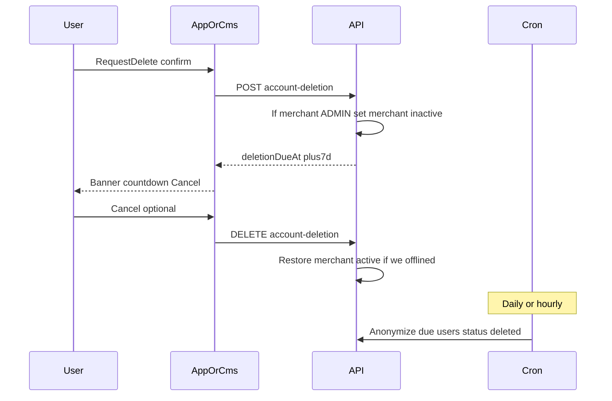

# 账号自助删除（7 天可取消）+ IAP 台账

Cursor plan（planned）：`d:/projects/xituan_module/.cursor/plans_planned/account_deletion_7d_f12810cb.plan.md`  
台账：`account-deletion-self-serve`；IAP 恢复：`merchant-ios-iap-pay-restore`。

## 已拍板

| 项 | 决定 |
|----|------|
| 范围 **A** | **两端 App + 网页**：同一套 API；顾客「我的」顶栏；商户首页顶栏；**CMS** [`dashboard.tsx`](xituan_cms/src/pages/dashboard.tsx) 顶栏；网站 `/delete-account` 改为登录后自助发起（不再唯一依赖邮件） |
| 用户数据 **B** | 到期匿名化用户 PII；订单/发票等依法保留；解除成员绑定 |
| 商户主体 | **只** `status → inactive` 关运营（ADMIN 发起时）；**不删内容**（商品/活动/设置/图/门店/订单等全部保留）。**不用** `suspended`。与 Platform「商户管理」状态开关同一字段 |
| 角色 | **ADMIN**：可删自己 + 确认后商店下线；**普通成员**（manager/producer/delivery）：只能删自己账号信息，**不**改商户 status |
| 用户 status | **扩展枚举** `epUserStatus`：新增 `deleted`（与未验证邮箱用的 `inactive` 分开） |
| 宽限期 | **7 天**；期间可登录；顶栏倒计时 + **取消删除**；到期 cron **匿名化** |
| iOS PassKit | 构建去掉商户 iOS Stripe/Apple Pay 链入；Resolution Center 说明；恢复见 planned `merchant-ios-iap-pay-restore`（**mid**） |

## 审核会不会挂 7 天？

**基本不会。** App Review 验的是：App 内能发起删除、非邮件客服唯一路径、文案透明。他们不会把 Submission 挂满 7 天等 cron 跑完。

风险不在「写 7 天」，而在：点了只是 mailto、或待删除无任何 UI 提示。建议 UI 写「将于 YYYY-MM-DD 彻底删除（约 7 天内），此前可取消」；Review Notes 可写 initiate → pending banner → cancel。无需为过审改成「立即物理删除」。

## 到期匿名化什么（B1）

**匿名 / 清除（platform.users 及附属）**

- `username` / `email` / `pending_email` / `phone` / `nickname` / `avatar_url` → 不可逆占位（保证 unique 约束）
- `password_hash` 清空；微信/Google/Apple 等外部 ID 全部清空
- `user_addresses` / `user_contacts` 删除或清空 PII
- 全部 `user_sessions` 删除；`user_device_push_tokens` 删除
- OpenIM：解绑/停用该用户侧标识（按现有 OpenIM 管理能力；实现时对齐现网）
- **`status → deleted`**（扩展 `epUserStatus`；PG enum / check 一并迁）
- 保留审计：`anonymized_at`；pending 字段清空或保留历史

**依法保留（不删行、不去掉业务事实）**

- 订单 / 支付 / 发票 / 税务相关；商户主体行与门店；履约副本
- **商户业务内容全部保留**：products / offers / preorder / news / settings / 图 / stores 等 **不删、不洗**
- 本阶段 **不** 批量改历史订单行上的收货人快照

**商户成员与关运营**

- 到期（或见下「时机」）：解除该 `user_id` 在各商户的成员绑定
- 用户在某商户角色为 **`epMerchantRole.ADMIN`**：该商户 **仅** `status → inactive`（关运营；CMS [`MerchantStatusGate`](xituan_cms/src/components/MerchantStatusGate.tsx) / 公网 `merchant.status !== 'active'` 已挡）；**禁止**级联删商户内容
- 用户仅为普通成员：只解绑自己，**不**改 `merchants.status`
- 其他成员账号不受影响；订单账本不删
- Platform「商户管理」编辑状态与此同源；实现时 Select 建议补上 `inactive` / `suspended`（现 UI 多只列 pending/active/rejected，实体注释已含 inactive/suspended）

**关店时机（拍板）**

- **发起删除时**即对 ADMIN 所管商户置 `inactive`（店立刻下线，避免 7 天窗口内仍接单）
- **取消删除**：仅当本次流程把该商户从 `active` 改为 `inactive` 时，恢复为 `active`（原先已是 suspended/inactive 的不动）
- 到期匿名化：不再重复改商户 status（已 inactive）

## 商户 App 确认文案（按角色）

- **ADMIN**：二次确认须明示「将关闭本店运营（inactive），7 天内可取消并恢复营业；到期删除你的账号个人数据」
- **普通成员**：只确认「删除你的账号个人数据；不影响店铺运营」

顾客 App / Site 删号走同一 API：若该用户同时是某店 ADMIN，同样关店（后端按成员角色判定，不按客户端）。

## 数据流

## 实现切片（确认执行后）

### Backend

- Migration `platform.users`：`deletion_requested_at` / `deletion_due_at` / `anonymized_at`（timestamptz）；`epUserStatus` 加 `deleted`；记录因删号下线的 merchantId 列表（用户行 jsonb 或小表，供取消时精确恢复）
- API（登录用户）：`POST` 发起、`DELETE`/`POST cancel` 取消、`GET me` 带回 pending +（可选）affectedMerchants
- 发起时：查 `user_member_merchants`；对每个 `role === admin` 且 `merchant.status === active` 的商户 → `inactive` 并记入恢复清单
- 到期任务：internal cron 匿名化 + `status=deleted` + 解绑成员
- 登录：pending 可登录；`deleted` 不可登录

### Merchant App

- [`MoreScreen`](xituan_app_merchant/src/screens/MoreScreen.tsx)：按当前商户角色分支确认文案 → API
- [`MerchantHomeScreen`](xituan_app_merchant/src/screens/MerchantHomeScreen.tsx) 顶部：倒计时 + 取消

### Customer App

- [`AccountInfoScreen`](xituan_app_customer/src/screens/AccountInfoScreen.tsx)：应用内发起（若 me 返回将关店列表则提示）
- [`ProfileScreen`](xituan_app_customer/src/screens/ProfileScreen.tsx)（我的）最顶部：倒计时 + 取消

### CMS / Site

- CMS [`dashboard.tsx`](xituan_cms/src/pages/dashboard.tsx) 最顶部横幅（ADMIN 删号后进 CMS 会走 MerchantStatusGate / inactive 页，横幅主要服务「仅成员删自己」或取消前窗口）
- [`DeleteAccountContent`](xituan_site/src/components/legal/DeleteAccountContent.tsx)：登录自助；邮件非必经

### iOS 去 PassKit（商户过审）

- iOS 构建不挂 Stripe Apple Pay `merchantIdentifier`（或条件排除 plugin）
- Resolution Center：曾因跨端 SDK；本版已移除；日后 IAP 再加

### Planned-work

- `merchant-ios-iap-pay-restore`，**mid**（见 [`ios_iap_pay_restore`](C:/Users/lance/.cursor/plans/ios_iap_pay_restore_e3b4d099.plan.md)）

## 明确不做

- 不物理 DELETE 商户行；**不删**商户商品/活动/设置等任何业务内容（只 inactive）
- 不删订单账本
- 普通成员删号不关店
- 不以邮件为唯一删号路径
- 不为过审把宽限期改成 0
