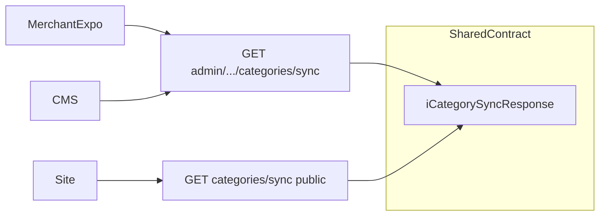
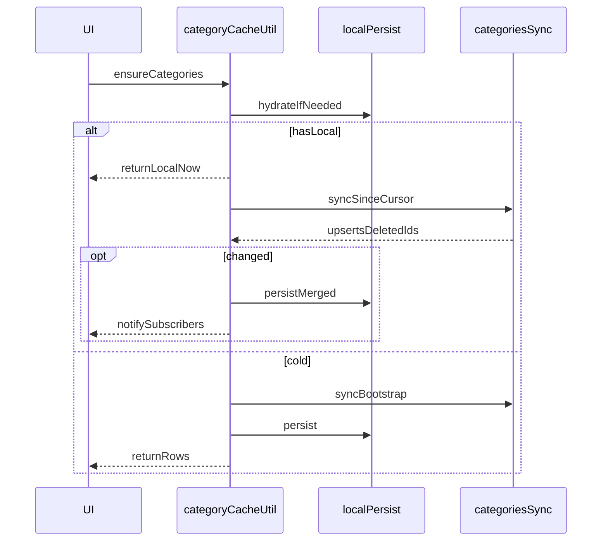

# 统一分类缓存管理器（跨端可复用）

**2026-11-07：** Merchant App Phase1 **已完成**。跨端复用 = planned-work **mid**，主动启动前不排期。

## 软删堆积与 30/45 天对账

会堆积在服务端，直到 **软删超过 45 天** 被 purge（物理删或等价清理）。列表默认不带 deleted。

- Sync：水位内软删行进 `deletedIds` → 客户端立刻摘掉
- 本地：只存非 DELETED；不堆积已删行
- 客户端 **≥30 天未动** 条目：每天最多一次 bootstrap 对账（见下）
- 服务端 **软删 ≥45 天**：purge（**平台手动触发**、全商户扫；有关联数据的行跳过不删）

### 「能不能保证客户端用不到已 purge 的软删分类？」

**冷缓存（≥30 天未动）——基本能。**  
对账时 bootstrap 只返回当前非 DELETED；purge 掉的不会再出现，本地整表替换后自然没有。30 &lt; 45，冷条目通常在 purge 前就已对账过至少一次。

**热缓存（天天用）——仅靠 30 天冷对账不够。**  
若增量 sync 长时间失败/漏跑，软删行在 45 天被 purge 后，增量里既无 upserts 也无 `deletedIds`（墓碑没了），本地可能残留「以为还在」的分类。

**补洞（Phase 1 一并做）：** 当前登录商户若本地 `cursor`/`savedAt` 距今 **≥30 天未成功 bootstrap/全量对齐**，则强制一次 bootstrap（与是否天天 touch 无关）。这样热户也不会无限期只靠增量。

有了「冷条目 30 天对账 + 热户 cursor 30 天强制 bootstrap + 服务端 45 天 purge」：客户端不会长期依赖「服务器已不存在的软删行」。仍接受：软删后到下次成功 sync 前的短暂最终一致窗口。

改名会 bump `updated_at` → upserts → 本地按 id 覆盖全语言 name。

## 跨端适用性（结论：可以，分面）

同一套「本地先用 + sync 水位 + upserts/deletedIds」适用于所有读分类树的客户端；**HTTP 面要分两条**（鉴权与可见范围不同）：

| 客户端 | 现有入口 | 应用 sync 的面 |
|--------|----------|----------------|
| Merchant Expo | `/api/admin/products/categories` | **Admin sync**（本次落地） |
| CMS 网页 | 同上 `categoryApi.getCategories` | **同一 Admin sync**（后续迁） |
| 微信商家面板 | panel `product-categories` → 同 controller list | **同一 Admin sync** 或 panel 代理（后续） |
| Site 网页 | 公开 `GET /api/categories`（activeOnly） | **Public sync**（后续；仅 active + 软删墓碑） |
| Customer App | 目前无独立分类列表拉取 | 若以后要离线/筛选，复用 Public sync |

原则：

- 响应形状进 **xituan_codebase**（如 `iCategorySyncResponse`），各端共用
- Admin sync：非 DELETED 全量进 upserts（含 inactive），全语言 jsonb，**不**做 Accept-Language 裁剪
- Public sync：默认只 sync active；deletedIds 仍要（下架/软删后 Site 缓存能摘掉）
- 各端自己的 cache util（RN AsyncStorage / CMS memory+localStorage / Site 视场景），**逻辑同构**

## 数据流（各端同构）

## Phase 1（已确认：先商家 App）

范围锁定：**Admin sync API + 平台手动 purge + 商家 App 缓存与调用点**；CMS/Site/微信/customer 仍 Phase 2。

### Backend admin sync（additive）

`GET /api/admin/products/categories/sync`

- Query: `since` (ISO), `sinceId` (uuid)
- 无 since：bootstrap — upserts = 商户全部非 DELETED；deletedIds 空
- 有 since：`(updated_at, id) > (since, sinceId)`；非 DELETED → upserts；DELETED → deletedIds
- 响应：`serverTime`, `cursor { updatedAt, id }`, `upserts`, `deletedIds`
- 落点：`product.repository.ts` / `product.service.ts` / `product.controller.ts` + `admin-product.routes.ts`
- Sync **不要**走 `processCategoryMultilingualData`
- codebase：新增 sync 响应 type，供 CMS/App 共用
- **软删 ≥45 天 purge**：平台侧 **手动触发** API/运维入口，扫 **全商户**；`status=DELETED` 且 `updated_at`（或软删时间）≥45 天；**仍有关联（如产品挂靠等）则跳过不删**；与客户端 30 天强制 bootstrap 配合

### Merchant App 分类缓存（原称「Expo 管理器」）

即商家 App（`xituan_app_merchant`）里的本地分类缓存模块，不是 Expo 框架本身的功能。文件：`merchant-category-cache.util.ts`（`merchantCategoryCacheUtil`）——负责磁盘多商户缓存、ensure/peek、增量 sync、30 天对账。

- 磁盘：`merchant.categoryCache.v1` 为 **多商户 map**（key = merchantId → `{ cursor, items, touchedAt, savedAt }`）
  - 读：按当前登录 `merchantId` 取条目；切户不删其它户缓存；命中时刷新该户 `touchedAt`
  - 写：更新当前户条目；**最多保留最近 100 家**（按 `touchedAt` LRU），超出淘汰最久未用
  - 单户 envelope 含全语言 `items` + sync `cursor`
- **30 天对账 / 强制全量**（每天最多一次，全局 `lastReconcileAt`）：
  - 扫描 map 中 `touchedAt` **≥ 30 天未动**的商户 → bootstrap 整表替换
  - 另：当前商户若距上次成功 bootstrap **≥ 30 天** → 强制 bootstrap（防热户漏 `deletedIds`）
  - 服务器已 purge 的行不再返回 → 本地消失；仍在的用服务器数据覆盖
  - 失败保留本地；成功更新 cursor/`savedAt`/`lastBootstrapAt`
  - 触发：hydrate 或首次 `ensure`，且距 `lastReconcileAt` ≥ 24h
- `hydrateFromDisk` / `peek` / `ensure` / `subscribe` / `applyLocalWrite`
- `activeOnly` 本地 filter
- `merchant-category.api.ts` → `syncCategories`
- `merchant-more-list-prefetch` 的 `categories` 委托本管理器

调用点：ProductBarcodes / MetadataMigrations / CategoriesList / CategoryEdit / CategoryBatchMigrate；写成功后 applyLocalWrite 或 invalidate。

## Phase 2+（计划登记，本次不写业务代码）

- CMS：`categoryApi.sync` + 轻量 cache util，替换各页裸 `getCategories`
- Public：`GET /api/categories/sync`（Site；必要时 customer）
- 微信 panel：改为调 admin sync 或 panel 薄封装
## 明确不做（Phase 1）

Lite / 按需单语言；独立长期 tombstone 表（靠 45 天内软删行 + 30 天强制 bootstrap）；CMS/Site/customer 业务迁移代码（仅契约可复用）。