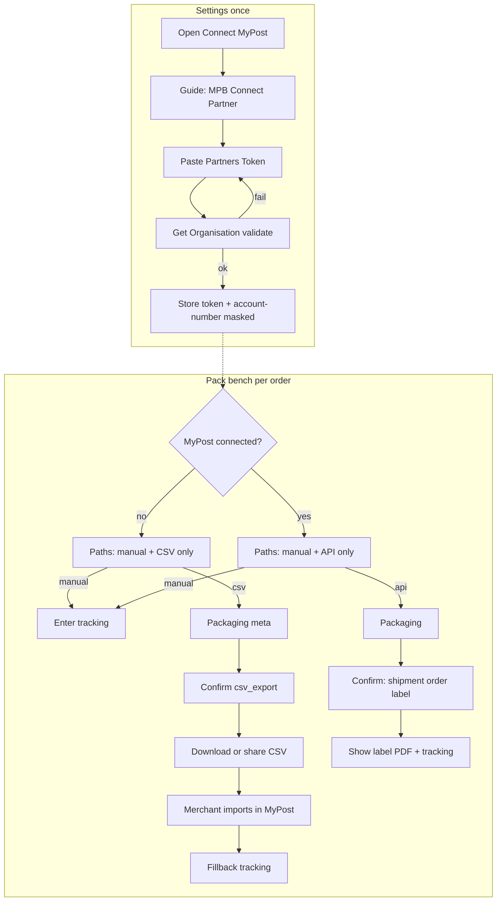
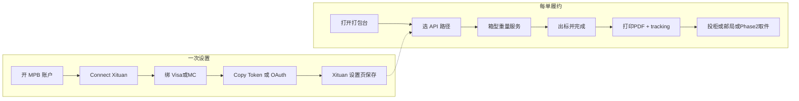
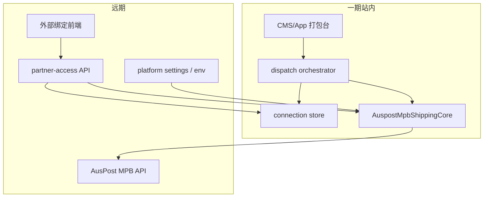

# AusPost 双轨集成：流程 + 界面（CMS / Merchant App 统一）

## 已拍板（可当 todo 执行前提）

- CSV：**未连接时显示；已连接时打包台隐藏**（有 API 不用 CSV）。代码不硬删；微信一期仍 CSV。
- 一期连接：**贴 Partners Token 必做**（testbed + 生产）；**OAuth 也做**，但文档写明 **仅生产可用、testbed 无**，故排在 Production Request / 正式凭证之后。
- 打包台：**未连不渲染 API**（用「去连接」文案引导，不用灰态假入口）；已连不渲染 CSV。
- 扣款：仅 **STORED_PAYMENT（绑卡）**；**Charge Account 暂不做**。
- 一期：国内出标 API + 打包台三路径；**仅 CMS + Merchant App**（微信一期仍 CSV）。
- CMS 连接入口：**独立「配送 / Australia Post」卡片**（与 Integration Key 分开）。
- 一期不做：国际、Charge Account、Pickup 实装、App 管 Chrome Integration Key、微信面板 API。
- Pickup = Phase 2。
- 平台级 Partner ID / API Key 服务端配置；商户级只存 merchant token。
- AusPost 建议：做 OAuth 时仍保留 Dashboard 贴 Token（我们照做）。
- **远期**：可对「非站内入驻」的外部商户开放同一套 AusPost Partner 能力（子账户绑定 + 出标 API）；**一期不单独开服务/不做外部绑定前端**，但核心 API **按可抽离微服务的方向分层**（见「远期兼容」）。
- **Connection 存储**：新建 `merchant` schema 表（加密 token + account-number + subject）；**不要** `HASH(merchant_id)` 50 分区（开发者已确认「这个表不用」）。
- **一期出标粒度：A（MVP）** — 单次 confirm **一个订单**（订单内可多包裹）；**不做 B**。目标：**先过 MPB Tech Sign Off / Production Request**；批量、Pickup、外部门户、OAuth（生产后）等后置。

## Testbed（2026-11，已到手）

MPB Partner Support 已发测试环境。密钥只在邮件和 Postman 集合里，**禁止写入仓库、计划或聊天记录**。本地用 env（例如 `AUSPOST_MPB_ENV=test`），`.env` 不提交。

- Base：`https://digitalapi.auspost.com.au/test/shipping/v1/`
- Partner ID（测试）：`TESTBED-XITUAN-8745`（生产上线后才换 `XITUAN-8745`）
- 平台：API Key + Password → `Authorization: Basic`
- 测试商户：Testbed Merchant Token → `auspost-merchant-token`
- `account-number`：先 `GET /organisations`，后续调用再带

Postman `BYO Trade Flow - Galaxy108` 顺序（一期对齐这条，不做国际/Pickup）：

1. `GET /organisations`
2. `POST /prices/items`（样例 `BE1P10` Parcel、`BE9P10` Express）
3. `POST /shipments`
4. `PUT /orders`（多件合并；`payment_method: STORED_PAYMENT`）
5. `POST /labels`（A4）
6. `GET /track`

生产申请（测完再做，主题必须是 `Production Request`，发给 MPBpartnersupport）：Technical Sign Off、各服务标签 PDF、请求/响应 JSON、工作流、错误处理。初审最多约 5 个工作日。

## 产品决策（沿用）

- **保留 CSV** 至 API 生产验证通过；之后作 fallback，再软弃用。
- **一期不做**：国际、**Charge Account**、**Pickup 实装**。
- **连接**：贴 Token（先）+ OAuth（生产后）；两者最终并存。
- **Pickup：可以做，定为 Phase 2**；一期只保证 API 出标主链路可验收。
- **扣款**：`payment_method: STORED_PAYMENT` only。

## 现状差距（要对齐的基线）

| 能力 | CMS | Merchant App |
|------|-----|--------------|
| 打包台路径 | 手动 / MyPost CSV | 同左 |
| CSV 确认后 | 自动下 batch CSV + MyPost 导入链 | 仅提示去 CMS |
| Partners Token 连接 | 无 | 无 |
| Integration Key（Chrome 扩展） | Settings 有 | 无（可后置） |

关键现有入口：

- CMS 打包台：[DispatchPackBenchModal.tsx](xituan_cms/src/components/shipments/DispatchPackBenchModal.tsx)
- App 打包台：[DispatchPackBenchScreen.tsx](xituan_app_merchant/src/screens/DispatchPackBenchScreen.tsx)
- CMS「集成」Tab 现为扩展 Key：[MerchantIntegrationPanel.tsx](xituan_cms/src/components/settings/MerchantIntegrationPanel.tsx)（**不是** Partners Token）
- 枚举已预留：`epDispatchCreateMode.API`、`epDispatchCarrierCode.AUSPOST` / `AUSPOST_EXPRESS`

---

## 一、流程设计（两端同一状态机）

分两层：**账户连接**（设置，一次）与 **履约出标**（打包台，每单）。



**打包台路径可见性（已拍板）**

| 连接状态 | 显示的路径 | 不显示 |
|----------|------------|--------|
| **未开通 / 未绑定 Token** | 手动 + **AusPost CSV** | **AusPost API**（整项不出现） |
| **已开通绑定** | 手动 + **AusPost API** | **AusPost CSV**（整项不出现；有 API 不用 CSV） |

- 未连接时**不**用灰色禁用 API 再点进去；直接不渲染 API，避免假入口。若需引导：在 CSV 旁或设置入口用文案「连接 MyPost 后可一键出标」链到 Settings（不是第三条 Radio）。
- 已连接后 CSV **对打包台隐藏**（代码与微信路径仍可保留；CMS 批量 CSV / 历史 batch 另议，默认也不再当主路径推销）。
- API 失败时：可读错误（更新卡 / 重连 Token），**不**临时把 CSV 塞回路经选择；商户可断开连接后才会再看到 CSV。

### 1) 连接 MyPost（设置）

商户动作（CMS / App 文案步骤一致）：

1. 打开 **设置 → 配送 / 承运集成 → Australia Post MyPost Business**
2. 看到状态：`未连接` / `已连接（account 掩码）` / `连接异常（需更新 Token 或绑卡）`
3. 按指南：登录 MPB → eCommerce Partners → Connect **Xituan** → 绑 Visa/Mastercard → Copy Token
4. 粘贴 Token → **验证并保存**（后端 `Get Organisation`；写 `auspost-merchant-token` 对应密；缓存 `account-number`）
5. 可 **断开连接**（清凭证，履约回退只能 CSV/手动）

凭证规则：Token **永不回显明文**；仅显示「已连接」+ 最后校验时间；UI 不可复制出完整 Token。

### 2) 打包台履约路径（三选一，两端相同）

| Path key | create_mode | carrier_code | 何时默认选中 |
|----------|-------------|--------------|--------------|
| `manual_entry` | `manual_entry` | 用户选的承运商 | 非 AusPost / 例外 |
| `mypost_api` | `api` | `auspost` 或 `auspost_express`（按包裹服务 PP/EXP 映射） | **已连接 Token 时默认** |
| `mypost_csv` | `csv_export` | `auspost_mypost_business` | 未连接 Token 时 AusPost 默认；或用户显式选 |

包装字段（箱型 / OWN 尺寸 / 重量 / PP·EXP）**API 与 CSV 共用同一表单块**，避免两套 UI。

**API 确认后链路（后端，对商户透明）：**  
`Get Organisation`（可用缓存）→ Create Domestic Shipment → Create Order from Shipments → Create Label → 落 PDF + tracking → 订单状态更新。  
失败：可读错误（绑卡失败、credit block、超时可恢复）；shipment 可 Delete 防 basket 堆积。

**CSV 确认后链路：** 保持现有；App 改为与 CMS 对齐——确认成功即 **下载/系统分享 batch CSV**，并提供「打开 MyPost 导入」外链（App 用 Linking）。

### 3) 已发货 / 运单

- API 路径：确认后通常 **已有 tracking**，浏览页只读 + 打开 AusPost 追踪链接；支持重新拉 label。
- CSV 路径：保持「待回填运单号」+ 手填 / Chrome 扩展（扩展仍仅 CMS 侧配置 Integration Key，App 不做 Key 管理一期）。

---

## 二、商户界面长什么样 + 使用流程（对标伙伴）

原则：**同一文案 key、同一步骤顺序、同一状态名**；CMS 用 Ant Design，App 用 Screen + chip。对标 **Shopify（贴 Token）** + **Starshipit（OAuth Authorise）**；AusPost 官方商户册见 `03-merchant-sender-support/MyPost Business Customer Integration Guide.pdf`。

### 对标：其他伙伴怎么做

| 伙伴 | 连接 | 日常出标 | 可借鉴 |
|------|------|----------|--------|
| **Shopify** | Settings → Shipping → Connect Australia Post → **贴 merchant token**；要求 MPB 已绑支付 | 订单履约里买 label → 打印 → tracking 自动回写；**作废须去 MPB**，Shopify 内不能 void | 设置与履约拆开；贴 Token 文案；作废边界 |
| **Starshipit** | Couriers → MyPost → **Authorise**（OAuth 跳转登录）也可选 token；Load products；选支付方式 | 打 label 即扣款并进 Shipped；**无需 manifest**；多包裹=多票分别计费 | OAuth 主按钮；「打标即收费」提示；服务/箱型加载 |
| **AusPost 官方期望** | MPB：Connect Partner → 接受条款 → **Visa/MC 绑卡** → Copy Token（须用 Copy 按钮，屏上不显示完整 token） | Partner 代下单；未绑卡则全部失败 | 步骤说明照抄官方；强调 Copy Token；断开后旧 token 作废 |

Xituan 合成：**设置一次连接（先贴 Token，生产后加 OAuth）+ 打包台一键出标**；CSV 作未连接/故障旁路（伙伴少有 CSV，我们因存量保留）。

### 使用流程（商户视角）



**一次连接（Settings）**

1. 商户自有 **MyPost Business**（非 eParcel Contract；Shopify 同限制）。
2. MPB → Business details → eCommerce Partners → Connect **Xituan** → 条款 → **绑 Visa/Mastercard** → Copy Token。
3. Xituan：设置 → 配送 / Australia Post → 粘贴 → 验证保存。  
   生产后多一按钮「用 MyPost 授权登录」（OAuth），成功后同样落到 Connected。
4. 状态：`未连接` / `已连接（account ••••）` / `需处理`（token 失效、校验失败）。

**每日履约（打包台，[`DispatchPackBenchModal`](xituan_cms/src/components/shipments/DispatchPackBenchModal.tsx)）**

1. 打开打包台 — 顶部路径**按连接态只显示两条 AusPost 相关之一**：
   - 未连：`手动` | `AusPost CSV`（无 API）
   - 已连：`手动` | `AusPost API`（无 CSV；默认 API）
2. 勾线拆包裹 → 箱型/重量/PP·EXP（API 与 CSV **共用**包装表单组件，只是不同时出现两条路径）。
3. API：`出标并完成` → shipment→order→label → PDF + tracking。  
   CSV（仅未连）：确认 → 下载/分享 → MyPost 导入 → 回填 tracking。
4. 实物投递；Pickup = Phase 2。

### 界面草图（信息架构，非像素稿）

**Settings 卡片（CMS / App 同构）**

```
┌ Australia Post · MyPost Business ─────────────┐
│ 状态: 已连接 · account ••••a1b2 · 校验 今天    │
│ [用 MyPost 授权连接]  ← 仅生产；testbed 隐藏   │
│ 或 粘贴 Partners Token  [••••••••] [验证保存]  │
│ [更新 Token]  [断开连接]                       │
│ ▸ 如何获取 Token（折叠：官方 5 步 + 外链）      │
│ 提示: 须在 MPB 绑 Visa/Mastercard；断开后旧    │
│       Token 立即失效，需重新 Copy。            │
└────────────────────────────────────────────────┘
  （旁边另卡：Chrome Integration Key — 名称完全不同）
```

**打包台 — 未连接（无 API）**

```
┌ 打包台 · 订单 #1234 ──────────────────────────┐
│ ( ) 手动录入运单                               │
│ (•) Australia Post — CSV                       │
│  提示: 连接 MyPost 后可一键出标 → [去连接]     │
└────────────────────────────────────────────────┘
```

**打包台 — 已连接（无 CSV）**

```
┌ 打包台 · 订单 #1234 ──────────────────────────┐
│ ( ) 手动录入运单                               │
│ (•) Australia Post — API   ← 默认               │
│ 发货门店 / 箱型 / 服务 / 重量 …                 │
│ [出标并完成]                                    │
└────────────────────────────────────────────────┘
成功: PDF + tracking；扣款在 MPB；作废请去 MPB
```

### 使用因素与注意事项（产品/文案必须覆盖）

**连接与支付**

- 商户必须自有 MPB；**未绑卡则 Partner 代下单全部失败**（官方原文）；仅 Visa/Mastercard。
- Token 屏上不完整 → 文案强调 **用 Copy Token**，勿手抄截断。
- MPB 侧 Disconnect → 旧 token **永久失效**；Xituan 须提示「到 MPB 断开后请回来更新/重连」。
- 换卡：在 **MPB Payment methods** 操作，不在 Xituan 存卡号。
- OAuth **仅生产**；testbed/开发只能贴 Token（含 testbed merchant token）。

**出标与扣款（对齐 Starshipit FAQ）**

- **打标/建 order 即收费**（卡扣）；批量会合并或分笔以邮局为准；UI 避免「先预览再决定不付钱」的错觉（若 API 支持先 quote：`prices/items` 可展示估价，确认后再 order）。
- **无需 manifest**（与旧 eParcel 不同）；成功即可投递。
- **作废/退款**：对标 Shopify — **在 MPB 操作**，一期 Xituan 不做 void；文案写清。
- 多包裹：通常 **每包裹独立 shipment/计费**；拆包 UI 要让商户知道「多包裹=多张标/多笔费」。

**运营与错误**

- credit block / 卡过期 / token 无效 → 状态 `需处理` + 可读指引（去 MPB 更新卡或重连）。
- API 超时：可恢复重试；失败的 shipment 应清理，避免 MPB basket 堆积。
- 地址/重量不合格：确认前校验，错误落在包裹行（BusinessError lineErrors 风格）。
- 国际/Charge Account/Pickup：一期入口不出现，避免点到空功能。

**合规与品牌**

- 设置/帮助链到 AusPost 商户指南；Logo 用 `04-brand-guidelines` 合同锁图，勿自制假官方标。
- Token **永不回显明文**；日志不打完整 token。

### A. 设置实现要点

- CMS：独立「配送 / Australia Post」卡片，与 `MerchantIntegrationPanel` 分开。
- App：More/Settings 同名入口；Secure TextInput。
- 状态：`Not connected` / `Connected` / `Needs attention`。

### B. 打包台路径（按连接态互斥）

| 连接 | 可见 Path | 默认 |
|------|-----------|------|
| 未连 | `manual_entry` + `mypost_csv` | AusPost 场景默认 CSV |
| 已连 | `manual_entry` + `mypost_api` | 默认 API；**不渲染 CSV** |

确认文案：API=`出标并完成`；CSV=`确认并导出 CSV`；Manual=现有。  
未连不渲染 API（不用灰态假入口）；用短链「去连接」引导设置。

### C. 成功态

| 路径 | CMS | App |
|------|-----|-----|
| API | PDF + 打印/下载 + tracking | PDF 查看/分享 + tracking |
| CSV | 下载 + MyPost 导入 | 分享 CSV + 导入外链 |
| Manual | 关面板 | 返回 |

### D. 不做 / 后置 UI

- OAuth：生产后做；testbed 隐藏
- 打包台内嵌完整 MPB 登录、站内 void、Charge Account、国际、Pickup（Phase 2）、App 管 Chrome Key

---

## Pickup 是否值得做（Phase 2）

**值得考虑，但不要进一期 Tech Sign Off 范围。**

| 维度 | 判断 |
|------|------|
| 商户价值 | 烘焙等本地商户常有「不想自己投柜/跑邮局」；API 出标后下一步自然需求就是上门取件 |
| 技术量 | 相对国内出标主链路约 +25%～40%：可服务性、产品可用性、Create Pickups、Create Orders from Pickups、数量上限规则 |
| AusPost 规则 | 每单最多 1 个 pickup product；每票 pickup 有 shipment 数量上限；需单独报价/校验 |
| 验收 | Sign Off 表有 Pickup 勾选项；一期可不勾；Phase 2 再补 payload + walkthrough |
| CSV | CSV 路径**没有**对等的站内预约；Pickup 基本是 **API 路径专属增值** |

### Phase 2 流程（CMS / App 同构）

仅在打包台路径 = `mypost_api` 且 Token 已连接时出现：

1. 出标成功后（或确认前可选）勾选 **Request pickup**
2. 填：取件地址（默认发货门店）、日期/时段、预估包裹数
3. 后端：Suburb serviceability → product availability → Get Pickup Price（可选展示）→ Create Pickup → 与 shipments 关联下单
4. 成功态展示：取件单号 / 预约时间；失败可读错误（不可服务邮区等）

界面：确认成功态增加「预约取件」次要按钮；或打包台 API 路径底部开关「出标后预约取件」。两端同一文案 key。

### 一期预留（零业务逻辑）

- 成功态/设置里**不**放假入口；避免商户点到空功能。
- 数据模型 / dispatch labelMeta 预留 `pickup` 字段位即可，不写死 UI。

---

## 三、CMS 与 App 统一检查清单

必须一致：

- 三路径语义与 `create_mode` / `carrier_code` 映射
- 连接状态来源（同一 merchant 凭证 API）
- Packaging 字段与校验错误码 i18n
- API/CSV 成功后「下一步」文案（出标 vs 去 MyPost 导入）

允许端差异：

- CMS：多订单 batch 打包、活动列表批量 CSV、Integration Key
- App：单订单为主；CSV 用系统分享代替浏览器下载
- 控件：Radio vs Chip、Modal vs Screen

---

## 四、后端支撑（界面依赖的最小契约）

- `GET/PUT/DELETE` 商户 MyPost 连接（存加密 token；`validate` 调 Get Organisation）
- `confirm` 支持 `create_mode=api`（替换 stub）
- Header（以 Postman 为准，小写）：`auspost-partner-id` + `auspost-merchant-token` + `account-number` + Basic auth。
- **平台级 backend env 命名**（对齐 `DOORDASH_*` / `GOPEOPLE_*`，只写 `.env.*`，不进 git）：

```env
AUSPOST_MPB_BASE_URL=https://digitalapi.auspost.com.au/test/shipping/v1
AUSPOST_MPB_PARTNER_ID=TESTBED-XITUAN-8745
AUSPOST_MPB_API_KEY=
AUSPOST_MPB_API_KEY_PASSWORD=
# 仅本地冒烟；生产商户 token 存 DB，不放 env
AUSPOST_MPB_TEST_MERCHANT_TOKEN=
```

生产切环境时：`BASE_URL` 去掉 `/test`，`PARTNER_ID` 改为 `XITUAN-8745`，换正式 API Key/Password。`account-number` 运行时从 `GET /organisations` 取，不设 env。
- Label 产物落存储并可对 CMS/App 返回 URL
- CSV 路径行为保持；App batch export/share 与 CMS `exportBatchCsv` 对齐

### 远期兼容：外部商户 Partner API / 可抽微服务（一期只约束设计，不交付）

目标形态（以后）：像其他「纯 AusPost 集成开放商」一样——外部商户不入驻 Xituan 店，也能绑定 MPB 子账户，调用你们以 **Galaxy108 Partner ID** 为底座的出标 API；前端绑定页另做；运行时可仍挂在现 backend，或抽成以 **platform settings + backend** 为配置源的独立服务。



**一期必须遵守的分层（兼容以后单开）**

| 层 | 职责 | 禁止 |
|----|------|------|
| **A. `AuspostMpbShippingCore`（纯客户端）** | 只吃：平台凭证 + merchant token + account-number；封装 organisations / prices / shipments / orders / labels / track / oauth token 交换 | 禁止 import 订单、CMS、微信、打包台 UI；禁止写死「必须是 merchant 表某行」 |
| **B. Connection 账户** | 抽象「谁绑定了 MPB」：`subject_type` + `subject_id`（一期只用 `merchant`；预留 `external_partner`）+ 加密 token + account-number + status + validated_at | 禁止把 token 只塞进无法复用的 CMS-only blob 且无抽象读取口 |
| **C. 应用编排（站内）** | orchestrator / pack bench：订单→包裹→调 Core→写 shipment/tracking | 出标业务规则可留这层；Core 不感知 Xituan order |
| **D. 平台配置** | Partner ID / API Key / Base URL：一期 env；字段命名稳定，远期可迁 `platform_settings`（或微服务读同一配置源） | 禁止把平台 Key 写进商户库或前端 |

**一期主动不做**

- 外部商户注册 / API Key 发放 / 独立绑定站
- 单独部署的 AusPost 微服务进程
- 对外公开的 partner-access 出标路由

**远期开口（实现时预留，不写死 UI）**

- Connection：`subject_type = merchant | external_partner`（或等价枚举）；查询一律 `getConnection(subject)`，站内 confirm 只传 merchant subject。
- HTTP：站内继续 admin/merchant 路由；远期加 **partner-access** 组（对齐现有 api-route-groups），请求带外部凭证，内部仍调同一 Core。
- 抽服务时：Core + Connection + 平台配置 = 可搬边界；orchestrator 留在主站或变 thin BFF。
- OAuth `redirect_uri` / client 登记按「产品面」可多回调（CMS、App、未来外部门户），不要写死单一 CMS URL 在 Core 内。

**与当前 stub/adapter 的关系**

- 现有 [`iDispatchCarrierAdapter`](xituan_backend/src/domains/dispatch/ports/dispatch-carrier-adapter.port.ts) 继续做站内 dispatch 适配；**AusPost 真 HTTP 放在 Core**，adapter 只做参数映射与结果回写，避免以后抽服务时把整棵 dispatch 树拖走。

### Skill 交付（执行计划时先落地，后写业务代码）

**路径**：[`xituan_module/.cursor/skills/auspost-mpb-api-service/SKILL.md`](d:/projects/xituan_module/.cursor/skills/auspost-mpb-api-service/SKILL.md)  
**触发**：实现/评审/重构任何 MyPost Business（MPB）连接、出标、OAuth、凭证、partner-access 出标；站内打包台 API 与远期外部 Partner API **同一标准**。  
**权威**：本 skill 优先于临时聊天习惯；与本 plan「远期兼容」冲突时以 skill + 本 plan 已拍板条款为准。

**Skill 正文要点（落地时写入 SKILL.md，勿稀释）**

```markdown
---
name: auspost-mpb-api-service
description: >-
  AusPost MyPost Business (MPB) Partner API service standard for Xituan:
  extractable ShippingCore, subject-based connections, platform vs merchant
  credentials. Use when implementing or reviewing MPB connect, labels,
  OAuth, env/platform settings, dispatch API adapters, or future external
  partner-access shipping APIs—in-app or stand-alone service.
---

# AusPost MPB API Service Standard

## Goal

MPB 能力以「Partner 平台出标服务」建模，**不**以「仅 CMS 入驻商户打包台习惯」建模。
站内履约与远期外部商户 API 共用同一 Core，降低拆成独立服务端的成本。

## Mandatory layers

1. **AuspostMpbShippingCore** — HTTP only: platform creds + merchant token +
   account-number; organisations / prices / shipments / orders / labels /
   track / oauth token exchange. No orders, CMS, WeChat, pack-bench UI,
   merchant table FK assumptions.
2. **Connection store** — subject_type + subject_id (merchant | external_partner),
   encrypted token, account-number, status, validated_at. Access via
   get/put/deleteConnection(subject). Never CMS-only blob without this port.
3. **App orchestration** — dispatch orchestrator / pack bench / future
   partner-access BFF maps domain DTOs → Core. UI path rules (CSV vs API
   visibility) live here only.
4. **Platform config** — PARTNER_ID / API_KEY / BASE_URL via env (stable names);
   later platform_settings or microservice config. Never ship platform secrets
   to clients or merchant DB.

## Hard rules

- Do not put AusPost HTTP inside DispatchPackBenchModal or WeChat-only helpers.
- iDispatchCarrierAdapter may wrap Core; must not become the only place with
  MPB protocol knowledge.
- STORED_PAYMENT for phase-1 orders; Charge Account out unless product reopens.
- OAuth production-only; testbed uses paste token; keep paste token always.
- Token never returned plaintext on GET; logs redact full token.
- External portal / separate deploy is out of scope until scheduled; still do
  not add coupling that blocks extraction.

## Checklist before merge

- [ ] New MPB call lives in Core (or thin client used only by Core)
- [ ] Connection keyed by subject, not hard-coded merchant settings path only
- [ ] Pack-bench / CSV visibility changes do not alter Core signatures
- [ ] Platform env names unchanged or documented migration
- [ ] No order/CMS imports in Core module
```

执行顺序：先写 skill → 再 settings-connect / Core 代码，避免实现漂移。

### 一期粒度 A vs 后置 B（已拍板 A）

| | A（一期） | B（后置） |
|--|----------|----------|
| 含义 | 打包台一次 confirm **一个** Xituan 订单；其内可多包裹 → 多 shipment，可按 Postman 合并进一个 MPB order | CMS 一次选中 **多个** 订单，批量出多张标 / 多笔 MPB order |
| AusPost 申请 | **不必另开 Partner 申请**；Partner Agreement + 一次 Production Request 即可 | **也不必另签协议/另开 Partner**；属产品能力扩展 |
| Sign Off | 按 A 交国内出标样本即可 | 若上线 B，建议补交「多订单/多 shipment」walkthrough + JSON/标签样本（可邮件补充，通常无需重新走完整入驻） |
| 技术 | 对齐 organisations → shipments → orders → labels | 循环 A 或批量编排；注意扣款笔数与 idempotency |

**结论：B 不用向 AusPost「单独申请」新资质**；只是后期产品 + 可选补充验收材料。

---

## 五、落地顺序

1. ~~本地 env 写入 testbed，按 Postman 六步冒烟~~ **已完成**
2. **凭证 API + 设置页贴 Token**（当前下一步；testbed 可验）
3. 打包台第三路径 `mypost_api`（未连 token 时引导连接）
4. API confirm 实装（国内 PP/EXP + `STORED_PAYMENT`，对齐 organisations → shipments → orders → labels → track）
5. App CSV 确认后分享 parity
6. 填 Sign Off，邮件主题 `Production Request`（不勾 Pickup / 国际 / Charge Account；OAuth 可在 Sign Off 勾「Via Platform Partner」若当轮已交付，否则先勾 Dashboard 贴 Token）
7. **生产凭证到手后：OAuth 一键连接**（见下）
8. **Phase 2**：Pickup 预约；再补验收

### OAuth（步骤 7，不麻烦但有硬约束）

文档（API Guide §6）：**OAuth only available in production, not in test environment。**

流程（Authorization Code）：

1. CMS/App 跳转  
   `https://auspost.com.au/mypost-business/authorisation/authorize?response_type=code&client_id={platform_client_id}&redirect_uri={ours}&state=...`
2. 商户在 MPB 登录/授权后回跳：`?code=...&state=...`
3. 后端 `POST https://digitalapi.auspost.com.au/mypostbusiness-authorisation/v1/oauth2/token`  
   Body：`grant_type=authorization_code` + `code` + `redirect_uri`；Header：Basic（平台 Client ID/Secret，与 API Key 体系对齐以官网/Support 确认为准）
4. 响应 `token` → 与贴 Token 相同落库路径 → 再 `GET /organisations` 校验

实现要点：

- **必须先有贴 Token**：testbed 验收、以及 AusPost 明确建议 OAuth 平台仍支持 Dashboard 贴 Token
- 回跳 URL：CMS 用站点/settings 回调；App 用 deep link / 通用链接，或先 Web 完成授权再回 App（一期可 CMS 优先，App 跟进）
- `redirect_uri` 需与 AusPost 登记一致；向 MPB Support 确认 `client_id` 与生产 API Key 的对应关系（示例形如 `MY_PLATFORM_2905`）
- 工作量：中小（标准 code 交换 + 设置页按钮）；**阻塞项是生产环境与 client 登记，不是代码量**
- **Charge Account**：订单 `payment_method` 与 Sign Off 均不纳入；保持绑卡 STORED_PAYMENT

### 步骤 2 怎么做（settings-connect）

目标：商户把 MyPost **Partners Token** 贴进 Xituan，后端用 `GET /organisations` 校验并落库；与现有 Chrome **Integration Key**（[`MerchantIntegrationPanel`](xituan_cms/src/components/settings/MerchantIntegrationPanel.tsx)）完全分开。

**后端（先）**

- 新商户级凭证 API（建议挂 admin merchant settings，勿塞进 extension key 路由）：
  - `GET` 连接状态：`connected | not_connected | needs_attention` + account 掩码 + 最后校验时间（**永不回显 token 明文**）
  - `PUT` 保存 token：调 testbed/prod `GET /organisations`（header：`auspost-partner-id` + `auspost-merchant-token` + Basic）；成功则加密存 token、缓存 `account-number`
  - `DELETE` 断开：清凭证
- 平台级仍读 env：`AUSPOST_MPB_BASE_URL` / `PARTNER_ID` / `API_KEY` / `API_KEY_PASSWORD`
- 商户 token 存 DB（加密），**不要**长期依赖 `AUSPOST_MPB_TEST_MERCHANT_TOKEN`（该 env 仅本地冒烟）
- 现有 [`StubApiCarrierAdapter`](xituan_backend/src/domains/dispatch/carriers/stub-api.adapter.ts) 的 `validateConnection` 可在本步换成真校验，或先单独 settings service，打包台 API 路径留到步骤 3–4

**CMS（紧随）**

- Settings 独立卡片「Australia Post / MyPost Business」（与 Integration Tab 的扩展 Key 并立、不同名）
- UI：状态 Tag、粘贴 Token、验证并保存、更新 Token、断开、折叠步骤说明（MPB → Connect Partner → Copy Token）

**Merchant App（同构）**

- More/Settings 同名入口；Secure TextInput 贴 token；同一套状态文案 key

**本步验收**

- 用 testbed merchant token：PUT → 状态变 Connected + account 掩码
- 错 token → needs_attention / 可读错误
- DELETE → 回 not_connected；打包台此时仍只能走 CSV/手动（API 路径步骤 3 再接）

---

## 六、CSV 去留（已拍板：连接态互斥）

**结论：代码保留；打包台按是否开通 MyPost 互斥显示。**

| 场景 | CSV |
|------|-----|
| 商户**未**连接 MyPost | 打包台显示 CSV（+ 手动）；**不显示 API** |
| 商户**已**连接 | 打包台显示 API（+ 手动）；**不显示 CSV**（有 API 不用 CSV） |
| API 调用失败（仍保持连接） | 错误提示去 MPB/重连；**不**自动露出 CSV |
| 微信面板一期 | 仍 CSV（无 API UI） |
| 代码 / 历史 batch | 不硬删；软弃用 Gate 以后再收 |

「App CSV parity」仅服务**未连接**商户的 App 导出体验。Sign Off 验收走 API。
