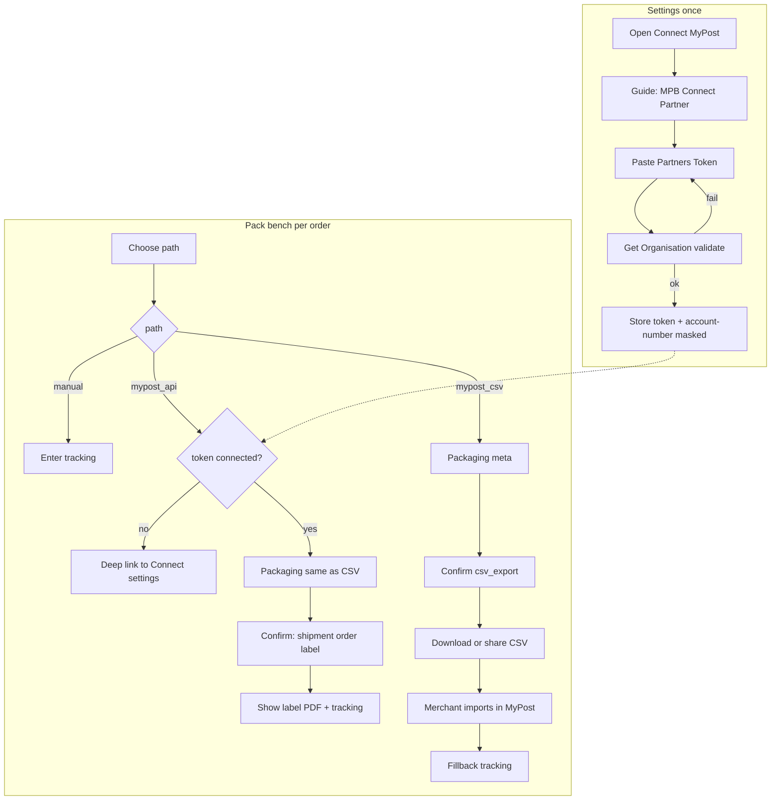

# AusPost 双轨集成：流程 + 界面（CMS / Merchant App 统一）

## 已拍板（可当 todo 执行前提）

- 保留 CSV；API 后作 fallback，再软弃用。
- 一期：贴 Partners Token（不做 OAuth）+ 国内出标 API + 打包台三路径；**仅 CMS + Merchant App**（微信一期仍 CSV）。
- CMS 连接入口：**独立「配送 / Australia Post」卡片**（与 Integration Key 分开）。
- 一期不做：国际、Charge Account、Pickup 实装、App 管 Chrome Integration Key、微信面板 API。
- Pickup = Phase 2。
- 平台级 Partner ID / API Key 服务端配置；商户级只存 merchant token。

## Testbed（2026-11，已到手）

MPB Partner Support 已发测试环境。密钥只在邮件和 Postman 集合里，**禁止写入仓库、计划或聊天记录**。本地用 env（例如 `AUSPOST_MPB_ENV=test`），`.env` 不提交。

- Base：`https://digitalapi.auspost.com.au/test/shipping/v1/`
- Partner ID（测试）：`TESTBED-XITUAN-8745`（生产上线后才换 `XITUAN-8745`）
- 平台：API Key + Password → `Authorization: Basic`
- 测试商户：Testbed Merchant Token → `auspost-merchant-token`
- `account-number`：先 `GET /organisations`，后续调用再带

Postman `BYO Trade Flow - Galaxy108` 顺序（一期对齐这条，不做国际/Pickup）：

1. `GET /organisations`
2. `POST /prices/items`（样例 `BE1P10` Parcel、`BE9P10` Express）
3. `POST /shipments`
4. `PUT /orders`（多件合并；`payment_method: STORED_PAYMENT`）
5. `POST /labels`（A4）
6. `GET /track`

生产申请（测完再做，主题必须是 `Production Request`，发给 MPBpartnersupport）：Technical Sign Off、各服务标签 PDF、请求/响应 JSON、工作流、错误处理。初审最多约 5 个工作日。

## 产品决策（沿用）

- **保留 CSV** 至 API 生产验证通过；之后作 fallback，再软弃用。
- **一期不做**：OAuth 站内授权、国际、Charge Account、**Pickup 实装**。
- **Pickup：可以做，定为 Phase 2**（见下文）；一期只保证 API 出标主链路可验收。
- **一期商户连接方式**：MyPost Dashboard 生成 Partners Token → 在 Xituan 粘贴保存（BYOK）。

## 现状差距（要对齐的基线）

| 能力 | CMS | Merchant App |
|------|-----|--------------|
| 打包台路径 | 手动 / MyPost CSV | 同左 |
| CSV 确认后 | 自动下 batch CSV + MyPost 导入链 | 仅提示去 CMS |
| Partners Token 连接 | 无 | 无 |
| Integration Key（Chrome 扩展） | Settings 有 | 无（可后置） |

关键现有入口：

- CMS 打包台：[DispatchPackBenchModal.tsx](xituan_cms/src/components/shipments/DispatchPackBenchModal.tsx)
- App 打包台：[DispatchPackBenchScreen.tsx](xituan_app_merchant/src/screens/DispatchPackBenchScreen.tsx)
- CMS「集成」Tab 现为扩展 Key：[MerchantIntegrationPanel.tsx](xituan_cms/src/components/settings/MerchantIntegrationPanel.tsx)（**不是** Partners Token）
- 枚举已预留：`epDispatchCreateMode.API`、`epDispatchCarrierCode.AUSPOST` / `AUSPOST_EXPRESS`

---

## 一、流程设计（两端同一状态机）

分两层：**账户连接**（设置，一次）与 **履约出标**（打包台，每单）。



### 1) 连接 MyPost（设置）

商户动作（CMS / App 文案步骤一致）：

1. 打开 **设置 → 配送 / 承运集成 → Australia Post MyPost Business**
2. 看到状态：`未连接` / `已连接（account 掩码）` / `连接异常（需更新 Token 或绑卡）`
3. 按指南：登录 MPB → eCommerce Partners → Connect **Xituan** → 绑 Visa/Mastercard → Copy Token
4. 粘贴 Token → **验证并保存**（后端 `Get Organisation`；写 `auspost-merchant-token` 对应密；缓存 `account-number`）
5. 可 **断开连接**（清凭证，履约回退只能 CSV/手动）

凭证规则：Token **永不回显明文**；仅显示「已连接」+ 最后校验时间；UI 不可复制出完整 Token。

### 2) 打包台履约路径（三选一，两端相同）

| Path key | create_mode | carrier_code | 何时默认选中 |
|----------|-------------|--------------|--------------|
| `manual_entry` | `manual_entry` | 用户选的承运商 | 非 AusPost / 例外 |
| `mypost_api` | `api` | `auspost` 或 `auspost_express`（按包裹服务 PP/EXP 映射） | **已连接 Token 时默认** |
| `mypost_csv` | `csv_export` | `auspost_mypost_business` | 未连接 Token 时 AusPost 默认；或用户显式选 |

包装字段（箱型 / OWN 尺寸 / 重量 / PP·EXP）**API 与 CSV 共用同一表单块**，避免两套 UI。

**API 确认后链路（后端，对商户透明）：**  
`Get Organisation`（可用缓存）→ Create Domestic Shipment → Create Order from Shipments → Create Label → 落 PDF + tracking → 订单状态更新。  
失败：可读错误（绑卡失败、credit block、超时可恢复）；shipment 可 Delete 防 basket 堆积。

**CSV 确认后链路：** 保持现有；App 改为与 CMS 对齐——确认成功即 **下载/系统分享 batch CSV**，并提供「打开 MyPost 导入」外链（App 用 Linking）。

### 3) 已发货 / 运单

- API 路径：确认后通常 **已有 tracking**，浏览页只读 + 打开 AusPost 追踪链接；支持重新拉 label。
- CSV 路径：保持「待回填运单号」+ 手填 / Chrome 扩展（扩展仍仅 CMS 侧配置 Integration Key，App 不做 Key 管理一期）。

---

## 二、界面设计（统一信息架构，控件按端适配）

原则：**同一文案 key、同一步骤顺序、同一状态名**；CMS 用 Ant Design Modal/Form，App 用 Screen + chip/section。

### A. 设置：Connect MyPost Business

**CMS**

- 在 Settings 增加独立区块（可放在现有 Integration Tab 之上，或「配送集成」子区），与 `MerchantIntegrationPanel`（扩展 Key）**分开命名**，避免混成一个「集成」。
- 卡片：标题、连接状态 Tag、操作按钮「连接 / 更新 Token / 断开」、折叠「商户操作步骤」。

**Merchant App**

- More / Settings 下同名入口「Australia Post (MyPost)」。
- 同结构：状态、Paste Token（Secure TextInput）、验证按钮、步骤说明（可 WebView/外链 MPB 帮助）。

两端状态文案统一示例：

- `Not connected` / `Connected` / `Needs attention`（校验失败、expired、未绑卡类错误码映射 i18n）

### B. 打包台路径选择

两端顶部路径控件统一为 **三个选项**（CMS Radio.Button / App chip）：

1. Manual entry  
2. Australia Post — API（未连接时 disabled +「去连接」）  
3. Australia Post — CSV  

未连接时点 API → 跳转设置连接页（CMS 开 settings tab / App navigate），返回后刷新连接状态。

包装区：路径为 API 或 CSV 时显示同一 AusPost packaging 表单（复用现有 CSV 校验 util）。

确认按钮主文案：

- API：`Create label` / `出标并完成`
- CSV：`Confirm and export CSV` / `确认并导出 CSV`
- Manual：现有确认文案

### C. 确认成功态

| 路径 | CMS | App |
|------|-----|-----|
| API | Modal 内嵌 label PDF 预览 + 打印/下载 + tracking | Screen：PDF 查看/分享 + tracking |
| CSV | 自动下载 + MyPost 导入按钮 + 再导出 | **分享 CSV 文件** + 打开 MyPost 导入 URL（对齐 CMS，去掉「只能去 CMS」） |
| Manual | 关 modal / 返回 | 返回订单 |

### D. 不在一期做的 UI

- OAuth「一键授权回跳」
- 在打包台内嵌完整 MPB 登录
- App 管理 Chrome Integration Key
- 国际 / Charge Account
- Pickup 完整预约流（Phase 2）

---

## Pickup 是否值得做（Phase 2）

**值得考虑，但不要进一期 Tech Sign Off 范围。**

| 维度 | 判断 |
|------|------|
| 商户价值 | 烘焙等本地商户常有「不想自己投柜/跑邮局」；API 出标后下一步自然需求就是上门取件 |
| 技术量 | 相对国内出标主链路约 +25%～40%：可服务性、产品可用性、Create Pickups、Create Orders from Pickups、数量上限规则 |
| AusPost 规则 | 每单最多 1 个 pickup product；每票 pickup 有 shipment 数量上限；需单独报价/校验 |
| 验收 | Sign Off 表有 Pickup 勾选项；一期可不勾；Phase 2 再补 payload + walkthrough |
| CSV | CSV 路径**没有**对等的站内预约；Pickup 基本是 **API 路径专属增值** |

### Phase 2 流程（CMS / App 同构）

仅在打包台路径 = `mypost_api` 且 Token 已连接时出现：

1. 出标成功后（或确认前可选）勾选 **Request pickup**
2. 填：取件地址（默认发货门店）、日期/时段、预估包裹数
3. 后端：Suburb serviceability → product availability → Get Pickup Price（可选展示）→ Create Pickup → 与 shipments 关联下单
4. 成功态展示：取件单号 / 预约时间；失败可读错误（不可服务邮区等）

界面：确认成功态增加「预约取件」次要按钮；或打包台 API 路径底部开关「出标后预约取件」。两端同一文案 key。

### 一期预留（零业务逻辑）

- 成功态/设置里**不**放假入口；避免商户点到空功能。
- 数据模型 / dispatch labelMeta 预留 `pickup` 字段位即可，不写死 UI。

---

## 三、CMS 与 App 统一检查清单

必须一致：

- 三路径语义与 `create_mode` / `carrier_code` 映射
- 连接状态来源（同一 merchant 凭证 API）
- Packaging 字段与校验错误码 i18n
- API/CSV 成功后「下一步」文案（出标 vs 去 MyPost 导入）

允许端差异：

- CMS：多订单 batch 打包、活动列表批量 CSV、Integration Key
- App：单订单为主；CSV 用系统分享代替浏览器下载
- 控件：Radio vs Chip、Modal vs Screen

---

## 四、后端支撑（界面依赖的最小契约）

- `GET/PUT/DELETE` 商户 MyPost 连接（存加密 token；`validate` 调 Get Organisation）
- `confirm` 支持 `create_mode=api`（替换 stub）
- Header（以 Postman 为准，小写）：`auspost-partner-id` + `auspost-merchant-token` + `account-number` + Basic auth。
- **平台级 backend env 命名**（对齐 `DOORDASH_*` / `GOPEOPLE_*`，只写 `.env.*`，不进 git）：

```env
AUSPOST_MPB_BASE_URL=https://digitalapi.auspost.com.au/test/shipping/v1
AUSPOST_MPB_PARTNER_ID=TESTBED-XITUAN-8745
AUSPOST_MPB_API_KEY=
AUSPOST_MPB_API_KEY_PASSWORD=
# 仅本地冒烟；生产商户 token 存 DB，不放 env
AUSPOST_MPB_TEST_MERCHANT_TOKEN=
```

生产切环境时：`BASE_URL` 去掉 `/test`，`PARTNER_ID` 改为 `XITUAN-8745`，换正式 API Key/Password。`account-number` 运行时从 `GET /organisations` 取，不设 env。
- Label 产物落存储并可对 CMS/App 返回 URL
- CSV 路径行为保持；App batch export/share 与 CMS `exportBatchCsv` 对齐

---

## 五、落地顺序

1. 本地 env 写入 testbed（不进 git），按 Postman 六步冒烟并留 JSON/标签样本
2. 凭证 API + 设置页（CMS 先行，App 同构）；测试阶段可用 testbed merchant token 验证连接
3. 打包台第三路径 `mypost_api`（未连 token 时引导连接）
4. API confirm 实装（国内 PP/EXP，对齐 organisations → shipments → orders → labels → track）
5. App CSV 确认后分享 parity
6. 填 Sign Off，邮件主题 `Production Request`（不勾 Pickup / 国际）
7. **Phase 2**：Pickup 预约；再补验收

---

## 六、与 CSV 去留关系

双轨并行：有 Token 默认 API；无 Token 或 API 失败时仍可选 CSV。不删除 CSV 入口，直到后续软弃用 Gate。
