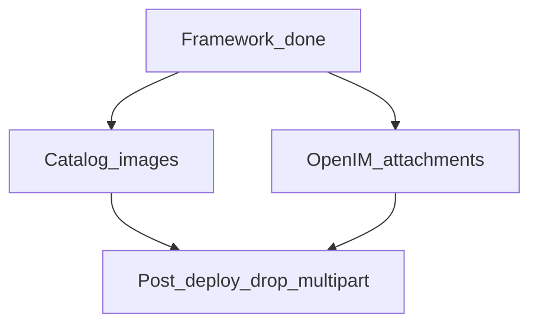

# 直传业务迁移清单（框架已完成）

## 已完成（勿再开新框架工作）

| 项 | 位置 |
|----|------|
| CloudFront 写分布 + IAM + site-domain upload/wechatUpload | [s3-direct-upload/reference.md](../skills/s3-direct-upload/reference.md) |
| Backend signer + `DirectUploadService` + admin/customer 路由（`purpose=probe`） | `xituan_backend/src/domains/direct-upload/` |
| codebase `directUploadUtil` + 各端 Transport | CMS/Site/商家App/顾客App/微信 |
| Jest + probe 烟测 | `tests/**/direct-upload*`；`scripts/probe-direct-upload.ts` |
| 框架 plan / 测试 plan | [plans_completed](../plans_completed/) |

权威约定与平台坑：skill `s3-direct-upload` / `s3-direct-upload-web|ios|android`。

## 本 plan 范围

**做**：在现有框架上挂业务 `purpose`、complete hook、薄 UI；对齐已有台账。

**不做**：

- 再建第二套 presign/PUT 状态机
- 迁支出 OCR / OTA（继续 `amazonaws.com` SigV4）
- 在 `media` / `content` 开写
- 历史 OpenIM Mongo `.png` URL 回填

**上传面总表 + 迁移差异 + 典型流程**：[image-upload-surface-inventory.md](../../xituan_agent/devGuide/image-upload-surface-inventory.md)

## 清单 A — 目录 / 业务图

台账：[catalog-image-direct-upload](../../xituan_agent/devGuide/planned-work/entries/2026-10-catalog-image-direct-upload.md)  
标准：[catalog-image-direct-upload-standard.md](../../xituan_agent/devGuide/catalog-image-direct-upload-standard.md)

1. `epDirectUploadPurpose`（或 bindKind）覆盖团购/预定/商品/新闻等图；禁止平行 `CatalogImageDirectUploadService` 状态机——扩展现有 `DirectUploadService.complete` hook。
2. `complete`：HEAD → **IMAGE_NORMALIZE sync** → 只回 **canonical**；表单只交 path 文本。
3. 端：CMS → 微信商家 → Expo 商家；Offer/Preorder 先打通，再 Product/News。
4. 更新 skill `cms-form-image-upload`。
5. 旧 `.../images/:kind` multipart 与 CMS FormData 收文件 → 流量归零后 **post-deploy** 另开。

## 清单 B — OpenIM 附件

台账：[openim-attachment-direct-upload](../../xituan_agent/devGuide/planned-work/entries/2026-09-openim-attachment-direct-upload.md)

1. 同一 upload 写分布；`putUrl` 不透明；各端复用已有 Transport。
2. `complete`：会话权限、附件持久化、图片则 canonical webp + `cdnUrl`。
3. 孤儿 TTL（申请未确认）。
4. 旧 `POST .../attachments` multipart 下线另开 post-deploy。

## 共享横切

| 项 | 说明 |
|----|------|
| 孤儿清理 | catalog 与 OpenIM 共用 `upload-incoming/` TTL 策略，可一次实现 |
| 验收 | Jest 扩 purpose/ownership；真链继续 probe + 业务冒烟 |
| registry | 启动实施时把对应 entry 从「依赖框架」改为进行中；完成后 `done` |

## 建议实施顺序

1. purpose + complete hook（目录图 IMAGE_NORMALIZE）可先于 UI  
2. CMS Offer/Preorder 薄组件打通  
3. 微信 / Expo 商家同契约  
4. OpenIM（或与目录图并行，视人力）  
5. post-deploy 拆旧 multipart  

## 触发

主动启动「减 backend 上传带宽」或「OpenIM 附件直传」时实施；**现在不改业务页**。
