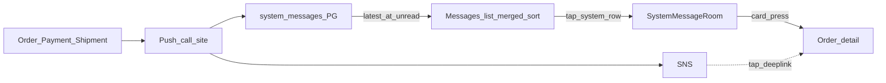

# 系统消息会话（订单/支付/物流推送历史）

## 产品结论（已定稿）

- 消息列表里有一条「系统消息」会话行（头像/标题固定），点进去是只读聊天时间线。
- **不当置顶、不固定槽位**：与真人 IM 会话同一列表，按**最新一条系统消息时间**参与排序（有新推送/双写 → 行上浮；久无更新 → 自然下沉）。
- 每条业务推送 → 卡片气泡 + 简短文案；点卡片进对应订单详情。
- 本轮仅双端 Expo；顾客全 App 一条系统会话，商家按当前商户一条。
- **存储：PG inbox 双写，不写 OpenIM。**

## 已确认（schema / 双写范围）

- **表**：`merchant.system_messages`，**需要** `PARTITION BY HASH (merchant_id)` **50** 分区（与 expenses / ledger 同模式）。
  - 顾客全 App 聚合：每行仍带事件来源 `merchant_id`（分区键）；查询按 `recipient_user_id` + `recipient_app=customer`（跨分区或路由策略在实现时按现有 merchant 分表查询习惯）。
  - 商家会话：按当前登录 `merchant_id` 分区内查 `recipient_app=merchant`。
- **本轮双写（选项 C）**：顾客 + 商家都做；写入订单创建、订单状态、退款申请/结算、物流异常。
  - **不写**：`devicePushShipmentTrackNotifyUtil` 物流 track **中途更新**（push 可照发，inbox 本轮省略）。

## 列表混排（相对旧稿变更）

| 旧 | 新（按你的要求） |
|----|------------------|
| 顶部/固定槽「系统消息」 | **取消置顶** |
| 与 IM 分离展示 | 合成一行 `kind=system`，与 OpenIM 会话 **同一 FlatList**，按 `lastMessageAt` 降序混排 |

实现要点：

- 拉 IM 会话列表的同时拉系统会话摘要（最新 `summary` + `created_at` + unread）。
- 客户端 merge：`[...imRows, systemRow?]` → sort by `lastMessageAt`。
- **尚无任何系统消息时**：不插入该行（避免空会话占位）；首条双写后出现并按时间排队。
- 行样式可区分（系统头像/不可 mute 等），但排序规则与普通 IM 一致。

## 进房定位

**始终落在最新一端**；推送深链仍进订单详情，不先进系统消息房；进房即标已读。

## 为何不复用 OpenIM

真人客服 / 平台客服 / merchant_push 不承载订单事件写链路。UI 像聊天，存储仍是 notification inbox。

## 写路径

在发设备 push 同调用点 insert：

- [`device-push-notification-channel.handler.ts`](xituan_backend/src/domains/notification/channels/device-push-notification-channel.handler.ts)（下单/状态/退款/物流异常）
- [`device-push-order-notify.util.ts`](xituan_backend/src/domains/notification/utils/device-push-order-notify.util.ts)（若仍有直调）

**本轮不挂钩** [`device-push-shipment-track-notify.util.ts`](xituan_backend/src/domains/notification/utils/device-push-shipment-track-notify.util.ts)。

push 失败仍尽量保留 inbox；`dedupe_key` 防重复。新 insert 更新「会话摘要」时间 → 下次进列表自然靠前。

## 数据 / API / UI（摘要）

- 表：`merchant.system_messages`（50 分区）；字段含 `merchant_id`（必填分区键）、`recipient_user_id`、`recipient_app`、`kind`、`title`/`summary`、`card`/`deeplink` jsonb、`dedupe_key`、`created_at`/`read_at` timestamptz
- 摘要接口或 list 首条拼行：`preview`、`lastMessageAt`、`unreadCount`
- API：list / read / unread-total（或 conversation-summary）
- UI：混排行 + `SystemMessageRoomScreen`（无 composer）；Messages tab 未读 = IM + system

## 顺带：商家 Messages 置顶「Platform Support」行（非聊天气泡）

对象是 [`ConversationListScreen`](xituan_app_merchant/src/screens/ConversationListScreen.tsx) 顾客列表 **ListHeader 置顶槽** `platformCs`（`styles.csSlot` + [`ConversationListCard`](xituan_app_merchant/src/components/ConversationListCard.tsx)），不是聊天室内 context 气泡。

### 宽度

- 普通会话卡：`ConversationListCard` 自身 `marginHorizontal: 12`
- 置顶槽又套了 `csSlot.paddingHorizontal: 12` → **左右双倍缩进，比普通行更窄**
- 修法：去掉 `csSlot` 水平 padding（或置顶卡用 0 margin 二选一），使置顶行与下方 IM 卡同宽

### 为何不是 i18n

App 侧已有 `im.platformSupportTitle`（中/英/繁），但展示用的是 API 返回的 `conversation.title`，且仅在 title 为空时才 `|| t(...)`。

后端对商户视角写死英文：

- [`openim-merchant-platform.service.ts`](xituan_backend/src/domains/openim/services/openim-merchant-platform.service.ts) `toSummary`：`title = 'Platform Support'`
- 同类硬编码还在 binding / participant / customer-merchant 等处的 nickname/title

因此中文环境下仍显示英文。

修法（定稿）：

- **商家列表/进房展示**：对 `MERCHANT_PLATFORM` 商户视角 **始终用** `t('im.platformSupportTitle')` 覆盖显示名（不信任后端英文字符串）
- 后端可顺手把商户视角 summary title 留空或常量 key，避免再写死展示文案；OpenIM nickname 可暂留英文（SDK 侧），以 App 展示覆盖为准

不做：聊天气泡 `maxWidth: 280` 调整（上次误判，已撤）。

## 明确不做

系统消息置顶/固定槽；物流 track 中途进 inbox；微信/Site/CMS UI；写 OpenIM 系统消息；替换设备 push；历史回填；进房跳首条未读；推送深链先进系统消息房；聊天气泡宽度

## 实施顺序

1. Migration：`merchant.system_messages` + 50 HASH 分区 + insert helper
2. list/read/unread（含会话摘要字段）
3. 双写（不含 track 中途）
4. 双端列表 **merge+按时间排序** + Room + 卡片跳转
5. 商家 Platform Support 置顶行宽 + i18n 标题覆盖
6. 未读并入 tab / 桌面角标
7. 短 devGuide
