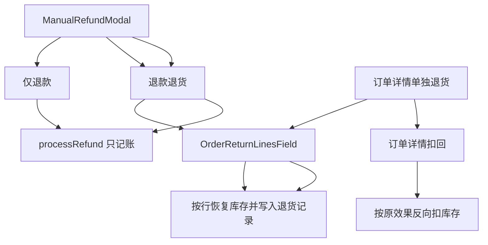

# CMS 退货选品（仅退款不加库存）

**2026-11-07：** planned-work **high**；**正在做**。本轮只做 CMS。微信商户端和商户 App 的退款界面不改；它们不传新字段时，全额退款仍走现在的 `releaseOrderStock`。

## 已确认

- 只做 CMS。微信商户端和商户 App 这一轮不改。
- 退款金额仍由商户单独填写。退货勾选和数量只决定加回哪些库存，不预填、不锁定金额。
- 未发货且预留锁还在时，只能退款退货，退货列表默认全选。已发货或库存已确认售出后，才允许仅退款。

## 行为

- **未发货且预留锁还在**（状态是 `pending` / `processing` / `ready_for_delivery`，并且仍有 `ORDER_RESERVED`）：不提供「仅退款」。弹窗直接是退款退货，退货列表立刻出现并**默认勾选全部仍可退行，数量为剩余可退数量**。提交后按释放预留把货放回可售。后端拒绝这个状态下的 `disposition: refund_only`。
- **已发货**（`shipped` / `in_delivery` / `delivered`）**或预留已经确认成已售**（锁已没了）：才提供「仅退款 / 退款退货」。默认仍是仅退款，只退钱，不改库存；全额退款更新状态时 `skipInventoryAdjustment: true`，避免 [order.service.ts](xituan_backend/src/domains/order/services/order.service.ts) 对 `REFUNDED` 再调 `releaseOrderStock`。切到退款退货时，退货列表同样默认全选剩余可退数量。
- **退款退货**：同一笔退款提交退货行。库存只按勾选数量处理，不整单恢复。商户可取消勾选或改小数量。未勾选任何行不能提交。
- **订单详情单独退货**：不产生退款记录，复用同一选品组件，打开时同样默认全选剩余可退行。
- **扣回多退**：只在订单详情，不在退款弹窗里。某一行已退净数量大于 0 时，可填扣回数量。默认 0，最大为该行已退净数量，不能扣成负数，也不改已发生的退款金额。按原退货记录从新到旧抵消，库存按当时的效果反向扣回。

## 库存规则（按行，不调用整单 `restoreInventoryOnRefund`）

在 [inventory-management.service.ts](xituan_backend/src/domains/inventory/services/inventory-management.service.ts) 增加按订单行数量的退货：

- 该行数量仍在 `ORDER_RESERVED`：按释放预留处理（`stock += qty`，`reserved -= qty`，`total` 不变），并减少或删掉对应锁。
- 锁已确认删掉：按已售退回（`stock += qty`，`total += qty`，`reserved` 不动）。无限库存 `stock = -1` 不改数字，只记流水。
- 团购/预购仍走现有活动行；活动已清仓或行已删时退回主仓，与 `restoreInventoryOnRefund` 的落点一致，但数量用商户填写的 qty。
- 同一行退货净数量不得超过 `order_items.quantity`，也不得小于 0。扣回只减少已记下的退货净数量。
- 扣回时按该行退货记录从新到旧抵消。当初是释放预留的，扣回时 `stock -= qty`、`reserved += qty`，并按原锁信息补回 `ORDER_RESERVED`（补不回原锁行时记流水并仍把预留加回）。当初是已售退回的，扣回时 `stock -= qty`、`total -= qty`。无限库存仍不改数字。

## 数据

下一号迁移 `xituan_backend/migrations/1710000000402_order_item_returns.sql`（`timestamptz`，不改 `migrations_stable`，不自动执行）：

- `merchant.order_item_returns`：`id`、`merchant_id`、`order_id`、`order_item_id`、`quantity`（退货为正，扣回为负）、`stock_effect`（`released_reservation` 或 `restored_sold`）、可空 `refund_payment_record_id`、`created_at`。
- 单独退货时 `refund_payment_record_id` 为空；退款退货时指向刚生成的退款支付记录。扣回不挂退款记录，钱保持原样。
- 一行的已退净数量是该行 `quantity` 之和。

[iRefundRequest](xituan_backend/submodules/xituan_codebase/typing_entity/order-payment-record.type.ts) 增加可选字段：`disposition?: 'refund_only' | 'refund_and_return'`，`returnLines?: { orderItemId: string; quantity: number }[]`。未传 `disposition` 的旧客户端保持现状。

## CMS

- 新组件 [xituan_cms/src/components/orders/OrderReturnLinesField.tsx](xituan_cms/src/components/orders/OrderReturnLinesField.tsx)：行勾选 + 数量（1 到剩余可退）。被 [ManualRefundModal.tsx](xituan_cms/src/components/orders/ManualRefundModal.tsx) 和 [OrderEditModal.tsx](xituan_cms/src/components/orders/OrderEditModal.tsx) 共用。
- 退款弹窗：未发货且锁还在时不渲染「仅退款」，直接渲染退货列表且默认全选。其余情况用 Radio，默认仅退款，只有退款退货才渲染该组件，并默认全选。
- 订单详情商品区增加「退货」入口，打开同一组件；已退净数量从新接口读出。已退净数量大于 0 的行旁边提供「扣回」，数量框默认 0。
- 文案进 `messages/zh_cn.json`、`zh_tw.json`、`en.json`。

## 接口

- `POST /api/admin/orders/refund`：`refund_and_return` 时校验行与数量，退款成功后再写退货记录并改库存。库存失败不回滚已成功的支付退款，记日志（与手动确认库存失败一致）。
- `POST /api/admin/orders/:id/returns`：单独退货，同一套校验和库存函数。
- `POST /api/admin/orders/:id/return-reversals`：按行扣回。数量不得超过该行已退净数量。不创建退款、不修改退款金额。
- `GET` 订单详情附带每行 `returnedQuantity`（退货净数量），供剩余可退、默认退货数量和扣回上限。
